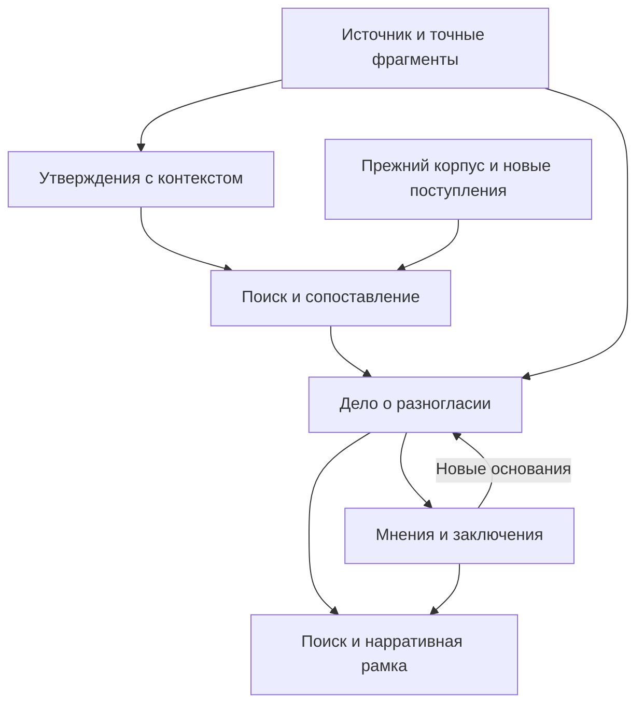

# Журнал разногласий и экспертная верификация в региональной базе знаний

**Дата:** 18 октября 2026 года.  
**Статус:** аналитический проект расширения существующей РКБ; описанные новые функции ещё не реализованы и не приняты в production.  
**Срез кода:** `onedayonemasterpiece/regional-knowledge-base`, `main` = `cc20239f46d959a1a00efcba9da6cf2c084e14bb`, проверен через DevCoveer 18.10.2026 в 13:08 UTC.  
**Предмет:** выявление расхождений внутри источника и между источниками, рецензии, экспертное рассмотрение, режимы поиска, локальная нарративная рамка и включение в импорт.

## 1. Рекомендуемое решение

Сделать разногласия частью доказательной модели РКБ: **суждение источника → сопоставление → дело по конкретному вопросу → мнения и заключения → поиск с учётом результата**. Разногласие становится сохраняемым исследовательским объектом, к которому можно вернуться после нового источника, исправления чтения или экспертного возражения.

Основная единица — конкретное утверждение с авторством, контекстом и точным местом в источнике. Книга, статья или автор не получают один общий флаг «ненадёжный». В одном произведении могут соседствовать точные сведения, ошибка, пересказ чужой позиции и продуктивная интерпретация.

Выявление включается в обычный импорт как обязательная учитываемая работа. Для каждого выделенного утверждения должно быть понятно, какой поиск и какое сравнение выполнены, что осталось и почему. Корректно импортированная книга сохраняет доступность, пока продолжается исследование; состояние «содержание доступно» не означает «анализ разногласий закончен».

Пользовательская гипотеза о поиске практически каждого суждения верна по направлению. Технически следует **проверять каждое выделенное суждение, объединяя повторяющуюся поисковую работу**, а не создавать отдельный последовательный сетевой вызов на каждое предложение. Векторный поиск отбирает кандидатов, но не устанавливает противоречие и не гарантирует полноту. Сопоставление учитывает объект, период, роль события, единицы, модальность, говорящего и использованные основания.

Решение расширяет действующие assertions/evidence/assessments/reconciliation и единую SQLite РКБ. Канонические вопросы о POI продолжают принадлежать Street Story. Projects Hub предоставляет рабочее место специалистам. Новые RDF-сервер, векторная БД, самостоятельный планировщик и скрытый серверный LLM для этого не требуются.

## 2. Что уже есть и чего действительно не хватает

### 2.1. Проверено по текущему коду и контрактам

| Область | Существующая основа | Существенный предел |
|---|---|---|
| Импорт | Одна вызывающая модель читает страницы и передаёт page graph, chunks, сущности, истории, даты и числа; есть `knowledge_reviewed` и продолжение извлечения | Проход по странице не доказывает обнаружение всех суждений; истории — отобранные эпизоды |
| Утверждения | `historical_claim`, `attributed_account`, `interpretation`, `hypothesis`; авторство и временная область | `story_assertion_versions.story_id` обязателен: самостоятельное суждение источника пока связано с редакционной историей |
| Свидетельства | Версия источника, страница/регион/диапазон, точная цитата; `reports`, `supports`, `contradicts`, `provides_context` | Наличие точной цитаты удостоверяет текст источника, а не истинность исторического вывода |
| Оценки | `RecordAssessment`: поддержка, независимость, смысловая оценка, обоснование, версия метода, замещение прежней оценки | Это оценка конкретного assertion; одного `assessor_kind=human` недостаточно для подтверждения человеческого авторства |
| Сопоставление | `story_reconcile`: очередь, claim/lease, предложение, применение, проверки версий и свидетельств, повторное использование решений по паре | Якорь — story, кандидат — story/chunk; максимум 50 кандидатов на run; нет полного учёта дельт корпуса, переполнения и позднего индексирования |
| История | Версии карточек, аудит, оценки, исправление/отзыв/восстановление связей, сохранённые решения пар | Нет общей карточки многопозиционного разногласия по произвольному суждению книги |
| Поиск | Поиск корпуса и историй, BGE/FTS, отдельные свидетельства и проверки ACL | В прочитанных публичных контрактах нет общего режима выдачи по разногласиям и автоматического раскрытия всех позиций найденного дела |
| Внешние продукты | RKB владеет текстом и историческими основаниями; Street Story — POI claims/ledger/arbitration; Projects Hub — пользовательская поверхность | Журнал литературных интерпретаций шире предмета POI; требуется точное разделение вопросов |

Основания: [импорт][C1], [контракты утверждений и reconciliation][C2], [таблицы реестра][C3], [реализация reconciliation][C4], [история и известные пределы][C5], [границы интеграций][C6].

Особенно полезно существующее различие между фактом сообщения «автор пишет X» и историческим утверждением «X произошло». Его нужно сохранить при расширении. Иначе система незаметно превращает принятую транскрипцию в подтверждённую историю. Нынешний `_current_assessments` уже оставляет одновременно действующие несовместимые оценки видимыми: порядок записи не выбирает последнюю как победителя [C3].

Конфликт canonical POI identity в графовом коде — отказ противоречащей привязки объекта. Его нельзя засчитать готовым журналом фактологических разногласий. Общий поиск тоже требует реального расширения: существующий `knowledge_search` получает ограниченный пакет evidence, но его контракт не задаёт раскрытие сторон дела [C11].

### 2.2. Фактическое наблюдение MCP

При чтении `indexing_status` 18.10.2026 получено:

| Показатель | Значение |
|---|---:|
| Активные фрагменты | 2 959 |
| Готовые BGE-векторы | 2 959 |
| Отсутствующие BGE-векторы | 0 |
| Состояние BGE worker | `stopped` |
| Состояние BGE-запросов | `unavailable` |
| Эффективный поиск | `lexical_only` |

Это один прочитанный ответ текущего MCP, без нагрузочного прогона; собственной серверной временной метки в ответе нет. Из него следует, что готовность документных векторов и доступность векторного запроса — разные состояния. Он не доказывает длительность отказа, его причину или качество нынешнего поиска. Исполняемый SHA сервиса отдельно в этой работе не устанавливался.

Нельзя обосновывать будущую пропускную способность одним количеством векторов. Пока BGE-запросы недоступны, допустимо накапливать суждения, разбирать явные ссылки и проводить лексический поиск, сохраняя незавершённость необходимой смысловой проверки.

Независимая задача OpenCode через DevCoveer была действительно запущена с `access=read`, `provider=opencode`; провайдер вернул `401 api_key_expired` до анализа. Повторов с тем же ключом, смены на native Codex и ремонта credentials не выполнялось. Выводы о коде получены прямым чтением GitHub/DevCoveer. Рабочие checkout, текущие импорты и production-данные не изменялись.

## 3. Практики, на которые опирается проект

Это прикладная адаптация опубликованных моделей, а не заявление о полном соответствии стандартам.

| Практика | Что переносим в РКБ |
|---|---|
| [CIDOC CRMinf][R1] | Разделение содержания утверждения, понимания источника, принятия сообщения и оценки участником; связь аргумента с предпосылками |
| [HiCO][R2] | Интерпретацию можно хранить как действие с автором, временем, критериями, источниками и отношениями к другим интерпретациям |
| [W3C PROV][R3] | Происхождение, производность, цитирование, версии и ответственность; первичность относительно конкретного вопроса |
| [W3C Web Annotation][R4] | Устойчивые ссылки на фрагменты: источник и версия, точная цитата, диапазон, окружающий контекст |
| [SciFact][R5] | Отношение между утверждением и конкретным свидетельством сопровождается доказательным фрагментом; это отдельно от глобального заключения об истинности |
| [COPE][R6] | Конкретная аргументация, компетенция и границы рассмотрения, раскрытие известных конкурирующих интересов |
| [Crossref][R7] и [NISO][R8] | Различать рецензию, ответ автора и другие материалы процесса, связывать с рассмотренной версией; сохранять существенные сведения о процедуре |

Для культурно-исторического материала нельзя механически перенести биомедицинскую лестницу доказательств. Архивная запись, мемуары, карта, подпись под фотографией и позднейшее исследование имеют разную полезность для разных вопросов. Решение зависит от предмета и метода, а не только от жанра или даты публикации.

## 4. Что считать разногласием

Разделяются две вещи: **область возникновения** и **характер расхождения**. Область: внутри документа; между произведениями одного автора; между авторами/источниками. Характер определяется после проверки сопоставимости.

| Характер | Пример или смысл | Следствие |
|---|---|---|
| Фактическая несовместимость | Об одном и том же открытии указаны взаимоисключающие даты | Кандидат на дело о дате |
| Различие интерпретаций | Разные объяснения причин, значения, мотивов | Сохранить позиции и аргументы; они могут частично совмещаться |
| Недостаточность основания | Рецензент считает доказательство слабее вывода | Это ещё не доказательство противоположного тезиса |
| Разный контекст | Другое время, территория, объект, метод подсчёта | Уточнить контекст; выбор победителя может не требоваться |
| Разная точность | Год против интервала, округлённая против точной величины | Проверить совместимость диапазонов |
| Пересмотр позиции | Автор исправляет прежнюю версию | Связать пересмотр, основания и редакции |
| Ошибка чтения/атрибуции | Потеряно отрицание, перепутана строка таблицы, цитата оппонента приписана автору | Исправить извлечение с сохранением следа |
| Недостаток данных | Неясно, об одном ли объекте говорится | Оставить неопределённость; не регистрировать установленную ложность |

Все следующие примеры условные:

- «Строительство моста началось в 1901» и «мост открыт в 1903» совместимы.
- «Мост открыт в 1901» и «тот же мост открыт в 1903» требуют проверки роли даты, тождества и этапа открытия.
- «Участвовал архитектор Б» не опровергает «проект создал архитектор А» без утверждения об исключительном авторстве.
- «В городе 40 тысяч жителей» и «42 тысячи» нельзя сравнивать без года, границ и метода подсчёта.
- Автор, который сначала цитирует чужую датировку, а затем её отвергает, не обязательно противоречит себе.
- «Символ модернизации» и «инструмент политического контроля» могут быть двумя совместимыми интерпретациями одного сооружения.

Логическая несовместимость не всегда попарная. Несколько датировок и отношений «раньше/позже» могут образовать противоречивую совокупность. Поэтому дело должно поддерживать аргумент с несколькими предпосылками. В первой реализации достаточно локального разбора связанных утверждений; универсальный автоматический доказатель теорем не нужен.

Само отношение «противоречит» не транзитивно. Нельзя объединять дела только потому, что их утверждения соединены цепочкой связей или близки по embedding. У дела должен оставаться конкретный исследовательский вопрос.

## 5. Единицы знания и минимальная модель данных

### 5.1. Утверждение источника

Одно предложение может содержать несколько суждений; одно суждение может опираться на несколько предложений, сноску и предыдущую страницу. Атомизация нужна настолько, чтобы можно было отдельно оценить совместимость и поддержку, сохранив связи составного аргумента.

Утверждение включает:

- устойчивый ID и версию; источник, его редакцию и точные evidence refs;
- самодостаточную формулировку и оригинальное выражение;
- объект/событие, свойство или обсуждаемый вопрос, значение при его наличии;
- историческое время, пространственную область, точность, календарь, единицу и метод, когда применимы;
- авторство на уровне статьи/главы, роль говорящего: утверждает, цитирует, пересказывает, допускает, отвергает;
- отрицание, модальность, количественные ограничения;
- вид: фактографическое суждение, интерпретация, гипотеза, свидетельство, сообщение о чужой позиции;
- происхождение нормализации и версию её метода.

Неизвестные значения сохраняются неизвестными. Сопоставление имени не становится тождеством человека, соседство изображения с текстом — доказанным изображением объекта, дата публикации — датой события.

Нормализованный текст нужен для поиска и сравнения. Он не заменяет цитату. Для русских, немецких, польских вариантов имён и названий используются существующие aliases и графовые связи с указанным основанием. Перевод хранится как производная версия; уверенность в переводе и расхождение оригиналов — отдельные вопросы.

### 5.2. Сопоставление

Сохраняется проверяемый результат конкретного сравнения: какие версии изучены, почему они сопоставимы, какое отношение предложено, какие фрагменты это объясняют и кто выполнил сравнение. Для аргумента из нескольких материалов перечисляются все использованные основания.

Нужны отдельные оценки уверенности в извлечении и в обнаружении разногласия. Самооценка модели без калибровки не является вероятностью исторической истины. Векторная близость служит ранжированию кандидатов.

### 5.3. Дело о разногласии

Дело объединяет вопрос, варианты, свидетельства и рассмотрения. Минимум:

| Поле | Назначение |
|---|---|
| `case_ref`, `owner`, `revision` | Устойчивый адрес и единственный предметный владелец |
| Вопрос и границы | Что именно рассматривается, объект, период, терминология |
| Участники/позиции | Ссылки на версии утверждений и явные отношения между ними |
| Доказательные связи | Поддержка, возражение, контекст, зависимость, пересмотр |
| Рабочее состояние | Новое, рассматривается, рассмотрено; повторное открытие фиксируется событием |
| Результат рассмотрения | Например, контексты различены; одна версия предпочтительна; сохраняются альтернативы; данных недостаточно |
| Мнения и заключения | Авторство, версии оснований, аргументация, ограничения |
| История | Добавление материала, решение, возражение, исправление, повторное рассмотрение |
| Охват и свежесть | На каком составе доступного корпуса выполнялась проверка и появились ли необработанные существенные основания |

Рабочее состояние отделено от эпистемического результата. «Рассмотрено» может означать аргументированную невозможность выбрать одну версию. Завершение очереди само по себе не делает спорный тезис пригодным для режима «без разногласий».

### 5.4. Как расширить существующие таблицы

Не следует выпускать искусственную Story на каждое суждение. Это смешает литературный корпус и редакционный реестр, увеличит число карточек, пересборку snapshots и событий поиска.

Выбранный постепенный путь — общий `AssertionRepository` и ограниченный адаптер существующих stories. Общая адресуемая единица — `assertion_id + revision`; для каждой идентичности определяется единственное авторитетное место хранения. Старая запись остаётся в `story_*` со своими payload, evidence, IDs и действующим защищённым writer. Новое суждение источника получает source anchor и может существовать без редакционной карточки. Идентичности не копируются в оба хранилища.

| Предлагаемое расширение | Обязанность |
|---|---|
| `assertion_anchors` | ID, владелец и единственный маршрут к legacy story либо новому суждению источника |
| `assertion_versions`, `assertion_evidence`, `assertion_assessments` | Только новые самостоятельные суждения; общая с legacy семантика цитат, оценок и версий |
| `story_assertion_memberships` | Использование точной версии суждения в истории без повторного создания proposition |
| `disagreement_cases` и связанные участники/события | Вопрос, точные ссылки на позиции, рассмотрения и история |
| Расширение reconciliation coverage | Продолжение, просмотренные дельты, незавершённые задания |

Два физических поколения внутри той же SQLite не становятся двумя истинами при трёх условиях: у одного ID один writer; журнал/поиск/оценки обращаются через общий repository; legacy payload не копируются и не исправляются вторым путём. Anchor старого утверждения можно регистрировать лениво при обращении общего журнала. Полный перенос старой базы не становится предварительным условием первой поставки. Если позднее понадобится физическое объединение таблиц, оно выполняется отдельной проверяемой миграцией с сохранением ID.

В общий слой выделяются проверки точной цитаты и source revision, действующих оценок, fingerprints, идемпотентности и source ACL. Общий reconciliation принимает assertion anchors и смысловое отношение между суждениями. Старый `story_reconcile` сохраняет `same_episode` и другие ограничения своего нарративного сценария через адаптер. Простого добавления `ref_kind=assertion` недостаточно: нынешний валидатор также читает story snapshot и его evidence [C4].

Старые story grants и revision-bound курсоры сохраняют свою область; они не открывают все утверждения книги. Доступ к самостоятельному суждению определяется его владельцем и исходными evidence ACL. Новые memberships обязательно участвуют в dossier, variant blocks, fingerprints, прежних `validate`, export, source dependencies и проверке пригодности опубликованных вариантов. Старый API возвращает согласованную проекцию через адаптер, без второго авторитетного payload. История не может получить доступ к частному суждению или пройти проверку за счёт того, что membership отсутствует в старом snapshot. Изменение или отзыв существенного основания отмечает зависимые варианты как требующие пересмотра; историческая версия остаётся доступной в своём состоянии. Эта совместимость входит в этап A.

Полные журналы всех бессодержательных pairwise совпадений хранить бессрочно не требуется: отрицательные результаты можно сохранять компактными fingerprints и состоянием прохода. Доказательные решения, экспертная история и использованные версии остаются долговременными знаниями.

## 6. Владение между РКБ, Street Story и Projects Hub

Граница определяется **предметом вопроса**, а не тем, в какой программе обнаружили расхождение.

| Владелец | Канонические данные |
|---|---|
| РКБ | Содержание источников, суждения авторов, текстовые и визуальные основания, литературные зависимости; дела по вопросам вне канонической модели POI |
| Street Story | POI identity и предметные claims; соответствующий журнал разногласий и арбитраж; ссылки на доказательства РКБ |
| Projects Hub | Профиль специалиста, компетенции, назначения и взаимодействие; действия отправляются предметному владельцу |

Если книги расходятся в дате открытия конкретного музея и это свойство POI принадлежит Street Story, РКБ сохраняет оба авторских утверждения и передаёт сведения в каноническое дело Street Story. Спор о влиянии музея на городскую идентичность может остаться делом РКБ, связанным с тем же POI для навигации.

У дела один `owner` и один `case_ref`. В другом продукте хранится ссылка или явно версионированная проекция. Решения по разным предметным вопросам независимы; проекция одного и того же дела только отражает состояние его владельца и не имеет отдельного права закрытия. Применение решения выполняет владелец предмета с проверкой полномочий и ожидаемой ревизии. При обнаружении уже существующего дела новые основания присоединяются к нему. Передача владения оформляется явным событием, а не созданием незаметной копии.

Общий интерфейс очереди может объединять дела разных владельцев. Для согласования используется существующий outbox/receipt путь; глобальная транзакция между тремя базами не нужна. Если вопрос относится к канонической модели POI, а Street Story недоступен или для передачи основания ещё нет прав, в РКБ сохраняется detection proposal с `handoff_pending`, а не второе самостоятельно разрешаемое дело о том же свойстве. Перед повторной доставкой согласуется исходная операция; подтверждённый owner receipt связывает её с каноническим делом. Импорт остаётся доступным, но соответствующий анализ не объявляется законченным.

Отставание проекции должно быть видно, а повтор доставки — идемпотентен. Совпадение текста в РКБ и его проекции в Street Story не создаёт независимого свидетельства.

## 7. Процесс выявления при импорте

### Шаг 1. Единый смысловой проход

Модель, которая читает страницу через MCP, выделяет суждения вместе с нынешними сущностями, историями, числами и датами. Дополнительная повторная OCR-обработка всей книги не требуется. Используются текущие provenance и страницы; контекст продолжается через границы страниц и сносок.

Истории остаются отбором для редакционной работы. `assertion_candidates` расширяет обычный staged payload; отдельный транспорт на каждое утверждение не вводится. Размеры пакетов и продолжение согласуются с существующими ограничениями stage, а не обходятся огромным JSON.

Для уже принятых книг используется чтение сохранённых source regions и существующий путь возобновляемого extraction. Повторный импорт исходного файла нужен только при реальном дефекте исходного разбора или изменении источника.

### Шаг 2. Сохранение и постановка работы

Утверждения, evidence и задания сопоставления фиксируются с версией источника в существующем транзакционном пути. Принятие источника и статус исследовательского обогащения остаются различимыми. Ошибка одной даты или сравнения не уничтожает остальные принятые материалы.

Модель может отмечать явное противоречие уже во время чтения и сохранять черновой кандидат по двум доступным фрагментам. Межисточниковое обогащение продолжается после доступности нужных поисковых проекций; staged материал не раскрывается вне прав текущего импорта. Отдельно выполняется завершающая сверка по книге.

### Шаг 3. Поиск кандидатов

Поисковая выборка объединяет смысловой поиск и независимые адресные пути:

1. BGE-поиск полной формулировки и нейтрального вопроса о свойстве.
2. Поиск по выбранному объекту/событию и типу суждения.
3. FTS для редких имён, исторических написаний, архивных обозначений, чисел.
4. Явные ссылки, рецензии, исправления, ответы авторов и имеющиеся дела.
5. Внутридокументный поиск по уже прочитанным и позднее появившимся страницам.

Нейтральный вопрос о дате открытия помогает не заполнить весь top-k повторениями только одной даты. Кандидаты разнообразятся по источникам, вариантам и известным линиям происхождения. При этом неизвестная зависимость источников не становится автоматически независимостью.

Пока прежний корпус не разобран на атомарные утверждения, его chunks остаются полноправными кандидатами. Найденное нужное суждение извлекается из исходного фрагмента с точной ссылкой; старые книги не исчезают из сравнения после введения новой схемы.

### Шаг 4. Сопоставимость и отношение

Сначала проверяется, говорят ли материалы об одном объекте, событии, времени и свойстве. Затем модель определяет отношение: совместимы, дополняют, уточняют, оспаривают, расходятся в интерпретации или пока несопоставимы.

Числовые правила работают только при установленных единицах, методах, интервалах и роли события. Детерминированный код проверяет форму, версии, существование цитат и полномочия. Исторический смысл остаётся явной модельной/экспертной оценкой. Уверенно найденное несовпадение чисел ещё не даёт права автоматически выбрать истинную дату.

Результат содержит точные основания с обеих сторон и краткое объяснение сопоставимости. Ошибка цитирования, неизвестный объект или отсутствующая сноска сначала попадают на уточнение извлечения. Специалистам показываются содержательные кандидаты, а не все пары низкой уверенности.

### Шаг 5. Дело и дальнейшее рассмотрение

Реальный кандидат создаёт новое дело либо дополняет существующее по тому же вопросу. Несколько повторов одной датировки становятся свидетельствами позиции, а не отдельными конфликтами. Модельное заключение о наличии кандидата сохраняется с его авторством; оно не выдаётся за экспертную историческую сертификацию.

### Шаг 6. Учёт незавершённого

Для каждого суждения сохраняется исход работы: проверено по политике; нужны кандидаты; ждёт векторы; сопоставлено частично; требуется контекст; включено в дело. Завершённый проход содержит версию политики и область доступного корпуса.

`awaiting_agent` — состояние работы для внешней вызывающей модели. Наличие очереди не означает наличие постоянно работающего исполнителя. Если нужен полностью автономный поток, его исполняет согласованный существующий оркестратор с бюджетом и сохранёнными заданиями. В этой постановке новый скрытый backend LLM не предлагается.

## 8. Масштабирование и экономия без ложных гарантий

### 8.1. Что даёт векторный поиск

ANN/HNSW позволяет эффективно отбирать похожие материалы, но приближённость означает обмен скорости на полноту. Официальная документация pgvector описывает влияние фильтрации после сканирования приближённого индекса и увеличение работы при расширении поиска [R9]. Исследование Indyk и Xu показывает пределы общих гарантий популярных ANN-реализаций [R10]. Это не прогноз плохой работы РКБ, а основание не обещать постоянную стоимость на произвольном корпусе.

Даже точные ближайшие векторы не равны полному набору противоречащих свидетельств. При росте корпуса фиксированный top-k может сохранять задержку и одновременно терять редкую альтернативу среди перепечаток. Требуются отдельные измерения качества отбора доказательств.

### 8.2. Первый шаг без вектора на каждое суждение

Все выделенные утверждения сохраняются в SQLite и связываются с существующими фрагментами. На первом этапе BGE исходных passages остаётся основным массивом для поиска. Дополнительный семантический индекс всего множества claims не объявляется обязательным.

Повторяющиеся запросы объединяются по объекту, событию и обсуждаемому свойству. Для небольшой группы суждений строится общий вопрос и общий набор кандидатов, затем для каждого суждения сохраняется отдельный результат сравнения. Механическое объединение по странице непригодно: одна страница может содержать несколько разных тем.

Индивидуальный запрос нужен, если суждение плохо выражено общим вопросом, содержит отдельную подтему, неоднозначность или недостаточный набор кандидатов. Состав группы и условия дополнительного поиска входят в версию политики. Пустая общая выдача сама по себе не доказывает, что отдельные суждения проверены достаточно.

Для смыслового поиска по журналу первыми дополнительными векторами становятся компактные карточки **всех доступных для такой индексации дел**: вопрос, варианты, ключевые понятия. Это самостоятельная поисковая проекция с честным coverage, не набор случайно закэшированных запросов. Она строится через существующий индексатор и BGE-контур. Доказательства продолжают храниться один раз у своих владельцев.

Текущее ограничение обязательно: BGE inference запросов и документов выполняется только существующим Kaggle worker через actor-scoped queue. На DevCoveer локальный BGE, новые веса и локальный fallback не устанавливаются [C7]. E5-small INT8 сохраняет отдельную существующую роль; он не подменяет обязательную BGE-проверку и не запускает несанкционированный backfill.

### 8.3. Условная оценка объёма работы

Это расчётный сценарий, **не замер РКБ, не прогноз времени и не выбор оплачиваемого провайдера**.

Пусть книга содержит `P` страниц, в среднем `c` суждений на страницу; `C = P × c`. Для прямого варианта с `r` поисковыми представлениями и максимум `k` кандидатами:

`Q = C × r` — логических поисков; `M ≤ C × k` — сравнений.

При группировке до `g` суждений, которые действительно выражают один вопрос, и доле `u` индивидуальных дополнительных поисков ориентир становится `Q ≈ r × ceil(C/g) + u × C`. Это формула объёма запросов при выбранной политике, не гарантия неизменной полноты.

| Условный параметр | Значение |
|---|---:|
| Страниц | 300 |
| Суждений на страницу | 12 |
| Всего суждений | 3 600 |
| Два представления на суждение без группировки | 7 200 поисков |
| До 20 кандидатов | До 72 000 первичных сравнений |
| Условно 15% требуют расширенного анализа | До 10 800 таких сравнений |

Если расширенное сравнение условно требует 700 входных и 90 выходных токенов, получается 7,56 млн входных и 0,972 млн выходных токенов. При тарифах за миллион `p_in` и `p_out` эта часть составляет `7,56 × p_in + 0,972 × p_out`. Сюда не входят чтение страниц, первичный отбор, извлечение, embeddings и повторы. Число 15% — плановая гипотеза, а не право пропустить остальные пары.

Пакетирование уменьшает повтор контекста и сетевые расходы, но не отменяет смысловую работу. Поэтому считать нужно время до пригодного результата, backlog, токены и стоимость на 1 000 суждений, а не только количество API вызовов.

Объём векторов тоже растёт: 100 000 векторов размерности 1 024 в float32 — 409,6 MB только числового payload, без HNSW, metadata, прежних ревизий и остальных таблиц. Это арифметика, а не оценка фактического размещения РКБ. Обязательная векторизация каждого claim требует отдельного измерения вместимости всей Supabase и качества сжатия; молча расширять текущий массив нельзя.

### 8.4. Работа на общем сервере

Использовать текущие очереди и их ограничители. Интерактивные запросы сохраняют выделенную возможность обслуживания; массовый импорт получает ограниченный бюджет и продолжение. Старые задания не должны бесконечно вытесняться новыми. Внешние вызовы и ожидание модели выполняются вне SQLite write transaction.

Один сериализованный SQLite writer и короткие commit достаточны как исходная архитектура; необходимость смены БД должна следовать из наблюдаемой нагрузки. Потребители, backups/WAL и временные данные учитываются в существующем дисковом бюджете. Новый индекс и журнал не оправдывают восстановление удалённых тяжёлых компонентов.

## 9. Параллельные импорты, позднее индексирование и повторное рассмотрение

Уже существующие fingerprints решений по парам полезны и должны сохраниться. Требуются следующие дополнения к той же обязанности reconciliation:

- **Продолжение после лимита.** 50 кандидатов остаётся ограничением отдельного run; остаток сохраняется и доступен следующими пакетами. Окончание первого пакета не означает завершение книги.
- **Учёт реально просмотренного корпуса.** Фиксируются законченные дельты/редакции и использованные поисковые каналы. Максимальный ID готовой записи не подходит, если индексирование завершается не по порядку.
- **Новые данные против новых.** Два параллельных импорта могут искать по состоянию, в котором другой ещё отсутствует. После публикации проекций выполняется сверка пересекающихся дельт.
- **Повтор затронутых вопросов.** Поиск «новое → старое» асимметричен из-за top-k. Новые источники запускают адресную проверку затронутых объектов и тем, а не полный повтор всего корпуса.
- **Внутрикнижное завершение.** Поздняя страница может расходиться с ранней, которая была проверена до её появления. Нужна сверка внутри книги после окончания смыслового прохода.
- **Версии и исправления.** Изменение чтения, объекта, цитаты, доказательного основания или политики делает зависимые сравнения требующими пересмотра. Изменение заголовка карточки не является новым историческим доказательством.

Ключ симметричного сравнения нормализует порядок версий утверждений; направление поддержки/критики сохраняется отдельно. Исправленные и отозванные связи не восстанавливаются простой повторной доставкой старого proposal. Значимое новое свидетельство переоткрывает вопрос с причиной; повтор того же текста лишь добавляет зависимое упоминание.

Показатель «проверено 97% выделенных суждений» характеризует выполнение заявленной работы. Он не означает обнаружение 97% всех возможных разногласий и не гарантирует полноту выделения самих суждений.

## 10. Рецензии как источник разногласий

Рецензия рассматривается как самостоятельный материал с автором, датой, видом и версией объекта рассмотрения. Научная рецензия, публичная книжная рецензия, редакционное письмо и комментарий читателя сохраняют различимый тип. DOI полезен, но не обязателен для старой региональной литературы: допускаются библиографический идентификатор и локальная версионированная ссылка.

Crossref задаёт полезные поля: роль автора, дату, связь `isReviewOf`, этап и раунд, тип материала, сведения об интересах; его модель включает ответы авторов и материалы после публикации [R7]. NISO описывает прозрачность идентичностей, взаимодействие рецензентов и сведения о процессе; этот стандарт ориентирован на журнальные статьи, поэтому применение к старым книгам — адаптация [R8].

Практический разбор рецензии:

1. Установить, какое произведение и какая его редакция рассматриваются.
2. Выделить отдельные замечания: фактическое, интерпретационное, методологическое, о достаточности доказательств, о цитировании, редакционное.
3. Найти целевое утверждение в оригинале и сохранить цитату рецензента.
4. Выделить альтернативный тезис, если он прямо сформулирован, и основания возражения.
5. Связать использованные источники и их зависимость от уже известных материалов.
6. Присоединить возражение к существующему делу либо создать новое.
7. Связать ответ автора, исправление, следующую редакцию и новую оценку.

Стилистические замечания не засоряют очередь исторических разногласий. Отрицательная общая оценка книги сама по себе не порождает дела против каждого её утверждения.

Если рецензируемый оригинал недоступен, запись имеет смысл «рецензент приписывает автору утверждение X; оригинал этого фрагмента не сверён». Она не заменяет непосредственное извлечение X из статьи. Проверка цитирования — самостоятельная часть доказательности.

**Условный пример.** Рецензент пишет, что статья датирует открытие школы 1901 годом, но приведённый отчёт относится к началу строительства; газетное объявление об открытии он датирует 1903 годом. Возникают: приписываемый статье тезис; возражение о смешении событий; альтернативная дата; ссылка на газету; задачи сверить статью, отчёт и объявление. После проверки дело может оказаться ошибкой чтения статьи, ошибкой рецензента или реальным разногласием.

Рецензия не получает автоматический приоритет над рецензируемым произведением. Её собственные утверждения могут оспариваться, а последующий авторский ответ может изменить квалификацию. Полезность рецензии — в явных предметах и аргументах критики.

## 11. Специалисты: мнение, заключение, возврат к вопросу

### 11.1. Два результата работы

**Экспертное мнение** — атрибутированная оценка участника в пределах его компетенции и просмотренного материала. Может быть предварительной, касаться одного свидетельства или предлагать дополнительный источник.

**Заключение по делу** — оформленный результат рассмотрения конкретного вопроса на определённых версиях оснований. Оно фиксирует действующую квалификацию и оставшуюся неопределённость. Здесь это продуктовые термины РКБ; специальный правовой статус экспертизы из названия не следует.

Обе формы используют общую основу: вопрос, участник, профиль компетенции, изученные материалы, метод, аргументы, результат, ограничения, дата и связь с прежними оценками. Для заключения дополнительно обязательны рассматриваемая revision дела, явно принятые/отклонённые позиции и условия применимости результата.

Система сохраняет подтверждённого участника и фактический канал действия. Поле клиента «человек» не доказывает, что человек ознакомился с текстом: текущий код уже честно записывает `assessor_claim_verified=false` и `actual_executor=application` [C3]. Модель может готовить проект мнения; заключение от имени специалиста должно быть подтверждено его действием через существующий аутентифицированный интерфейс. Импортированная опубликованная рецензия хранится как атрибутированный источник, отдельно от живого действия участника.

### 11.2. Обычный рабочий процесс

Специалист находит дело по теме, объекту, периоду, смыслу или очереди. Открывает позиции, точные фрагменты, при необходимости страницу/иллюстрацию, цепочки происхождения и прежние мнения. Затем добавляет аргументированную оценку или новое основание. Уполномоченный участник фиксирует заключение в сервисе владельца дела.

Не всем делам нужна комиссия. Исправление неверно прочитанной цифры допускает короткое мотивированное решение с доказательством чтения. Содержательная спорная атрибуция или конфликт заключений может потребовать независимого второго рассмотрения. Решение определяется аргументами, а не числом голосов. Мнение специалиста вне его подтверждённого предмета не превращается автоматически в универсальный арбитраж.

В очереди доступны понятные основания приоритета: поступил новый источник к рассмотренному вопросу; дело используется в ответах/публикациях; появилась рецензия с конкретным возражением; ожидается специалист нужного профиля. Сложные старые дела не исчезают из-за постоянного притока новых. Назначение работы не должно запрещать другим участникам читать дело и добавлять независимое мнение при наличии прав.

### 11.3. История и переоткрытие

Мнения и заключения не перезаписываются. Новая оценка ссылается на предшествующую; прежнее заключение доступно с датой и основаниями. Достаточные причины пересмотра: новый существенный источник, обнаруженная зависимость «независимых» свидетельств, исправление чтения, возражение против метода, изменение предметной привязки.

Возражение против экспертного заключения проходит тот же механизм: вопрос, основание и новый рассмотренный результат. При этом пересмотр одного тезиса не снимает все оценки книги и не обнуляет независимые пригодные результаты.

## 12. Независимость источников и вес аргументов

Количество публикаций не равно числу независимых линий свидетельств. Для отдельного утверждения или аргумента сохраняются связи «цитирует», «пересказывает», «перепечатывает», «переводит», «основывается на», «исправляет», с различием установленной и предполагаемой зависимости.

Один автор способен использовать разные первичные материалы; два автора способны повторять один источник. Поэтому одна фамилия и разные фамилии не являются достаточными правилами зависимости. Неизвестное происхождение остаётся неизвестным.

Эксперт оценивает непосредственность свидетельства для вопроса, происхождение и подлинность, точность чтения, соответствие месту/времени/объекту, метод получения, независимость и существенные возражения. Современность, известность автора и факт публикации в журнале — контекст, а не автоматическое установление истины.

В существующей POI-интеграции контекстный producer score, авторская атрибуция и unknown-состояния уже реализованы в коде [C8], [C12]. `_build_poi_events` использует контекст автора и тип публикации; при неизвестных компонентах score остаётся `null`. Это не универсальный экспертный lifecycle: бонусы corroboration и часть consumer-процесса в ранних разделах документации имеют статус рекомендаций. Для нового журнала существующий score может быть вспомогательным показателем с методом и версией; он не заменяет доказательства, не становится вероятностью истины и не закрывает разногласие по принципу «92 больше 88». Новая универсальная шкала рейтинга всех книг/авторов не требуется.

Принцип W3C PROV о первичности как отношении к конкретному предмету полезен именно здесь [R3]. Источник может быть непосредственным свидетельством позиции своего автора и слабым основанием для события, случившегося задолго до его жизни.

## 13. Режимы поиска и формирование ответа

Фильтрация применяется к утверждениям и делам. Она не исключает целиком книгу с одним спорным местом. Режим работы и пределы охвата входят в машинный ответ, чтобы вызывающий агент не менял смысл результата.

| Предлагаемый режим | Смысл и обязательное поведение |
|---|---|
| `balanced` — обычный | Релевантные сведения с отметками о существенных разногласиях и состоянии проверки; предпочтительный default |
| `no_known_disputes` — без известных разногласий | Завершена необходимая проверка по указанной политике и доступному корпусу, нет действующего содержательного спора или новой существенной необработанной дельты; непроверенные исключены |
| `expert_assessed` — рассмотренные специалистами | Есть действующее заключение нужного типа и области; возможно заключение о нескольких интерпретациях или недостатке данных |
| `disagreements` — исследование журнала | Поиск дел, позиций, аргументов, рецензий, мнений и истории; фильтры для специалиста |

`no_known_disputes` не означает «истина». Источник может оказаться единственным, проверка — ограниченной доступным корпусом, а извлечение — несовершенным. Ответ явно сообщает эти пределы. Дело с итогом «пока сохраняются две несовместимые версии» не попадает в этот режим только потому, что формально рассмотрено.

В `expert_assessed` ответ опирается на актуальное заключение и сохраняет ссылку на дело. Если заключение предпочитает одну дату, существенная известная альтернатива остаётся доступной с объяснением. Новое нерассмотренное существенное основание исключает бесспорное представление прежнего вывода. Если строгий режим не дал материалов, нельзя незаметно переключаться на общий поиск.

### Раскрытие дела после поиска

Первичный поиск может найти passage, содержащий несколько суждений. Сначала выполняется отображение `passage → assertion spans → все явные memberships в делах`. У одного суждения допустимо несколько связанных вопросов; одиночного поля `case_ref` недостаточно для полноты. Затем по найденным делам дополнительно выбираются известные позиции и основания, включая те, которые не попали в первоначальный top-k. Именно эта связь защищает от односторонней подборки наиболее похожих фрагментов.

Строгий режим проверяет все суждения, фактически включаемые в выдаваемый фрагмент. Если passage содержит допустимое и спорное суждения, можно вернуть точный допустимый source span, сохранив необходимый контекст, либо исключить весь passage. Нельзя разрешить один assertion, а затем выдать весь исходный чанк со спорным тезисом. Неразобранный passage не считается проверенным по отсутствию memberships.

Пакет включает вопрос, позиции, представительные точные свидетельства, группы зависимости, существенные возражения, текущее заключение и его свежесть. Большие дела возвращаются постранично. Дубликаты одной позиции сворачиваются, но различающиеся позиции не исчезают молча из-за token budget: передаются их краткое описание, `has_more` и продолжение. Полнота формулируется как «все известные доступные позиции этого дела», без обещания всей мировой историографии.

Равная возможность изучить позиции не означает равного доказательного веса. Если одна версия имеет существенно более сильное основание и есть мотивированное заключение, это прямо отражается в ответе.

### Компактное расширение MCP

Предлагаются предметные операции, а не инструмент на каждую таблицу:

- добавить режим и coverage/evidence bundle в существующий `search`/`knowledge_search`;
- общий `disagreement_search` для очереди/темы/семантики и фильтров;
- `disagreement_get` с пагинацией участников, оснований, мнений и истории;
- `disagreement_review` с типизированными действиями: мнение, заключение, возражение/переоткрытие;
- расширить существующий reconciliation generic assertion refs, продолжением и учётом просмотренных дельт.

Названия новых операций здесь проектные. Live сохраняет компактный поисковый профиль; импорт и экспертные записи доступны соответствующему полному/редакторскому клиенту. Сервер проверяет полномочия, expected revisions и идемпотентность. Существующие `story_*` клиенты сохраняют совместимость.

## 14. Локальная нарративная рамка

Рамка — версионированный синтез для конкретного вопроса, темы и периода. Она содержит:

1. Предмет и границы: об одном ли объекте/событии идёт речь.
2. Сведения, по которым в рассмотренном материале есть согласие.
3. Альтернативные позиции и авторство.
4. Основания и их зависимость.
5. Что именно расходится: факт, прочтение, метод или объяснение.
6. Экспертные оценки и объяснение текущего предпочтения, если оно есть.
7. Неустранённые пробелы и материалы, которые способны изменить вывод.
8. Дату, версии использованных дел и область доступных источников.

Такую рамку можно получать по запросу или сохранять как производный исследовательский вариант через существующий механизм вариантов и зависимостей. Изменение важного основания делает её требующей обновления. Пользователь может открыть исходное дело из каждой спорной формулировки.

Сгенерированная рамка не индексируется как независимый первоисточник, подтверждающий собственные предпосылки. При её использовании в следующем анализе сохраняются ссылки на исходные основания. Это предотвращает цикл искусственного самоподтверждения.

**Условная форма ответа:** «По дате открытия известны две версии. Поздняя статья указывает 1901 год; рецензия связывает эту дату с началом строительства и ссылается на объявление 1903 года. Заключение предпочитает 1903 для публичного открытия, сохраняя 1901 как дату начала работ. Источник объявления проверен / ещё ожидает проверки». Последний выбор формулировки определяется реальным состоянием свидетельства.

## 15. Доступ к полному журналу

Журнал доступен специалистам в пределах предоставленного им корпусного доступа через существующие resource-scoped grants. Доступ к публичному POI или профилю историка сам по себе не раскрывает частную книгу, неопубликованную рецензию или заключение.

ACL применяется к исходным суждениям, evidence, делу, мнениям и производному нарративу. Семантическая проекция вопроса тоже может раскрывать частный текст и наследует ограничения. Проверки выполняются при выборе кандидатов и повторно при раскрытии оснований. Кэши связываются с actor/scope и версиями.

Нельзя сообщать неавторизованному читателю «есть скрытый спор в частной книге», точное число таких споров или их предмет. Поисковые счётчики и facets строятся по доступной области. Во всех режимах нейтрально указано, что вывод ограничен доступным корпусом. Публичный синтез требует достаточных оснований, разрешённых для этой видимости; скрытые основания не превращаются в публичное заключение через модельный пересказ.

Для работы назначенного специалиста по полному делу владелец предоставляет необходимые существующие права на материалы. Отказ источника или отзыв доступа не стирает историческую запись решения, но текущая выдача и возможность опираться на прежний пакет пересчитываются по разрешённому представлению. Не вводятся новый IAM и передача пользовательского bearer между сервисами.

## 16. Этапы внедрения и проверяемый результат

### Этап A. Расширение доказательной модели и один полный исследовательский сценарий

Ввести общий repository с legacy-адаптером и самостоятельными source assertions; сохранить старые IDs, ACL и API без массового переноса payload. Добавить дело, членство утверждений, заключение и историю. Расширить обычный stage для суждений; использовать прежний источник и общие проверки цитат. Реализовать чтение дела, запись мнения и простое раскрытие связанных позиций в поиске. Рецензия, явное внутрикнижное противоречие и межисточниковая пара должны проходить один и тот же предметный путь.

**Пригодный результат:** реальный вопрос из разрешённых материалов можно открыть с обеими позициями, изучить основания, зафиксировать мнение/заключение, найти его снова и повторно рассмотреть. Он не зависит от сохранности чата импортировавшей модели. Это ещё не обещание массового автоматического охвата всех книг.

### Этап B. Обязательный возобновляемый анализ в обычном импорте

Дополнить reconciliation пакетными вопросами, поиском по нынешнему corpus BGE, продолжением после лимита и состояниями coverage. Реализовать сверку дельт, внутрикнижное завершение и позднее индексирование. Подключить смысловой индекс дел через существующий BGE-контур. Сохранять dense/lexical provenance фактических поисков.

**Пригодный результат:** каждая выделенная единица имеет проверяемое состояние; прерванный импорт и сравнение продолжаются; нет тихо потерянного остатка. Проверка по политике действительно выполняется, а не просто ставится в очередь без исполнителя.

### Этап C. Экспертная работа и продуктовые режимы

Подключить Projects Hub: очередь, профиль, мнение, заключение, возврат, единое чтение дел РКБ/Street Story. Довести строгие поисковые режимы, ACL производных пакетов, history/as-of и нарративные варианты. Потребители — Street Story, Projects Hub, подготовка лекций/публикаций — получают одинаковую семантику результатов и ссылку на основания.

**Пригодный результат:** экспертный вывод реально меняет поисковый ответ в своей области, при этом альтернативы, прежние основания и право повторного рассмотрения сохраняются.

Этапы допускают раннюю полезность, но конечное поручение об охвате импорта выполнено только после этапа B и проверки качества. Чисто текстовый проект, наличие таблиц или зелёные unit tests не являются такой приёмкой.

## 17. Как оценивать качество и стоимость

Нужен небольшой экспертно размеченный набор реальных разрешённых материалов плюс сложные отрицательные примеры. Исходный ориентир для пилота — порядка 100–200 содержательных вопросов/пар с несколькими типами расхождений; это рекомендуемый размер исследовательского начала, не доказательство качества всего корпуса. Часть источников целиком оставляется для независимой проверки; варианты одной страницы не должны попадать одновременно в настройку и контроль.

| Что измерять | Почему отдельно |
|---|---|
| Полнота выделения суждений на выбранных страницах | Потерянное до поиска утверждение уже нельзя проверить |
| Полнота нахождения нужных свидетельств | ANN recall ближайших векторов не равен полноте разногласий |
| Точность и полнота квалификации | Очередь должна находить реальные вопросы и не переполняться ложными |
| Корректность ссылок и атрибуции | Заключение должно проверяться по оригинальному месту |
| Качество дела | Все известные позиции, отсутствие ложных объединений, верная зависимость |
| Пользовательский результат поиска | Раскрытие альтернатив, строгие режимы и отсутствие утечки |
| Время/токены/стоимость на 1 000 суждений | Сопоставимый расход при разных книгах и размерах корпуса |
| Backlog и возраст незавершённых дельт | Рост очереди может скрываться за быстрым отдельным запросом |
| Работа эксперта | Время до оценки, доля полезных кандидатов, возвраты из-за плохой подготовки |

Результаты показываются по языкам, жанрам и типам проблемы, с размером выборки и неопределённостью. Модельная оценка не заменяет независимую предметную разметку. Нужно проверять не только пары, которые детектор уже нашёл: иначе невозможно измерить пропуски.

Обязательные различающие сценарии:

- Настоящее противоречие на далёких страницах и корректно распознанная цитата оппонента без самопротиворечия.
- Разные роли дат, интервалы, календарь, единицы и неопределённое тождество объекта.
- Рецензия на прежнюю редакцию; ошибочная цитата рецензента; ответ автора с исправлением.
- Три взаимосвязанных основания, которые нельзя оценить одним изолированным предложением.
- Новый источник дополняет дело; повтор импорта не создаёт дублей.
- Остаток после 50 сравнений не исчезает; две параллельные книги встречаются после индексации.
- Недоступный BGE не засчитывается выполненным dense-поиском.
- Найденная одна позиция раскрывает остальные из дела, даже за пределами первичного top-k.
- Рассмотренный, но не разрешённый спор не выдаётся как бесспорный.
- Модельный JSON с `human` не превращается в подтверждённое мнение специалиста.
- Membership нового source assertion участвует в старых story validate/export/ACL и не создаёт обхода проверки.
- Строгий поиск не пропускает спорное суждение через соседство с проверенным в одном passage; учитываются все связанные дела.
- Недоступность Street Story оставляет канонический POI-вопрос в pending, без второго независимого решения в РКБ.
- Новое существенное evidence переоткрывает дело; прежнее заключение сохраняется.
- Частные названия, цитаты, число скрытых дел и частный смысл embedding не раскрываются другому actor.
- Нарративная рамка не становится независимым свидетельством самой себе.

Текущий защищённый контракт массового импорта, вместимости, самостоятельного качества dense и задержек остаётся обязательным [C9]. Релевантные gates запускаются при реализации изменений, влияющих на поиск/масштабирование, до production. Этот аналитический документ их не меняет, не запускает и не объявляет пройденными.

## 18. Принятые проектные решения и оставшиеся неизвестные

**Рекомендуется принять:** утверждение как единицу; общий доказательный слой без обязательной Story; дело по конкретному вопросу; единый предметный владелец; обязательный учитываемый анализ импорта; пакетный поиск с индивидуальными результатами; отдельные мнения и заключения; сохранение истории; раскрытие дела после retrieval; честные режимы поиска; смысловой индекс журнала; существующие инфраструктурные границы.

**До реализации нужно измерить, а не угадать:** плотность суждений в книгах разных жанров; качество их выделения; качество поиска противоположных свидетельств на русских/немецких материалах; долю индивидуальных запросов после группировки; расходы на сравнение; рост SQLite и векторной проекции дел; время работы специалистов; фактическую доступность и пропускную способность Kaggle-контура.

Ресурсные неизвестные не препятствуют описанию модели данных и экспертного процесса. Они определяют интенсивность обработки и границы первой приёмки. Ценность системы — в накоплении проверяемых вопросов и аргументов, которые улучшают следующий импорт и следующий ответ, сохраняя возможность пересмотра.

## Источники и навигация по коду

### Текущий код и документация

- **C1.** Импорт: единый смысловой проход, источник, staged candidates и continuation.
- **C2.** Типы assertion/evidence/assessment и ограничения reconciliation.
- **C3.** SQLite schema и проверка фактического исполнителя оценок.
- **C4.** Применение предложений, точные evidence и проверки версий.
- **C5.** Существующая история, fingerprints и прямо указанные пределы coverage.
- **C6.** Владение РКБ, Street Story и Projects Hub.
- **C7.** Текущая граница BGE только на Kaggle и локального E5.
- **C8.** POI producer, авторские профили, score и границы consumer design.
- **C9.** Защищённый контракт массового импорта.
- **C10.** Текущая граница хранения и архивирования исходников.
- **C11.** Публичные контракты `search` и Live `knowledge_search`.
- **C12.** Реализованный расчёт контекстного POI producer score.

[C1]: https://github.com/onedayonemasterpiece/regional-knowledge-base/blob/cc20239f46d959a1a00efcba9da6cf2c084e14bb/docs/ingestion.md
[C2]: https://github.com/onedayonemasterpiece/regional-knowledge-base/blob/cc20239f46d959a1a00efcba9da6cf2c084e14bb/src/regional_knowledge/story_contracts.py
[C3]: https://github.com/onedayonemasterpiece/regional-knowledge-base/blob/cc20239f46d959a1a00efcba9da6cf2c084e14bb/src/regional_knowledge/story_registry.py
[C4]: https://github.com/onedayonemasterpiece/regional-knowledge-base/blob/cc20239f46d959a1a00efcba9da6cf2c084e14bb/src/regional_knowledge/story_reconcile.py
[C5]: https://github.com/onedayonemasterpiece/regional-knowledge-base/blob/cc20239f46d959a1a00efcba9da6cf2c084e14bb/docs/story-registry.md
[C6]: https://github.com/onedayonemasterpiece/regional-knowledge-base/blob/cc20239f46d959a1a00efcba9da6cf2c084e14bb/docs/integrations.md
[C7]: https://github.com/onedayonemasterpiece/regional-knowledge-base/blob/cc20239f46d959a1a00efcba9da6cf2c084e14bb/AGENTS.md
[C8]: https://github.com/onedayonemasterpiece/regional-knowledge-base/blob/cc20239f46d959a1a00efcba9da6cf2c084e14bb/docs/poi-integration.md
[C9]: https://github.com/onedayonemasterpiece/regional-knowledge-base/blob/cc20239f46d959a1a00efcba9da6cf2c084e14bb/.devcoveer/requirements.json
[C10]: https://github.com/onedayonemasterpiece/regional-knowledge-base/blob/cc20239f46d959a1a00efcba9da6cf2c084e14bb/docs/storage.md
[C11]: https://github.com/onedayonemasterpiece/regional-knowledge-base/blob/cc20239f46d959a1a00efcba9da6cf2c084e14bb/src/regional_knowledge/server.py#L739-L776
[C12]: https://github.com/onedayonemasterpiece/regional-knowledge-base/blob/cc20239f46d959a1a00efcba9da6cf2c084e14bb/src/regional_knowledge/stage_service.py#L831-L919

### Первичные внешние источники

- **R1.** CIDOC CRMinf, Classes & Properties, v1.2.1 (апрель 2026): аргументация, содержание утверждений и оценки.
- **R2.** Historical Context Ontology, v2.0: контекст интерпретаций культурного наследия.
- **R3.** W3C PROV-DM: происхождение, версии, цитирование и относительность первичного источника.
- **R4.** W3C Web Annotation Data Model: привязка аннотации к точному фрагменту и состоянию ресурса.
- **R5.** Wadden et al., EMNLP 2020, SciFact: утверждения, свидетельства и rationale.
- **R6.** COPE, Ethical guidelines for peer reviewers, v2 (2017): обоснованность и границы рецензирования.
- **R7.** Crossref, Peer reviews markup guide: типы материалов, метаданные и связь с объектом рецензирования.
- **R8.** NISO Peer Review Terminology: прозрачность процесса рецензирования.
- **R9.** Официальная документация pgvector: ANN, filtering, iterative scans и recall/speed tradeoff.
- **R10.** Indyk & Xu, NeurIPS 2023: Worst-case Performance of Popular Approximate Nearest Neighbor Search Implementations.
- **R11.** Li et al., ContraDoc: исследование противоречий внутри длинных документов; ориентир для состава контрольных случаев, не оценка качества текущих моделей РКБ.
- **R12.** Thorne et al., NAACL 2018, FEVER: retrieval, доказательные предложения и определение отношения.

[R1]: https://cidoc-crm.org/extensions/crminf/html/CRMinf_v1.2.1.html
[R2]: https://marilenadaquino.github.io/hico/
[R3]: https://www.w3.org/TR/prov-dm/
[R4]: https://www.w3.org/TR/annotation-model/
[R5]: https://aclanthology.org/2020.emnlp-main.609/
[R6]: https://members.publicationethics.org/sites/default/files/ethical-guidelines-peer-reviewers-cope.pdf
[R7]: https://www.crossref.org/documentation/schema-library/markup-guide-record-types/peer-reviews/
[R8]: https://peerreviewterminology.niso.org/
[R9]: https://github.com/pgvector/pgvector
[R10]: https://papers.neurips.cc/paper_files/paper/2023/hash/d0ac28b79816b51124fcc804b2496a36-Abstract-Conference.html
[R11]: https://arxiv.org/html/2311.09182v2
[R12]: https://aclanthology.org/N18-1074/
