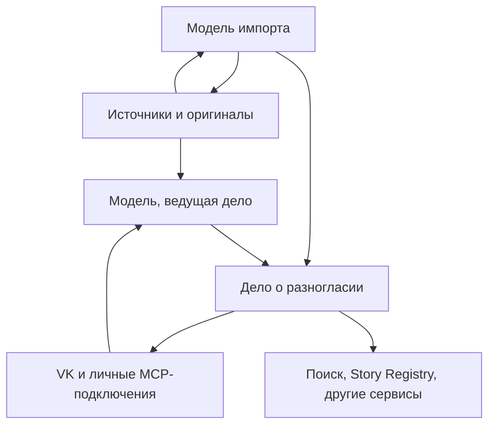

# Журнал и дела о разногласиях: самостоятельный исследовательский процесс РКБ

**Версия 2 — 18 октября 2026 года.**

**Статус:** продолжение проектирования по уточнениям владельца. Новые таблицы, MCP-операции, запрет параллельного импорта и навык ниже являются предлагаемым контрактом, а не уже реализованными возможностями. Продукт, источники и экспертные решения в этой работе не изменялись.

**Актуальный срез:** `onedayonemasterpiece/regional-knowledge-base`, свежий `main` = `926b8564d7d444cf144301ed68f88689f2ebda46`, проверен через DevCoveer 18.10.2026 в 14:24:57 UTC / 16:24:57 Калининград. SHA исполняемого сервиса отдельно не установлен. Документ заменяет архитектурные рекомендации первой версии, сохранившейся в истории Git.

## 1. Главный поворот

Создать в РКБ **самостоятельный журнал исследовательских дел о разногласиях**. Каждое дело собирает конкретный спорный вопрос, варианты, источники, точные цитаты, аргументы участников и последовательные предварительные заключения. Журнал — разные представления этой коллекции: очередь, фильтры, семантический поиск, история работы.

Story Registry формирует истории и материалы для использования и публикации. Он получает результаты дела по ссылке и ревизии. Создание и существование дела не зависят от story. Сам журнал не ставит целью построить полный исторический граф или универсальный каталог всех исторических фактов.

| Решение первой версии | Решение после уточнения владельца |
|---|---|
| Общий `AssertionRepository` и адаптер story как обязательная основа | Самостоятельные дела с локальными вариантами и источниковыми привязками |
| Постоянный общий реестр практически всех извлечённых суждений | Лёгкий протокол проверки суждений в импорте; богатая структура прежде всего у найденных дел |
| Обязательные новые memberships и изменения внутренностей Story Registry | Story потребляет `case_id + revision` и пакет результатов; миграция story не является начальным этапом |
| Поддержка гонок нескольких импортируемых книг | **В одном развёртывании РКБ одновременно исполняется только один импорт** |
| Сложная передача канонического дела между продуктами | РКБ владеет исследовательскими делами; внешние продукты применяют результаты в своей области |
| Экспертное рассмотрение преимущественно как внутренний процесс | Личные MCP-подключения и профессиональное обсуждение в VK — два входа в одно дело |
| Поиск разногласий преимущественно как расширение общей выдачи | Самостоятельный исследовательский поиск по источникам и отдельный семантический поиск по делам |

Этим убирается обязательная перестройка story, всеобщая атомизация корпуса и механизм согласования параллельных импортов. Их полезные обязанности сохраняются локально: у дела есть точные источники и история, у импорта — продолжение и учёт выполненной работы, у потребителя — ссылка на использованное заключение.

## 2. Какой результат должен получить пользователь

После полного импорта книга доступна поиску, а найденные при её чтении и сопоставлении расхождения уже оформлены в новые или существующие дела. Для каждого нового дела можно открыть оригиналы, увидеть спорный вопрос и продолжить разбор без исходного чата импортирующей модели.

Не нужно ждать окончательного решения профессионального сообщества, чтобы пользоваться делом. Уже предварительное заключение может разрешать осторожную формулировку, предпочитать лучше поддержанную версию, показывать несколько интерпретаций или рекомендовать не использовать конкретное утверждение как установленный факт.

Число заведённых дел не является планом, который модель должна выполнить любой ценой. Книга без найденных расхождений не хуже книги с большим числом ошибок. Результат оценивается полезностью и обоснованностью найденных дел, полнотой исследовательского прохода и сохранёнными ограничениями, а не искусственно увеличенным счётчиком.

Это схема работы, а не исторический граф. Выводы и смысловые решения формирует работающая через MCP модель. Сервер обеспечивает точные чтения, транспорт, поиск, сохранение, версии и права. BGE остаётся вычислительным инструментом поиска через существующий Kaggle-контур.

## 3. Что считать делом

### 3.1. Единица — конкретный исследовательский вопрос

Хороший предмет дела: «Какому событию относится приводимая дата?», «Кому приписано авторство этого проекта?», «Какие основания у распространённого объяснения названия?». Слишком широкий предмет «Все разногласия о городе» быстро станет неуправляемым.

В деле достаточно следующих частей:

| Часть | Содержание |
|---|---|
| Вопрос и границы | Что именно сравнивается; необходимый период, объект и контекст |
| Варианты | Формулировки позиций с устойчивыми локальными ID; говорящий и модальность |
| Основания | Цитаты и места в книгах, статьях, рецензиях, документах, комментариях |
| Причина разногласия | Объяснение модели или участника: какие положения несовместимы или оспариваются |
| Участие | Атрибутированные аргументы, мнения, ответы, замечания, поддержка и возражения |
| Текущее заключение | Что можно использовать сейчас, почему, с какими оговорками |
| История | Кто и что добавил, исправил, отозвал; какие материалы были рассмотрены |
| Следующие действия | Какой оригинал, специалист или уточняющий вопрос может изменить положение дела |

Один источник может уже содержать несколько позиций. Для регистрации такого дела не требуется искусственно искать вторую книгу. Но пересказ чужой позиции в книге не считается непосредственной проверкой процитированного автора.

### 3.2. Смысловая классификация выполняется моделью

Нужно различать фактическую несовместимость, интерпретационное разногласие, критику недостаточности оснований, исправление чужого чтения, пересмотр самим автором и кажущееся расхождение из-за контекста. Классы помогают искать и работать; они не заменяют объяснение.

Самопротиворечие требует установить одного говорящего, сопоставимый предмет и несовместимые утверждения. Цитирование оппонента с последующим возражением этому условию не соответствует. У одной книги могут быть автор, переводчик, редактор и составитель примечаний. Если авторство примечания не установлено, оно так и обозначается.

Не каждое различие нужно превращать в активное дело. Если из прочитанного контекста ясно, что сравнивались разные стадии строительства, результат фиксируется в протоколе проверки. Если путаница уже широко воспроизводится или требует профессионального разбора, её можно сохранить как дело с выводом «расхождение объяснено».

Модель может сразу зарегистрировать **кандидатное дело**, когда есть источник критики, но отсутствует оригинал критикуемой работы. Вариант получает происхождение «приписан автору в таком-то источнике» и конкретный пробел проверки. Это полезный материал для дальнейшего исследования, а не готовое опровержение.

### 3.3. Состояние работы и содержание вывода

Не создавать длинный автомат из десятков статусов. Достаточны рабочие состояния `open`, `paused`, `archived` и независимое наличие текущего заключения. Причины паузы и архивирования сохраняются словами и коротким кодом там, где это нужно для очереди.

У заключения есть собственный результат: расхождение объяснено контекстом; вариант недостаточно поддержан; вариант предпочтителен; сохраняются несколько допустимых интерпретаций; материалов недостаточно. Эти результаты не закрывают возможность новых аргументов.

Новое сообщение не обязано обнулять пригодное прежнее заключение. Модель оценивает, меняет ли новое основание его смысл. До этой оценки видно «есть новые материалы после заключения». Существенное возражение требует следующей версии. Архивирование означает организационное состояние, а не доказанную истинность.

## 4. Минимальная SQL-модель

Предлагается отдельный небольшой модуль в существующем приложении и пять основных таблиц. Это начальная схема обязанностей; физическая нормализация уточняется реализацией, без изменения границ продукта.

| Таблица | Назначение |
|---|---|
| `disagreement_cases` | ID, ревизия, вопрос, контекст, локальные варианты, состояние, ссылка на текущее заключение |
| `disagreement_evidence` | Версионированные цитаты, источниковые ссылки, места на страницах, происхождение и состояние проверки оригинала |
| `disagreement_contributions` | Мнения, аргументы, рецензии и наблюдённые версии комментариев; авторство и ссылки на варианты/основания |
| `disagreement_conclusions` | Версии синтеза, рекомендации использования, ограничения, рассмотренные материалы, поддержавшие и возразившие участники |
| `disagreement_events` | Короткая история изменений, исправлений, отзывов, объединений и переоткрытий с сохранением заменённого содержания |

Варианты сначала могут быть небольшой типизированной структурой в ревизии дела. Им нужны устойчивые ID, чтобы исправление текста не отрывало аргументы. При росте числа вариантов их можно вынести в таблицу без превращения в глобальные исторические факты.

У доказательств и вкладов собственные версии: исходная цитата или комментарий не перезаписывается бесследно. Для объединения дублей сохраняются прежние ID и переадресация. Автоматически объединять дела по высокой векторной близости нельзя: похожие вопросы могут быть различны. Разделение слишком широкого дела также оставляет ссылки и историю.

Используются существующие идентификаторы документов, ревизий, страниц, регионов и пользователей. Не добавляются общий реестр исторических сущностей, новый IAM или таблица «все факты региона». Ссылки между аргументом и его основанием — обычные связи внутри дела.

Права действуют сквозным образом: на название дела, материалы, сводки, историю, поисковые представления, векторы и метаданные выдачи. Производное содержание не становится доступнее своего основания автоматически. Для первого выпуска достаточно проверки доступа ко всем материалам раскрываемой ревизии; отдельно проверенная публичная проекция строится только из разрешённых оснований. Удалить закрытые ссылки, оставив основанную на них сводку, недостаточно. Поиск не раскрывает существование и счётчики чужих закрытых дел. Используется действующая авторизация, без новой системы аккаунтов.

Вспомогательные обязанности:

- Поисковые тексты и FTS — производные представления дела.
- Векторы — в существующей разрешённой векторной плоскости, с точными ID/ревизиями/хешами и проверенным запасом ёмкости.
- Профиль участника и персональный вес — расширение существующей идентичности, а не новая система аккаунтов.
- Протокол прохода и единственный активный импорт — в существующем механизме ingestion jobs/checkpoints.
- Связь с обсуждением — запись исходного поста и ревизии опубликованного дела; транспорт остаётся у существующей социальной интеграции.

Если нужного места хранения конкретной обязанности в текущем механизме нет, добавляется узкая таблица. Цель — отсутствие конкурирующих владельцев данных, а не искусственное соблюдение числа «пять».

## 5. Последовательный импорт: обязательное требование

### 5.1. Один активный импорт на развёртывание

Запрет должен действовать серверно для всех входов: новая книга, журнал, повторный импорт и другой MCP-клиент. При втором старте возвращается понятное `import_busy` или место в очереди. Другому пользователю не раскрываются название и материалы чужой книги.

Это **не длинная SQL-транзакция на время чтения книги**. Нужна сохраняемая запись единственного активного ingestion job. Короткие транзакции проверяют эту запись и обновляют checkpoint. Чтение страниц, работа модели и BGE выполняются вне блокировки SQL-записи.

Пауза, потеря чата или истечение lease не разрешают незаметно начать следующую книгу. Продолжается тот же job; старый исполнитель теряет право записывать после передачи управления новому. Слот освобождается после полного окончания либо явно оформленного прекращения импорта. Отмена не удаляет уже сохранённые пригодные дела; их фактическое основание и связь с неполным импортом остаются видимыми.

Договор о полном job принадлежит существующему `book_ingest`. Его контракт потребуется расширить явными `pause/resume/cancel` и статусом окончания обязательного анализа; в текущем перечислении команд эти действия не объявлены. `disagreement_scan` продолжает исследовательскую часть того же job и не создаёт второго владельца слота. Сериализация коротких start-транзакций, описанная сейчас в документации, сама по себе не является договором о последовательном исполнении полных импортов.

Если при внедрении уже есть несколько незавершённых jobs, их нельзя автоматически удалять или объявлять завершёнными. Новые старты ограничиваются, для существующих определяется порядок продолжения с сохранением состояния. Это задача внедрения, не действие настоящего исследования.

Несколько специалистов могут одновременно читать и пополнять дела. Их короткие записи не являются параллельным импортом книг. Изменение одного заключения защищается проверкой ревизии; независимые мнения не теряются из-за последней записи.

### 5.2. Полный цикл одной книги

1. **Открыть или продолжить импорт.** Модель получает обязательную инструкцию, capabilities текущего MCP и checkpoint. Проверяет, что работает с правильным job и ревизией.
2. **Прочитать небольшой связный фрагмент.** Видит страницы, примечания и продолжения. При обычном парсинге выделяет фактические и интерпретационные суждения, указывает говорящего и точные места.
3. **Найти сопоставимые материалы.** Ищет в существующем корпусе и уже прочитанных частях текущей книги; задаёт нейтральный вопрос, не требующий заранее правильности исходной версии.
4. **Прочитать существенные кандидаты.** Проверяет контекст, эпоху, событие, отрицание, условность и происхождение. При необходимости расширяет запрос и рассматривает противоположную позицию.
5. **Сохранить расхождение сразу.** Ищет подходящее существующее дело. Добавляет в него вариант/основание либо создаёт кандидатное дело с точным вопросом. Проверяет сохранённое через readback.
6. **Сверить ключевые цитаты с оригиналами.** Получает выделенные изображения. Неясность чтения или недоступный оригинал остаются конкретным следующим действием, а не выдуманным подтверждением.
7. **Записать checkpoint.** Какие суждения разобраны, какой поиск выполнен, какие материалы прочитаны, какие дела созданы/пополнены, что осталось.
8. **Завершить книгу.** Дочитать остаток; проверить связи между ранними и поздними страницами; обработать поиск, отложенный из-за индексации; подготовить короткие текущие итоги найденных дел и их поисковые представления.

Пока текущая книга не вошла в общий индекс, собственные ранние страницы доступны через её staged/accepted текст и checkpoint. Не требуется ждать общей публикации каждой страницы, чтобы заметить внутреннюю полемику. Для больших отложенных сравнений можно использовать текущую разрешённую временную проекцию; это одна книга, не второй конвейер импорта.

Сохранённое до финализации дело удерживает необходимое доказательство независимо от изменяемого checkpoint: точную цитату, SHA исходника, физическую страницу, локатор, происхождение и ссылку на надёжно сохранённый оригинал, если он доступен. Staged-привязка обозначается явно. При активации она связывается с соответствующей принятой ревизией после проверки содержания; при отмене не притворяется активным корпусным объектом. Существующая очистка должна учитывать зависимости сохранённых дел и не удалять их единственную опору как временный материал импорта. Если оригинал не сохранён или законно отозван, ограничение видно в деле; отметка проверки не подменяет доступность источника.

Техническая доступность текста поиску и окончание расширенного импорта — разные факты. Прежнее API `finalize` может продолжать материализовывать источник, но общий job нельзя обозначать полностью завершённым, если обязательный проход по разногласиям остался без исполнения. Включение нового этапа не должно заставлять существующий `finalize` бесконечно ждать сам себя: активация текста и последующая обработка его индексируемых материалов являются отдельными шагами одного job.

**Для завершения импорта не требуется дождаться мнений людей или окончательно разрешить все дела.** Требуется выполнить модельный проход, сохранить обнаруженные дела и их текущие ограничения. Известное расхождение с недоступным первоисточником может остаться открытым для сообщества. Массовая недоступность исследовательского поиска, напротив, не должна маскироваться как полноценная проверка всей книги.

### 5.3. Проверять суждения, не создавать реестр всего

Список суждений нужен модели как рабочая программа и checkpoint. Постоянно сохраняются короткие source spans, формулировки, проверенные вопросы, ссылки на выдачи/прочитанные доказательства и итог действия. Это протокол работы, без глобальных сущностей и их графовой нормализации.

Несколько суждений об одном предмете могут использовать общий поиск; каждое всё равно получает самостоятельное смысловое рассмотрение. Сохранённая отрицательная проверка применима только к данному вопросу, ревизии и реально доступному корпусу. Новая книга может добавить ранее отсутствовавшее основание.

Не требуется заранее вычислить все возможные пары утверждений. При новой книге модель ищет уже существующие материалы и дела; связанные места в старой книге добавляются в дело по мере обнаружения. Для пропущенной, исправленной или поздно проиндексированной части сохраняется конкретное продолжение. Запрет параллельных импортов убирает гонку «две новые книги ещё не видят друг друга», но не даёт гарантии полного обнаружения всех расхождений.

## 6. Три разных поиска

| Сценарий | Задача | Характер работы |
|---|---|---|
| Общий поиск РКБ | Ответы и материалы для множества сервисов | Предсказуемая задержка; источники и компактные готовые сведения о связанных делах |
| Исследовательский поиск по источникам | Сопоставить новое суждение, найти и проверить альтернативы | Несколько шагов, широкий набор кандидатов, оригиналы, явное продолжение |
| Семантический поиск по журналу | Найти дела по теме, аргументу, особенностям и неявным признакам | Поиск по содержательным представлениям дел с последующим чтением и отбором моделью |

Исследовательский процесс может занимать минуты и больше. Каждый MCP-вызов при этом должен сообщать результат или явное `pending` с ID продолжения, а не молча висеть. Готовый быстрый поиск не запускает полный профессиональный разбор при каждом пользовательском вопросе. Это сохраняет защищённый контракт обычного поиска [R1, R2].

### 6.1. Точность поиска источников

При обнаружении противоречий сначала нужна полнота сопоставимых свидетельств. Один высокий порог сходства способен отсеять как раз противоположный материал. Пример: для проверки автора проекта полезен запрос об авторстве проекта, а имя проверяемого автора не должно становиться обязательным фильтром.

Начальная стратегия: BGE-кандидаты, точные фамилии и варианты написания, редкие термины и архивные шифры в лексическом канале; затем чтение контекста вызывающей моделью. Дата, роль, территория и единицы становятся жёстким фильтром только тогда, когда модель обоснованно установила их сопоставимость. Рецензия или примечание часто сразу дают направление поиска оппонента.

Результат исследовательского инструмента должен содержать конкретный запрос, область доступного корпуса, использованные каналы, ревизии, найденные ID, непрочитанный остаток и состояние готовности. «В рассмотренной выдаче подходящего материала не найдено» нельзя превращать в «такого утверждения в базе нет».

Для первого выпуска достаточно расширить существующий retrieval primitive параметрами глубины и продолжения. Новый метод не вызывает скрытого исторического арбитра. Обычный search/fetch и исследовательское чтение должны использовать одну авторизацию и одни исходные материалы.

### 6.2. Более сильный индекс именно дел

У дела должны быть несколько коротких векторизуемых представлений:

1. **Вопрос и контекст:** что разбирается, в каких границах.
2. **Каждая существенная позиция и её аргумент:** отдельное представление, чтобы одна версия не растворилась в общей сводке.
3. **Исследовательская особенность:** проблема атрибуции, зависимость публикаций от одного основания, смешение события и его интерпретации, сомнение в чтении документа.
4. **Текущее заключение и открытый вопрос:** что стало яснее и какое новое свидетельство требуется.

Это позволяет искать, например, «дела, где много публикаций пересказывают один непроверенный документ» или «обсуждения, в которых новое чтение оригинала изменило предварительный вывод». Такие свойства не обязаны присутствовать в заголовке или в виде заранее заданного тега.

Тексты формирует модель из реально имеющегося материала. Каждое представление ссылается на case revision и конкретные основания; предположительная особенность обозначается как предположение. Нельзя добавлять вымышленные объяснения ради лучшего попадания в поиск. Производный текст не становится новым историческим свидетельством.

Первый вариант использует несколько обычных dense-векторов. BGE-M3 действительно поддерживает dense, sparse и ColBERT, а разработчики рекомендуют hybrid retrieval с последующим reranking [E4]. Но несколько смысловых карточек одного дела не требуют немедленно включать токенный ColBERT-индекс или отдельную модель reranker. Сначала вызывающая модель читает кандидатов и объясняет, почему дело соответствует запросу.

Текущий продукт ограничивает конечный augmented encoder input 512 токенами [R3]. Возможность BGE-M3 принимать 8192 токена не меняет этот действующий контракт. Представления дел сначала должны укладываться в текущий бюджет. Изменение модели, размерности, длины или режима индексации — отдельное измеряемое решение.

У результата поиска: `case_id`, revision, найденное представление, его исходный материал, канал и релевантность. Версии с меньшей поддержкой остаются находимыми, если соответствуют запросу. **Релевантность, персональный вес участника и обоснованность исторической версии — три разные характеристики.**

Вектора обновляются после изменения соответствующего материала; частота комментариев сама по себе не требует перевекторизации всего дела. До обновления доступен сохранённый текст через FTS/чтение, а устаревшая векторная проекция явно помечается. Старый индекс нельзя незаметно представлять как текущую ревизию.

У представления есть устойчивый ID, собственная версия/`material_hash` и ссылки на использованные материалы. Ревизия дела, при которой оно сформировано, хранится отдельно. Поиск сообщает версию найденного представления и текущую ревизию дела. Добавление несвязанного комментария не делает неизменное представление устаревшим; изменение его текста или оснований требует обновления. Так не возникает обязательной перевекторизации всего дела при каждой записи.

### 6.3. Где уместны более дорогие способы

Для небольшого журнала или ограниченного доступного набора можно проверить точный проход по векторам. Он устраняет потери ANN относительно выбранной метрики; это не гарантия исторической полноты. pgvector поддерживает exact и ANN, а фильтрация ANN может требовать более глубокого прохода [E5].

Если нужный материал попадает в кандидаты, но низко ранжируется, полезно улучшать отбор. Если не попадает — исследовать представление, язык, нейтральность запроса и полноту поиска. Более мощный embedding не исправляет неверно приписанную автору цитату.

Стоимость нужно считать по представлениям, а не по числу дел. Условный пример: 10 000 дел × 6 dense-представлений × 1024 компоненты × 4 байта = **245,76 MB** только числовых значений, без SQL, индекса, истории, временного перестроения и прочего корпуса. Это арифметика для планирования, не измерение РКБ. Требование запаса общей ёмкости сохраняется [R1, R2].

## 7. Оригинал и выделенная цитата

### 7.1. Уже есть полезная основа

Текущий MCP имеет `source_proof(id, quote, physical_page_index)`; корпусное чтение возвращает source revision, page/region и исходный текст. Документация описывает native text first и необязательный ограниченный Flash-Lite helper для сканов [R2, R4]. Это существующая основа, а не функция, которую необходимо придумывать с нуля.

Для нового процесса надо сохранить требование владельца: смысловое чтение и проверку делает вызывающая MCP модель. Поэтому исследовательский вариант proof должен поддерживать работу **без скрытого серверного читателя скана**. Текущий узкий интерфейс не следует объявлять уже полным контрактом для этой задачи.

### 7.2. Минимальное расширение proof

1. По точному source reference сервер возвращает исходную страницу, её размеры/поворот и native text/координаты, если они действительно есть.
2. Для native text точное сопоставление может механически получить координаты цитаты.
3. Если native layer недостаточен, вызывающая модель читает изображение и указывает выделяемые строки/области. Несколько строк и несколько страниц допустимы.
4. Сервер проверяет источник, ревизию, границы координат и привязку, рисует подсветку кодом и возвращает оригинал с выделением и читаемый фрагмент.
5. Модель смотрит результат и фиксирует, что именно удалось прочитать, а что остаётся неясным.

Не нужно генерировать изображение страницы или дорисовывать буквы. Не нужно делать OCR всей книги ради двух цитат. Изображения можно получать по запросу и повторно строить из уже сохранённого оригинала; карточка хранит устойчивый source locator, а не только временную ссылку на PNG.

Геометрически корректная рамка не доказывает, что внутри написана заявленная цитата. Состояния различимы: текст совпал в принятой транскрипции; место локализовано на оригинале; вызывающая модель визуально сверила чтение; специалист подтвердил/уточнил его. Неясное чтение не маскируется общей зелёной отметкой «верифицировано».

У доказательства нужны source SHA/revision, page ID, отдельные physical index и печатный номер, region/quote selector, точная цитата, контекст, координаты/версия локатора и происхождение проверки. Для примечания через границу страниц возвращается весь необходимый фрагмент. Строка из примечания не превращается в мнение автора основного текста без установления говорящего.

Доступ к принятому тексту не даёт доступа к частному оригиналу. Нужны существующие source grants, расширенные явным разрешением на proof для специалиста там, где сейчас proof ограничен владельцем. Кеш и производный crop повторно проверяют права; общая публикация цитаты отдельно проверяет возможность её открытого использования.

## 8. MCP-инструментарий: полный рабочий цикл, компактная поверхность

Имена ниже — **проект контрактов**, не список уже доступных инструментов. Реализация может объединить близкие операции, сохранив типизированные входы. Профиль для исследовательской работы предоставляет навыку весь цикл; Live-профиль обычного поиска не перегружается этой поверхностью.

| Инструмент/группа | Минимальный вход и результат |
|---|---|
| `disagreement_scan` | `ingestion_id`, действие `next/checkpoint/status/finish`; отдаёт следующий непройденный фрагмент и сохраняет точный прогресс внутри существующего job |
| `evidence_research` | Нейтральный вопрос/несколько явных запросов, scope, глубина, cursor/job; возвращает источники, контекстные ссылки, каналы и полноту выдачи |
| `disagreement_search` | Естественный запрос, фильтры/сортировка очереди, cursor; выдаёт дела и конкретные совпавшие представления |
| `disagreement_get` | Case ID, view и cursor; читает вопрос, варианты, evidence, contributions, conclusions или history без скрытого усечения |
| `disagreement_edit` | Типизированные create/add-position/add-evidence/correct/reclassify/link-duplicate/split/archive/reopen и `operation_status`; точные ссылки, reason, expected revision и operation key |
| `disagreement_contribute` | Добавить собственное мнение, аргумент, ответ, поддержку, возражение или отзыв; автор устанавливается из реального контекста и происхождения |
| `disagreement_conclusion` | Записать предлагаемую/текущую сводку, поддержать или оспорить конкретную версию; сохраняются основания, открытые вопросы, допустимые формулировки и статус авторства |
| `source_proof` | Расширенный prepare/render/readback по source reference и выделению вызывающей модели; изображения и точный locator |
| `disagreement_discussion` | Подготовить пакет VK, связать с фактически опубликованным постом, прочитать/синхронизировать наблюдённые версии комментариев с продолжением |
| `disagreement_participants` | Читать профили и веса; разрешённым управляющим — подтверждать связь личности, менять предметный вес и доступ с историей |
| `disagreement_export` | Пакет конкретной ревизии для поиска, story или публичного обсуждения с проверенными правами, вариантами, рекомендацией и исходными ссылками |

Очередь — сортировка и фильтрация того же журнала, например новые дела, новые аргументы после заключения, нужна сверка оригинала, нужна компетенция по теме. Назначение ответственного не даёт ему исключительного права читать дело и не лишает остальных допущенных участников возможности вносить вклад.

### 8.1. Общие гарантии записи

- Сервер устанавливает записывающего actor и полномочия; `expert=true` в payload ничего не разрешает.
- Повтор с тем же operation key не создаёт второе дело или повторный комментарий.
- Изменение состояния проверяет expected revision. При конфликте возвращается актуальная ревизия и причина, а не незаметная перезапись.
- Ответ записи включает operation ID, применённую ревизию, созданные/обновлённые ID и следующий шаг. Модель читает сохранённый результат.
- Timeout с неизвестным исходом сначала разрешается чтением операции; повтор не создаёт дубликаты.
- Длинные списки имеют cursor и `has_more`. Ни аргументы, ни альтернативные варианты не исчезают после первой страницы.
- Любой результат отделяет реальную цитату, атрибутированный пересказ и формулировку модели.

`operation_status` читается по заранее известному клиентскому operation key даже тогда, когда потерян ответ создания и модель ещё не знает Case ID. Результат различает `not_found`, `pending`, `applied`, `failed`; для применённого действия возвращает созданные ID и ревизию. Это действие того же инструмента, без отдельного диспетчера операций.

Не требуется отдельная ручная авторизация каждого обратимого внесения, если участник уже уполномочен на эту операцию. Формирование черновика публикации, сохранение дела и фактическая отправка в VK — разные действия; последнее исполняется существующим каналом при соответствующем поручении.

### 8.2. Где нужна детерминированность

| Модель решает | Сервер гарантирует |
|---|---|
| Какие суждения сопоставимы | Правильный источник, ревизия, страница и сохранённый текст |
| Есть ли разногласие и в чём оно | Целостность ссылок, проверка прав, отсутствие потери записи |
| Кто говорит и какова модальность | Раздельное хранение прямой речи и интерпретации модели |
| К какому делу отнести материал | Устойчивые ID, версии, обратимая история объединений |
| Как учесть компетенцию, основания и возражения | Подтверждённая идентичность и управляемый профиль веса |
| Какой предварительный вывод обоснован | Сохранение его автора, рассмотренного среза и ограничений |

Не вводятся правила «даты различаются — противоречие», «самый высокий similarity — нужное дело», «эксперт с большим баллом всегда прав» или «последняя оценка отменяет предыдущие». Структурные ограничения полезны именно там, где они защищают результат; они не должны подменять исследование.

## 9. Участники, персональный вес и заключения

### 9.1. Почти все могут вносить содержательный вклад

Студент, краевед и специалист могут добавить источник, аргумент, исправление и предложить предварительный вывод. Право добавить своё мнение отделено от права менять чужой текст, присваивать себе компетенцию, менять общий режим доступа или выдавать сводку за коллективно подтверждённую.

Участнику нужен персональный вес, задаваемый сообществом или уполномоченным управляющим по небольшой понятной шкале. Хранятся область применения, основание, назначивший и ревизия. Предметная компетенция может повышать вес именно для чтения рукописей, архитектурной датировки или другой работы. Не нужно начинать с автоматической репутационной экономики.

Модель получает вес вместе с вкладом и **использует его в анализе**: чьи профессиональные возражения требуют особого рассмотрения, где имеется квалифицированная поддержка, к какому суждению разумно относиться осторожнее. В заключении объясняется, как это повлияло на предпочтение версии. Если весомое мнение отклонено из-за более сильного оригинального свидетельства, причина также указана.

Персональный вес не равен силе доказательства. Проверяемый документ, принесённый студентом, может опровергнуть объяснение признанного специалиста. Много сообщений одного человека и повторение одного источника несколькими людьми не создают много независимых оснований. Изменение веса не должно незаметно пересчитывать прошлые заключения.

Имеющийся в RKB контекстный POI producer score не нужно автоматически переносить на экспертную работу: это другая обязанность. Для начала достаточно явно назначенных профилей и смыслового анализа, без формулы вероятности исторической истины.

### 9.2. Три вида результата

1. **Индивидуальное мнение/заключение.** Автор, предмет, основания, ограничения, дата и версия.
2. **Текущая исследовательская сводка модели.** Что следует из рассмотренного материала, чьи мнения учтены, где позиции разошлись. Явно обозначено модельное происхождение.
3. **Поддержанное профессиональное заключение.** Та же версия или новая, с конкретными подтверждениями участников; несогласие остальных не скрывается.

Так не требуется назначать одного вечного арбитра или вводить обязательный кворум для каждого полезного вывода. В то же время модель не может самостоятельно назвать свой текст «заключением экспертов».

Личное заключение не заменяет указатель на общую сводку. Обновление текущей сводки — отдельное действие с обозначенным срезом рассмотренных материалов и сохранением существенных возражений. Выполняющая его модель действует в рамках существующих прав ведущего дело; такое право можно дать нескольким участникам, а предлагать новые выводы может весь допущенный круг. Это право сопровождения общей записи, не повышенный исторический вес и не право аннулировать чужие мнения. Поддержка людьми относится к точной версии и не переносится автоматически на её следующий модельный пересказ.

Авторство записи, авторство мысли и подтверждение человеком — разные поля. Личное MCP-подключение устанавливает, от чьего аккаунта выполнена операция; оно само по себе не доказывает, что человек лично прочитал оригинал. Для такого заявления сохраняется его явное подтверждение или точный источник высказывания. При импорте комментария хранятся реальный VK author ID и наблюдённый текст; интерпретация моделью записывается отдельно.

Сопоставление VK и MCP личности требует подтверждения. Совпадения имени недостаточно; комментарий от имени сообщества не приписывается одному специалисту. Предметный вес не даёт доступа к чужим частным источникам.

### 9.3. Какие практики заимствовать

У eLife индивидуальные материалы рецензирования сопровождаются общей оценкой редактора и рецензентов; сила доказательств явно характеризуется [E1]. В F1000 зарегистрированные читатели могут комментировать, имена рецензентов раскрываются, а версии работ и рецензии сохраняются [E2]. Это полезные примеры сочетания широкого участия, различимого профессионального статуса и обновляемых выводов.

COPE подчёркивает предметную компетентность, раскрытие интересов, конкретность критики, источники и пределы реально рассмотренного материала [E3]. В РКБ эти принципы применяются к делам. Журнальные требования к степеням, количеству публикаций и числу рецензентов автоматически не переносятся на региональное сообщество.

## 10. VK как первая площадка обсуждения

### 10.1. Рабочий цикл

Модель готовит пакет из конкретной ревизии дела: ясный вопрос, краткий контекст, варианты с источниками, выделенные цитаты, что уже проверено и какие вопросы адресованы участникам. После разрешённой фактической публикации сохраняются ID/URL поста и ревизия дела, на которую отвечали комментаторы.

Комментарии, вложения и ответы получает существующая интеграция. Вызывающая модель выделяет из них мнения, аргументы, новые источники, исправления и ответы на возражения. Она связывает вклад с вариантом и конкретным комментарием, учитывает профиль автора и готовит очередную сводку. Не каждый комментарий обязан стать аргументом: организационные реплики остаются контекстом обсуждения.

Публичное обсуждение не является единственным архивом дела. В РКБ сохраняется наблюдённый материал, его происхождение и история изменений. Сводка по одному обсуждению может использоваться дальше ещё до окончания дискуссии, если ясно, что она предварительная.

Рецензии книг и статей обрабатываются тем же смысловым путём: исходная рецензия → точный предмет критики → аргумент → нужное дело. При отсутствии оригинала рецензируемого текста сохраняется атрибутированная критика и конкретная недостающая проверка. Отзыв о стиле или оформлении не становится историческим разногласием.

### 10.2. Белый список

Требование «только участники белого списка могут комментировать публичный пост» нельзя считать уже подтверждённой штатной возможностью VK. В изученной официальной публичной схеме есть закрытие комментариев, типы сообщества, настройки стены, получение комментариев и события их изменений; произвольный список разрешённых авторов конкретного публичного поста не найден [E8, E9]. Проверялась схема, а не интерфейс выбранного сообщества и не доступность методов конкретному токену.

Следует различить три режима:

- Платформа действительно запрещает посторонним писать — требует проверки выбранной конфигурации VK.
- РКБ принимает содержательные вклады только от подтверждённого белого списка — это можно обеспечить собственным контрактом.
- Модератор удаляет посторонние комментарии после появления — это не запрет публикации.

Если строгий платформенный whitelist недоступен, практичный первый вариант — публичная дискуссия с приёмом в дело только разрешённых участников либо отдельно контролируемое сообщество для обсуждения. Второй вариант может ограничить публичность чтения; выбор зависит от реально доступных настроек. Обещать одновременно оба свойства без проверки не следует.

### 10.3. Полнота, правки и отзыв

Официальная схема `wall.getComments` описывает страницы до 100 комментариев и максимум 10 встроенных элементов ветви; ветви можно читать отдельно. Для полного исследовательского среза нужны пагинация, дочитывание ответов и отсутствие усечения текста. Первой страницы или сортировки «интересные» недостаточно [E8].

Сохраняются provider ID, author ID, родитель/ветка, исходный текст, вложения, время наблюдения, хеш и состояние удаления. Наблюдённые правки создают версии. События VK new/edit/delete/restore помогают обновлению [E9], но не заменяют проверку доступного снимка и не гарантируют восстановление всех ранее не наблюдённых редакций.

Удалённый комментарий не означает признания ошибки его автором: причина и исполнитель удаления могут быть неизвестны. Существенное изменение использованного аргумента создаёт задачу пересмотра. Лайки не определяют персональный вес и не превращаются в историческое доказательство.

## 11. Что получает общий поиск и Story Registry

Они получают **готовую краткую проекцию текущего положения дела**, а не обязанность каждый раз заново проводить исследование. В ней: вопрос, существенные варианты, рекомендуемая формулировка, ограничения, статус подтверждения и ссылка на точную ревизию.

Связь устанавливается по доказательным местам: `document revision + page/region/span → связанные дела`. Одно место может относиться к нескольким делам. В общем ответе нельзя считать весь фрагмент недостоверным из-за одной оспариваемой фразы или пропускать её без оговорки вместе с соседним полезным текстом. Для этого не требуется глобальный AssertionRepository: достаточно адресуемых span-привязок у дел и протокола проверки.

У потребителя возможны разные политики:

| Политика | Поведение |
|---|---|
| Обычная выдача с учётом дел | Релевантный материал, короткая оговорка и текущая рекомендация там, где это существенно |
| Все известные варианты | Дополнительно извлекаются позиции и основания из дела, включая не попавшие в исходный top-k |
| Без известных содержательных разногласий | Исключаются спорные места; необходим актуальный протокол рассмотрения соответствующей области, иначе возвращается неполнота проверки |
| Пригодное по текущему заключению | Допускается использование обоснованной формулировки даже в открытом деле; видны авторство и ограничения заключения |

Нельзя называть третью политику «только истина». Отсутствие найденного дела и прохождение модельного чтения не доказывают историческую достоверность. Если нет подходящих материалов, режим не заменяется молча обычной выдачей.

Граница отрицательной проверки задаётся доступным срезом корпуса и датой рассмотрения. Новые известные связанные дела учитываются независимо от возраста протокола. Если клиент требует проверку на полном текущем срезе, а такого покрытия нет, возвращается неполнота. Первый выпуск не обещает автоматического наследования прежнего «не найдено» на все будущие книги и не запускает полное повторное рассмотрение корпуса после каждого импорта. Полезность обычного поиска от этого строгого требования не зависит.

Найденное дело раскрывается по ID, а не только через ранжирование его отдельных позиций: иначе поисковый алгоритм может потерять непохожее по словам, но существенное возражение. Все варианты доступны с продолжением, однако не обязаны получать равный доказательный вес.

Использование результата дела в story записывает ссылку на ревизию и конкретное заключение. Новая существенная версия показывает потребителю, что использованное основание требует пересмотра. Обычный новый комментарий не отменяет всю историю автоматически. Старые story не мигрируют в дела и сохраняют собственный публикационный процесс.

Локальная нарративная рамка здесь — краткая версия синтеза внутри дела: в чём согласие, какие интерпретации остаются, почему одна предпочтительнее, чего не хватает и какие формулировки допустимы. Это производный результат, а не независимый первоисточник. Его повторение в статье или story не создаёт нового подтверждения самого себя.

РКБ владеет исследовательским делом. Street Story сохраняет власть над канонической POI-идентичностью и применением изменений своей модели; ссылка на дело не меняет её автоматически. Projects Hub может дать рабочий интерфейс участникам. Для первой версии не требуется новый протокол передачи владения делами между тремя сервисами.

## 12. SQLite, PostgreSQL и Kaggle

Описанные дела укладываются в обычную реляционную модель. Текущая РКБ уже разделяет SQLite для прикладных данных и Supabase PostgreSQL/pgvector для векторов [R2]. Поэтому увеличение точности векторного поиска и перенос канонического журнала в PostgreSQL — разные решения.

SQLite поддерживает одного writer одновременно; при коротких транзакциях несколько участников могут последовательно сохранять небольшие изменения. Переход к серверной СУБД имеет смысл по измеренной конкуренции записей, объёму и эксплуатационным требованиям, а не по самому наличию связей и профессиональных мнений [E6]. Последовательный импорт дополнительно упрощает нагрузку.

Предлагаемое начало: дела в текущей SQLite, короткие транзакции, BGE через существующую Kaggle-очередь, отдельные case-проекции в разрешённой векторной плоскости после оценки ёмкости. Локальный BGE и PostgreSQL на DevCoveer в рамках этого проекта не вводятся.

### Если потребуется PostgreSQL/поиск в запускаемом Kaggle

Идея владельца подходит для восстановимого исследовательского снимка. Официальные инструменты Kaggle поддерживают запуски, получение состояния, выводов ноутбуков и конкретных версий datasets [E7, E10]. Это основа пакетной работы, но не свидетельство непрерывности транзакционного сервиса.

Минимальная роль такого компонента:

1. Постоянная РКБ формирует разрешённый срез материалов/векторов с манифестом ревизий и хешей.
2. Kaggle поднимает индекс или PostgreSQL из заданной версии, исполняет исследовательский запрос.
3. Возвращает кандидатов, оценки сходства и версию снимка через существующий принцип durable jobs; новый публичный сервер БД для этого не нужен.
4. РКБ проверяет актуальность и доступ, модель читает оригиналы и записывает результат обычной MCP-операцией.

Срыв сессии тогда теряет воспроизводимое вычисление. Он не теряет внесённое экспертом мнение. Нельзя подтверждать сохранение решения после записи только во временную БД ноутбука, рассчитывая выгрузить dataset позднее. Вторая одновременно записывающая каноническая копия потребовала бы отдельного сложного согласования.

Постоянный архив экспертных действий необходим при любом размещении. Если когда-нибудь потребуется перенести и его, это отдельный проект устойчивой фиксации и восстановления до подтверждения записи пользователю. Уменьшение нагрузки на DevCoveer не должно превращать окончание сессии в потерю невоспроизводимого вклада.

Работающий каталог PostgreSQL нельзя произвольно упаковать как согласованную резервную копию: нужны остановка, корректный snapshot/backup либо согласованный логический экспорт [E11]. Для производного индекса часто проще сохранить данные, векторы и версии схемы, затем восстановить структуру. Запуск и время восстановления PostgreSQL/pgvector в текущем Kaggle в этой работе не проверялись.

## 13. Спецификация обязательного навыка модели

Это проект содержания навыка для будущей реализации; он не установлен в текущую модель и не объявляет новые MCP-инструменты существующими. После реализации навык должен поставляться вместе с соответствующей версией MCP-контрактов и небольшими проверенными учебными примерами.

### Назначение

В ходе последовательного импорта обнаруживать и сразу оформлять содержательные разногласия, а затем вести дело по оригиналам и вкладам сообщества. Прочитанный текст, принадлежность мнения, смысловое расхождение и историческая обоснованность — отдельные уровни проверки.

### Обязательная рабочая инструкция

1. **Проверь возможности и продолжи существующее.** Прочитай профиль, доступные операции, состояние job и checkpoint. Не открывай вторую книгу. Если нет нужного инструмента, укажи конкретный пробел; не имитируй его вызов текстом.
2. **Читай источник связно.** Включай примечания, подписи, указанные продолжения и соседние страницы. Для каждого суждения отличай автора текста, цитируемого человека, редактора, переводчика и неизвестного говорящего.
3. **Сохраняй смысловые ограничения.** Не теряй отрицания, условность, приблизительность, версию перевода, роль события и временные рамки. Несколько суждений в предложении можно разделить; зависимые предпосылки нельзя разорвать так, чтобы изменить смысл.
4. **Формулируй нейтральный вопрос.** Сначала установи, что сравнивается. Ищи альтернативы, не только подтверждения. Не превращай проверяемое значение в обязательный фильтр без основания.
5. **Пользуйся поиском как навигацией.** Читай существенные результаты целиком, отмечай источники и продолжения. Не делай вывода об отсутствии материала по пустой первой странице или недоступному dense-поиску.
6. **Объясни отношение.** Одинаковый факт, разный контекст, уточнение, пересмотр, критика, несовместимые сведения, несколько интерпретаций или пока недостаточно данных. Объяснение привязывай к конкретным местам, не к репутации книги целиком.
7. **Оформи полезный результат сразу.** Найди существующее дело по вопросу. Добавь материал либо создай кандидатное дело; не дублируй его из-за иного заголовка и не объединяй автоматически по сходству. Прочитай сохранённый результат.
8. **Сверь значимые цитаты визуально.** Получи оригинал и подсветку. При плохом чтении укажи, что не установлено. Сохрани исходную цитату отдельно от собственной нормализации и интерпретации.
9. **Работай с людьми прозрачно.** Различай исходные комментарии, извлечённые аргументы и собственный синтез. Учитывай персональный предметный вес, независимость оснований и возражения; не суммируй сообщения как голоса за истину.
10. **Дай предварительный вывод, когда он полезен.** Что уже можно использовать, с какой оговоркой, какая версия предпочтительнее и почему, что остаётся открытым. Не приписывай модельный вывод людям, которые его не подтверждали.
11. **Подготовь поисковые представления.** Отдельно сформулируй вопрос, позиции, основания и исследовательскую особенность. Всё должно следовать из материалов дела; сохраняй нужную ревизию и ссылки.
12. **Сохрани продолжение.** Отрази разобранные source spans, прочитанные источники, созданные/пополненные дела и конкретный остаток. Заверши расширенный импорт только после прохода; ожидание будущей экспертной дискуссии не удерживает его открытым.

### Небольшие различающие учебные сценарии

Все примеры в таблице условные; это ожидаемое поведение, не исторические факты.

| Материал | Ожидаемая работа модели |
|---|---|
| В одном абзаце пересказывается оппонент, на следующей странице следует возражение | Дело о полемике с разными голосами; не самопротиворечие автора |
| «Здание открыто в 1888», «перестройка завершена в 1894» | Установить разные события; не завести ложное противоречие только по числам |
| Рецензент утверждает, что в книге допущена ошибка, оригинал недоступен | Кандидатное дело с атрибутированной критикой и задачей получить оригинал |
| Студент приносит документ, не согласующийся с мнением известного специалиста | Прочитать документ, учесть компетенцию и аргументы; не решать по статусу автора |
| Несколько участников пересказывают одну и ту же статью | Одна общая источниковая опора, различимые человеческие мнения |
| Отзыв содержит «интересная работа» и один конкретный спор о датировке | Извлечь предметный аргумент; не превращать всю рецензию в набор дел |
| Native text отсутствует, рамка захватила соседнюю строку | Исправить выделение по оригиналу; не принять геометрию за доказательство текста |
| Клиент потерял ответ сохранения и продолжает в новом чате | Прочитать operation/job; не создавать дубликат дела или второй импорт |

Навык должен обучать суждению на таких контрпримерах. Одного указания «найди противоречия» и списка инструментов недостаточно. Проверка навыка — наблюдение за действиями модели на небольшом заранее разобранном наборе; это не обещание, что текст инструкции сам обеспечит качество.

## 14. Первый рабочий выпуск и последующее усиление

### Первый связный участок

Самостоятельное дело → точные исходные места → сравнение на изображениях → атрибутированные вклады → предварительная сводка → семантическое нахождение дела → пакет для общего поиска/story.

Сразу с ним идут минимальный MCP-профиль, навык, сохранение истории и единственный активный импорт. На уже импортированном небольшом материале модель заводит первые реальные дела без повторной загрузки книг. Можно начать с обнаруженной авторской полемики и рецензий: там вопрос и противоположные позиции часто уже выражены в источнике.

Затем этот же процесс включается в полный проход одной книги. В конце показываются новые и дополненные дела, характер расхождений, оставшиеся проверки оригиналов и пример того, как заключение меняет общую выдачу. Техническое извлечение текста отдельно от этой демонстрации не доказывает готовность расширенного импорта.

### Обсуждение сообщества

Подключить одну разрешённую VK-дискуссию и несколько участников с явно заданными профилями. Проверить, что ответы и правки не теряются, чужой пересказ не превращается в утверждение автора, а предварительный вывод сохраняет несогласие участников. Публикация конкретного поста является отдельным поручением; в этой работе посты не отправлялись.

### Усиление по выявленной причине

| Что не сработало на реальных делах | Следующее изменение |
|---|---|
| Дело не находится по особенностям аргументации | Улучшить содержательное представление и его исходные ссылки |
| Нужное дело найдено, но затерялось среди нерелевантных | Улучшить отбор моделью; затем оценить дополнительный reranker |
| Dense пропускает релевантный материал | Разобрать язык/предмет/формулировку; сравнить подходящие retrieval-режимы |
| ANN теряет то, что находит точный проход | Углубить ANN или использовать exact для исследовательского набора |
| Векторы не укладываются в измеренную ёмкость | Оценить компактное представление или Kaggle-снимок; не переносить весь журнал автоматически |
| Модель создаёт много ложных дел | Исправить контекст, атрибуцию и учебные примеры; не увеличивать объём журнала ради отчёта |
| Короткие экспертные записи регулярно конфликтуют на уровне хранения | Измерить SQL-транзакции и конкуренцию; затем решать вопрос канонической СУБД |

На старте достаточно нескольких реальных дел, чтобы увидеть ошибки контракта. Для оценки качества расширенного импорта нужен отдельный небольшой экспертно размеченный набор со спорными и похожими, но непротиворечивыми местами, включая целые не использованные при настройке источники. Несколько удачных примеров не являются оценкой полноты всего корпуса.

Полезные показатели: верность атрибуции и цитат, доля полезных дел среди созданных, попадание нужного свидетельства в расширенную выдачу, поиск по неявным признакам, сохранение существенных альтернатив, затраты модели на 1000 рассмотренных суждений, время полного импорта, объём векторов/индексов и время специалиста на дело. Протоколированный проход не равен проценту обнаруженных исторических противоречий.

При реализации достаточно проверок конкретных рисков: конкурентный второй старт отклонён; crash продолжает тот же импорт; source revision/ACL не обходятся; цитата соответствует изображению; спорная фраза не просачивается в строгую выдачу; мнения и правки не теряются; новый существенный аргумент виден при использовании старого заключения. Общие защищённые quality/capacity/latency gates остаются обязательными там, где изменяется соответствующее поведение [R1]. В данном документационном исследовании такие тесты не запускались.

## 15. Зафиксированные ограничения настоящего исследования

- Проверены текущие документация/контракты РКБ и отдельные реальные source passages через MCP. Выявленные полемические места являются кандидатами для дальнейшего разбора, а не завершённой независимой исторической верификацией.
- В начале наблюдения MCP сообщал готовые документные BGE-векторы при недоступном query runtime и `lexical_only`. Следующие ограниченные поисковые обращения после состояния `starting` вернули `bge`/`ready`. Это последовательность отдельных ответов, а не доказательство постоянного сбоя или измерение SLA.
- Изображения исходных цитат в этом исследовании не сверялись. Состояние текста в РКБ и совпадение на оригинале не смешиваются.
- Новые дела не записывались в production: специализированного договорённого MCP-контракта ещё нет. Не создавались маскирующие их story-карточки.
- Настройки конкретного VK-сообщества, доступность API его токену и строгий whitelist комментаторов не проверялись в живом интерфейсе.
- В первой части этой работы OpenCode не запустил анализ из-за `401 api_key_expired`; это не выдаётся за выполненное заключение OpenCode. Повтор без изменения доступности не запускался. Настоящее проектирование опирается на прямые чтения и анализ.
- PostgreSQL/pgvector в Kaggle, новые embedding-режимы и масштаб журнала не тестировались. Нет оснований объявлять их уже доказанным улучшением.

## Источники

### Проверенный проектный код и контракты

- **[R1]** [AGENTS.md и архитектурные границы](https://github.com/onedayonemasterpiece/regional-knowledge-base/blob/926b8564d7d444cf144301ed68f88689f2ebda46/AGENTS.md); [защищённые требования](https://github.com/onedayonemasterpiece/regional-knowledge-base/blob/926b8564d7d444cf144301ed68f88689f2ebda46/.devcoveer/requirements.json).
- **[R2]** [Storage, privacy and lifecycle](https://github.com/onedayonemasterpiece/regional-knowledge-base/blob/926b8564d7d444cf144301ed68f88689f2ebda46/docs/storage.md).
- **[R3]** [Ingestion](https://github.com/onedayonemasterpiece/regional-knowledge-base/blob/926b8564d7d444cf144301ed68f88689f2ebda46/docs/ingestion.md).
- **[R4]** Доступные MCP contracts: `search`, `fetch`, `corpus_read`, `source_proof`, `book_ingest`, `book_pages`, `story_*`; [server.py](https://github.com/onedayonemasterpiece/regional-knowledge-base/blob/926b8564d7d444cf144301ed68f88689f2ebda46/src/regional_knowledge/server.py); [quote_proof.py](https://github.com/onedayonemasterpiece/regional-knowledge-base/blob/926b8564d7d444cf144301ed68f88689f2ebda46/src/regional_knowledge/quote_proof.py).

### Первичные внешние источники

- **[E1]** [eLife Assessments](https://elifesciences.org/about/elife-assessments).
- **[E2]** [F1000: Peer review](https://www.f1000.com/resources-for-researchers/how-to-publish-your-research/peer-review/).
- **[E3]** [COPE Ethical guidelines for peer reviewers, v2, 2017](https://members.publicationethics.org/sites/default/files/ethical-guidelines-peer-reviewers-cope.pdf).
- **[E4]** [BAAI BGE-M3 model card](https://huggingface.co/BAAI/bge-m3).
- **[E5]** [pgvector: exact/ANN retrieval, filtering and iterative scans](https://github.com/pgvector/pgvector).
- **[E6]** [SQLite: Appropriate Uses](https://www.sqlite.org/whentouse.html).
- **[E7]** [Kaggle CLI: kernels](https://github.com/Kaggle/kaggle-cli/blob/main/docs/kernels.md).
- **[E8]** [VKCOM API schema: wall methods](https://github.com/VKCOM/vk-api-schema/blob/333481bd082ad747d4873ef4a77f9247097eeef0/wall/methods.json).
- **[E9]** [VKCOM API schema: groups methods](https://github.com/VKCOM/vk-api-schema/blob/333481bd082ad747d4873ef4a77f9247097eeef0/groups/methods.json).
- **[E10]** [KaggleHub: versioned datasets and notebook outputs](https://github.com/Kaggle/kagglehub).
- **[E11]** [PostgreSQL: File System Level Backup](https://www.postgresql.org/docs/current/backup-file.html).

Внешние источники подтверждают описанные практики и технические возможности. Конкретная схема дел, роль персонального веса, MCP-контракты и этапы — проектное предложение для РКБ; они не представлены как готовый научный стандарт или реализованный продукт.
