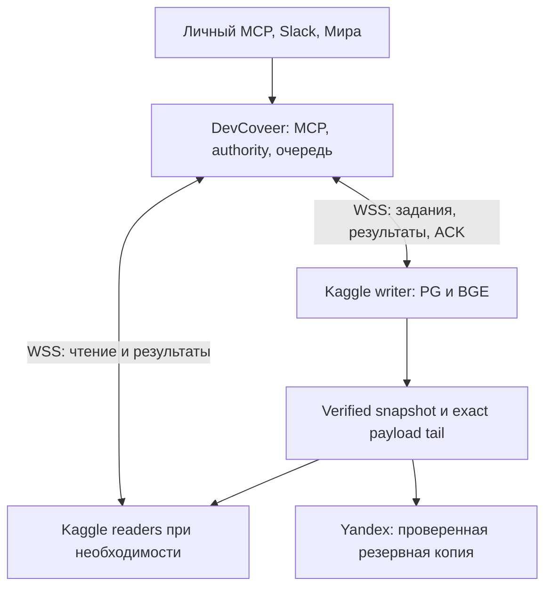

# Целевая архитектура RKB: Kaggle PostgreSQL/BGE и DevCoveer control

Дата: 2026-10-19. Статус: целевой дизайн для внедрения; проверенный исходный main `8799f8a01e63070f19fe4bea714777d1be9bbae6`. Этот документ не утверждает выполненного deploy.

**Самодостаточное задание кодовому агенту:** [rkb-scalable-kaggle-implementation-20261019.md](../prompts/rkb-scalable-kaggle-implementation-20261019.md). Оно содержит все инварианты, промпты и этапы; данный документ фиксирует архитектурное решение и причины.

## Решение

Рабочие corpus, lexical/vector search, source assertions, entities, stories, dates/observations и disagreement cases размещаются в одном PostgreSQL/pgvector в Kaggle. BGE-M3 — один embedding space, baseline 1024 FP32 и текущий input limit512 по pinned BGE tokenizer. E5 в target отсутствует. DevCoveer сохраняет существующий MCP/ASGI, BgeQueue/controller, durable user requests, identity/permissions, небольшую authority/command/delivery БД и recovery pointers.

Между notebook и DevCoveer устанавливается **прямая двусторонняя постоянная WSS связь**: notebook открывает исходящий authenticated socket к DevCoveer HTTPS/443, работа и результаты проходят по нему в обе стороны. Один dispatcher/queue/run attachment. PostgreSQL не публикуется наружу; публичный inbound endpoint notebook не нужен.

Это topology хранения и исполнения; внешняя доставка остаётся у существующих владельцев: VibePublish, PH, Street Story и Cartography. Snapshot/recovery tail — восстановительные данные, не второй онлайн-каталог книг.

## Почему именно так

| Исходная проблема | Решение | Ограничение |
|---|---|---|
| SQLite corpus + Supabase vectors + отдельный story-vector путь усложняют перенос и согласованность | Один PG domain store + pgvector, typed projections в общем BGE space | PG требует измерений WAL/index/temp/backup footprint; установка сама по себе не доказывает latency. |
| Ephemeral notebook нельзя считать единственным durable storage | Exact accepted command/payload до применения, consistent snapshot + tail | Daily backup не гарантирует RPO0 при потере DevCoveer control disk. |
| Polling transport и неверная классификация expired claim выключают прогретый worker | Outbound WSS, durable ACK/RESUME, typed stale_claim/revoked_run | WSS не ускоряет сам encode и не отменяет provider quotas. |
| Внутреннее status polling сохраняет SQL lock contention | Read без BEGIN IMMEDIATE, notify after commit, bounded cross-process reconciliation | Process-local Event не видит работу, добавленную другим процессом. |
| Model generation нельзя воспроизвести одним parser/source hash | Exact immutable accepted payload, frozen UUID/time/defaults и schema/codec | Large payload не помещать в SQLite BLOB; references должны быть реально durable. |
| Каждый кандидат превращается в Story, через неё сохраняются даты/числа | Source-bound facts независимо от Story + one research workflow с bounded compose | Фильтрация «сухих stories» до нового factual пути теряет функциональность. |
| Новый backend может сохранить поиск, но сломать доказательства/каналы | PG corpus adapter для source_proof; явный PH provider/result ACK; полный feature inventory | Existing code/doc или emulator result не равен production E2E. |

## Контрольные инварианты

1. Input ACK следует durable приёму, save ACK — сохранённой resolved command и применённому PG outcome. Socket send/Pong не является подтверждением application result.
2. Apply_seq назначается готовым resolved commands, не медленным исследованиям. Domain effects + applied_ops + непрерывный cursor находятся в одной PG transaction.
3. Старые новые submissions fenced по current writer/run/claim/connection generation; уже accepted commands прошлого epoch replay обязательны.
4. Canonical snapshot pointer и внешний sender проверяют authority вне notebook. Локальный epoch в потерявшем связь PG не предотвращает позднюю внешнюю публикацию.
5. Snapshot exact version/hash/WAL/internal watermark проверяется restore; читатели не обращаются к произвольному Dataset latest.
6. Yandex replacement сохраняет old+candidate до verification. Compaction ограничена самым старым retained verified watermark и незавершёнными consumers; TTL не удаляет подтверждённый хвост.
7. min_data_seq нужен для read-after-write/research; ordinary search сообщает data_as_of. Current revocation/source visibility/pixel/draft grants проверяются перед output/cache reuse/delayed delivery.
8. 30 минут useful idle от спроса, socket health, task claim и короткая writer lease независимы. Reconnect не выгружает BGE и не запускает новый notebook только ради сокета, пока Kaggle-сессия жива. Завершение notebook требует нового run/restore/warmup; постоянный WSS не сохраняет RAM завершённой сессии.
9. Одна очередь пользователя сохраняет canonical-person fairness, dialog order, stage permits и confirmed result/hash ACK. UNKNOWN одного диалога не блокирует остальных.
10. Source activation и persisted research frontier атомарны, но экспертное согласие/POI/map не блокируют accepted книгу.
11. Story, factual assertion, public Variant, independent case и private draft различаются. Даты/observations не зависят от художественной пригодности.
12. Text across active accepted books публичен в принятом владельцем смысле без owner book ACL; pixels/original/private drafts и writes имеют свой scope.

## Работа с историями

Принято сочетание улучшенного prompt/rendering и одной bounded compose стадии внутри existing persisted workflow. Stage сохраняет факты/даты/наблюдения и routing отдельно от создания Story; продолжение эпизода переживает границу страницы/чата. Existing angle, gaps, assertions/evidence/assessment и VariantBlock достаточно; новая фабрика и второй судья не нужны.

История — связное объяснимое событие, изменение, практика или вопрос с основаниями. Change/choice/consequence — полезные признаки, не универсальный запрет на everyday_life или спокойный рассказ. Ноль новых stories допустим; отсутствие готового variant не означает потерю полезного знания. Case contested не является степенью редакционной готовности.

Полные инструкции и source-grounded A/B приёмка находятся в §8 единого handoff. Ограниченная live выборка17 records/3dossiers и код подтверждают механизм, а не долю плохих историй во всём корпусе.

## Восстановление и границы надёжности

Physical pg_basebackup + required WAL — стартовый путь для быстрого restore с indexes; logical dump рассматривается при version upgrade с отдельным измерением rebuild. Секретная runtime configuration не попадает в corpus backup. Source/variant/private grants не делают закрытый recovery object общедоступным.

Рабочий notebook loss покрывается baseline+tail. Защита DevCoveer disk loss требует независимой копии свежих accepted commands/payloads или согласованного RPO. Пока нет ответа владельца, не рекламировать zero-loss; isolated implementation/probe не блокируется.

Kaggle остаётся средой с конечным notebook lifetime, quotas и возможными cold starts. Фактические limits и возможность долгого WSS проверить на целевом аккаунте. Один writer и readers по измеренному спросу проще избыточного кластера, но не дают обещания 24/7 доступности.

## Данные и интеграции

Миграция ограничена историческими/картографическими слоями, их identity/provenance и согласованными ручными зависимостями. Старые книги переимпортируются через MCP. Legacy anchors остаются historical/unanchored до exact source verification; не подсоединяются к новому изданию по названию/странице. Production layer identities создаются до свежих книг; rollback после target writes сохраняет новый tail.

Мира в PH — предпочтительный voice client. Adapter search-only требует реального resource-bound provider, расширенных typed bundles, pending/result/readback и ACK. Slack Kaliningrad Base — единственный пользовательский бот; Dot — заменяемый executor. RKB research needs связываются с PH tasks; публикацию/комментарии/модерацию VK выполняет VibePublish; физические POI и картографические интерпретации не дублируются.

## Проверка и источники

[Приёмка](../testing/rkb-scalable-kaggle-acceptance-20261019.md), [перенос](../migrations/rkb-layers-only-cutover-20261019.md), [сводный аудит](../reports/rkb-comprehensive-critical-audit-20261019.md), [полный Opus55](../reports/rkb-opus55-redesign-20261019.md), [story Opus55 с disposition](../reports/rkb-opus55-story-quality-20261019.md).

Технические основания: [pg_basebackup](https://www.postgresql.org/docs/current/app-pgbasebackup.html), [pgvector](https://github.com/pgvector/pgvector), [WebSocket keepalive](https://websockets.readthedocs.io/en/stable/topics/keepalive.html), [Starlette WebSockets](https://starlette.dev/websockets/), [Kaggle notebooks](https://www.kaggle.com/docs/notebooks). Исходный код и owner decisions закреплены ссылками в §17 handoff. Новая архитектура требует собственных измерений; historical report не превращается в новое PASS.
