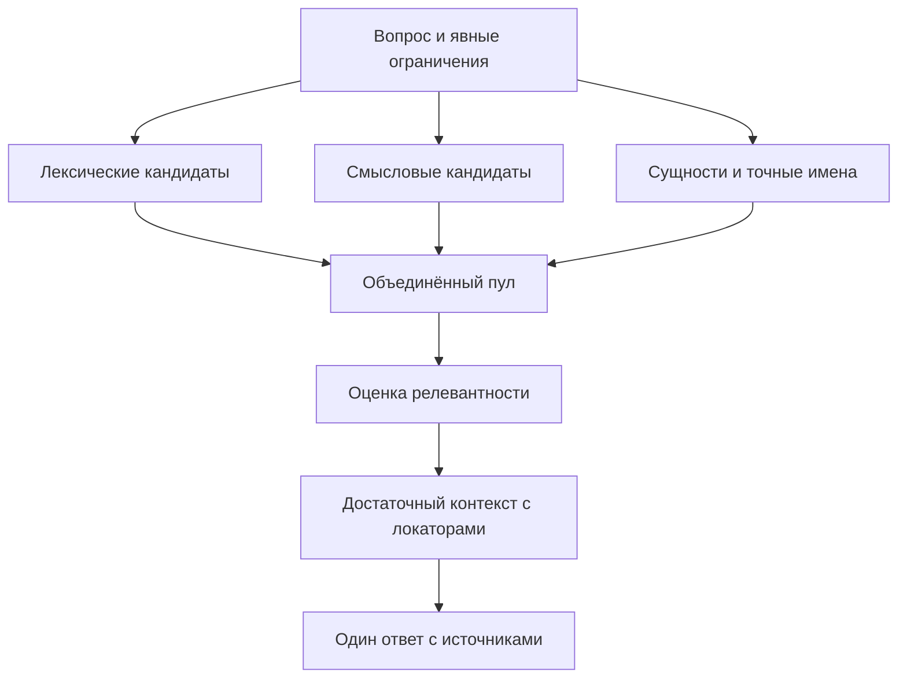

# Стратегия поиска по большим корпусам и двуязычной базе РКБ

**Дата исследования:** 26 октября 2026 года, Europe/Kaliningrad.  
**Назначение:** исследование мировой практики retrieval/RAG и рекомендации для русско-немецкого корпуса РКБ.  
**Статус:** docs-only; предложения и протокол экспериментов, без новых измерений качества или скорости на корпусе.  
**Проверенный исходный код:** [main@97dc0fcc1572082bb14ebf1e08b60c6f8fc93f8d](https://github.com/onedayonemasterpiece/regional-knowledge-base/tree/97dc0fcc1572082bb14ebf1e08b60c6f8fc93f8d). Версия исходников не доказывает версию работающего сервиса.  
**Основание ветки публикации:** свежий [main@3ed3b321b51eea216b5a444f694eac6f48f4fb0d](https://github.com/onedayonemasterpiece/regional-knowledge-base/tree/3ed3b321b51eea216b5a444f694eac6f48f4fb0d). Проверенная разница с исследованным снимком — PR508 о восстановлении Slack-очереди/доставки; поисковые SQL, fusion, лимиты и формат результата, на которых основаны выводы, не изменены.  
**Задание:** [исходный исследовательский промпт](https://github.com/onedayonemasterpiece/regional-knowledge-base/blob/docs/rkbans-search-research-prompt-20261026/docs/tasks/rkb-search-research-prompt-20261026.md); уточнение владельца: исследовать также мировую стратегию результативной поисковой выборки, шире текущих дефектов РКБ.

**Навигация:** [краткий ответ](#0-ответ-владельцу-в-десяти-строках) · [мировая стратегия](#2-как-в-мире-организуют-результативную-поисковую-выборку) · [история и текущий RKB](#3-что-уже-исследовали-и-что-действительно-исполняется-в-ркб) · [лексика и fusion](#4-лексика-и-fusion-точность-прежде-дополнительной-сложности) · [PostgreSQL](#5-postgresql-ранжирование-индексы-и-стоимость-масштаба) · [RU/DE](#6-русский-и-немецкий-что-реально-закрывает-межъязычный-разрыв) · [выдача и MCP](#7-сколько-результатов-отдавать-и-что-должна-видеть-модель) · [chunking](#8-фрагменты-структура-книги-и-достаточный-контекст) · [reranking](#9-реранкеры-learned-sparse-и-colbert) · [протокол оценки](#10-протокол-честной-офлайн-оценки) · [план изменений](#11-минимальный-путь-шесть-возможных-изменений-без-обязательного-набора-всех-шести) · [внешние источники](#13-аннотированный-реестр-внешних-источников) · [код и прежние исследования](#14-источники-в-репозитории-и-точные-точки-кода).

## 0. Ответ владельцу в десяти строках

1. Наиболее обоснованный путь для РКБ — сохранить PostgreSQL и BGE-M3, улучшить отбор свидетельств и сравнивать варианты на одной офлайн-копии корпуса.
2. В рассмотренных работах результативный поиск строится из разных обязанностей: полнота кандидатов, точное ранжирование, достаточность контекста и проверяемая ссылка на источник.
3. Русский вопрос по немецкой книге — отдельная задача; русский и немецкий стеммеры её не решают, а общий многоязычный рейтинг модели её не доказывает.
4. OR сам по себе допустим в ranked retrieval; после его включения в РКБ сообщалось о регрессии, а роль шумной лексики, равного RRF и top-3 требует разделённой проверки.
5. Нужны независимые dense- и lexical-кандидаты и использование уже сохранённых точных алиасов; число веток само по себе не является улучшением.
6. Первое окно для сравнения — десять поисковых результатов с различимыми заголовками и локаторами; один короткий ответ пользователю не требует читать только три фрагмента.
7. Для хронологий, подписей и словарных статей полезнее сохранить предметный контекст при импорте, чем добавлять всё новые поисковые проходы.
8. BM25 внутри PG17 реален; pg_textsearch и pg_search заслуживают сравнения, но требуют проверки языков, установки, памяти и восстановления в Kaggle.
9. Реранкер, перевод всего корпуса, sparse/ColBERT и генеративное расширение запросов — условные кандидаты после дешёвых исправлений, с измерением их собственного вклада.
10. Первые действия: восстановить эталон и диагностический baseline; согласовать полноту выдачи; подключить существующие алиасы и выбрать lexical/fusion по удержанным вопросам.

Это вывод исследования и рекомендуемый порядок, а не объявление внедрённого улучшения. Доказательства, границы применимости и различающие проверки приведены ниже.

## 1. Покрытие исследования и правила чтения результатов

Исследованы официальные документы PostgreSQL, pgvector и поисковых расширений; авторские инженерные руководства; научные статьи; модельные карточки и код; первичные обсуждения ошибок у разработчиков; прежние документы и история pull request РКБ. Для исторических решений использованы GitHub API, неизменяемые версии файлов и PR, включая неслитые работы. Локальный полный git log не выдаётся за выполненную проверку.

Поиск не ограничивался регионом. В выборку вошли работы BAAI/USTC из Китая, Waterloo из Канады, Stanford и других американских команд, NAVER Labs Europe из Франции, Unicamp из Бразилии, TU Darmstadt и deepset из Германии, Edinburgh из Великобритании, NUS из Сингапура, TII/MBZUAI из ОАЭ, Melbourne/Queensland из Австралии, dbi services из Швейцарии, Postgres Professional из России, а также международных команд. Их страны не служат оценкой качества. Большая часть научных первоисточников опубликована по-английски; рассмотрены также русские материалы, немецкая языковая специфика и китайское обсуждение BGE. Связь конкретной работы с выводом указана в реестре источников.

**Уровни доказательств:**

- **Код:** механизм установлен в указанной версии; частота его влияния на пользователей может быть неизвестна.
- **Старый замер РКБ:** результат сохранённого отчёта с его корпусом, знаменателем и ограничениями. Повторного прогона здесь нет.
- **Внешний эксперимент:** результат авторов на их данных; не прогноз процентов или миллисекунд для РКБ.
- **Документация:** заявленное поведение определённой версии; совместимость с конкретным Kaggle отдельно не установлена.
- **Предложение:** собственный вывод из сопоставления источников, требующий указанной проверки.

Первичные issue полезны как сообщения авторов и пользователей; воспроизводимость оценивается по наличию версии, условий и примера. Закрытый issue не обязательно означает реализованную функцию, открытый issue не доказывает дефект всех версий. Рекламные сравнения поставщиков не используются как независимый выбор победителя. В реестр включены применимые источники, а не все найденные страницы.

### 1.1. Что именно оптимизируется

Для пользователя РКБ результат — содержательный ответ с подходящим свидетельством из источника. Для поисковой системы это несколько разных целей:

| Уровень | Что считается успехом | Что не является достаточным доказательством |
|---|---|---|
| Покрытие данных | Искомый факт действительно есть в принятом и индексируемом тексте | Книга видна в каталоге; число векторов совпало с числом записей |
| Набор кандидатов | Хотя бы одно достаточное свидетельство попало в объединённый пул | Нашлась та же книга или тематически похожий абзац |
| Ранжирование | Нужные свидетельства оказались в доступном модели окне | Высокая cosine similarity или RRF score |
| Выбор контекста | Сохранены субъект, дата, условия, оговорки, необходимые части ответа | Один подходящий фрагмент при вопросе из нескольких частей |
| Ответ и цитирование | Ответ следует из прочитанного, ссылка ведёт к правильному месту | Модель сообщила общеизвестный правильный факт по своей памяти |
| Эксплуатация | Качество и задержка сохраняются под обычной конкурентной работой и после восстановления | Быстрый одиночный тёплый запрос без импорта |

Разделение retrieval и generation поддержано систематическим сравнением BERGEN и исследованием достаточности контекста. Последнее показывает, почему нужно различать отсутствующее доказательство и ошибку модели при уже достаточном контексте; обязательный дополнительный LLM-судья в рабочем запросе из этого не следует. [G02] [G03]

## 2. Как в мире организуют результативную поисковую выборку

### 2.1. Устойчивый шаблон: разные представления, ограниченный общий пул, выбор доказательств

Рассмотренные системы и исследования сходятся на полезном разделении: дешёвый широкий поиск должен иметь высокий recall; более дорогая оценка работает с ограниченными кандидатами; конечный контекст собирается для ответа на конкретный вопрос. Это схема обязанностей, а не требование ставить отдельный сервис на каждый этап. BEIR показывает одновременно силу BM25 как базового метода и цену более точных reranking/late-interaction подходов. Инженерный пример Supabase помещает объединение lexical/dense в обычный SQL; Vespa подробно объясняет разделение ranking phases. [M6] [P11] [P33]

**Главная инженерная развилка:** объединять независимые пулы или сначала отфильтровать всё лексикой. Если semantic score вычисляется только для строк, уже найденных полнотекстовым поиском, русский вопрос не получит немецкий фрагмент, отсутствующий в lexical pool. Это логическое ограничение такого конвейера. Dense и lexical должны иметь возможность независимо внести кандидата, если обе способности нужны продукту. [P34]

Есть также два разных OR: объединение терминов внутри одного lexical-запроса и объединение результатов разных методов. Они решают разные задачи. В ranked lexical retrieval широкое совпадение допустимо при подходящем скоринге; в hybrid retrieval объединение позволяет одному методу компенсировать слепую зону другого. [P25] [P30] [P31]

### 2.2. Семейства методов и область их полезности

| Метод | Что умеет хорошо | Главная слабость или цена | Вывод для стратегии |
|---|---|---|---|
| Лексический поиск с BM25/BM25F | Имена, термины, числа; прозрачное влияние редкости и полей | Синонимы, другой язык, ошибочная токенизация | Сильный baseline; analyser столь же важен, как формула |
| Dense bi-encoder + ANN | Перефразирование и смысловая близость; при подходящей модели — разные языки | Редкие имена, точные числа, отрицания, тематически близкие ложные ответы | Независимый источник кандидатов; сравнивать ANN с exact |
| Learned sparse, например SPLADE | Сочетает обученные веса/расширение с разреженным поиском | Обучение, словарь, индекс и языковая переносимость | Это отдельное представление, а не просто новый вес BM25 |
| Late interaction / ColBERT | Сравнение на уровне токенов лучше сохраняет локальные совпадения | Память и усложнение индекса | Полезно при доказанном выигрыше; не бесплатная настройка dense |
| Cross-encoder | Совместная оценка пары «вопрос–фрагмент», способная улучшить precision | Стоимость каждого кандидата, конкуренция за ускоритель | Применять после достаточно полного первого этапа |
| Точное entity/alias-сопоставление | Исторические названия и проверенные варианты имени | Неоднозначные объекты; одно имя не отвечает на весь вопрос | Использовать идентичность и связи с источником, не общий словарь догадок |
| Структурированные фильтры | Автор, книга, период, тип материала при явном запросе | Ошибочный фильтр навсегда убирает правильное свидетельство | Явное ограничение отделять от простого упоминания |
| Parent–child / соседний контекст | Поиск по компактной единице и чтение достаточного окружения | Излишний контекст и потеря границ при грубой склейке | Разделять размер поиска и размер чтения |

Основания по семействам: BM25/BM25F [P30], SPLADE [G04], ColBERT/ColBERTv2 [M22] [M23], cross-encoder [M17], parent–child/window [M11] [M12]. Таблица — сравнительный вывод, не утверждение, что все компоненты нужно внедрить вместе.

### 2.3. Информационная потребность определяет выборку

**Факт или дата** требует точного короткого свидетельства и его контекста. **Объяснение причины** требует связанного рассуждения источника. **Сравнение нескольких авторов** требует покрытия разных позиций. **Обзор всего корпуса** требует агрегирования и тематического охвата. Одна фиксированная глубина выдачи не гарантирует достаточного покрытия всех этих задач.

Для диалога важно разрешать отсылки: «а когда он вернулся?» нельзя надёжно искать без понимания «он». QReCC исследует именно переформулирование контекстного вопроса в самостоятельный. В РКБ это естественная работа уже отвечающей модели-клиента; источник результата должен оставаться проверяемым, а история диалога не должна превращаться в длинный мешок поисковых слов. [M25]

Явное «только в книге X» — фильтр. Упоминание книги X как сравнения или ошибочная предпосылка — не основание исключать остальные источники. В старом stress-тесте РКБ постороннее название книги в запросе существенно ухудшало поиск; поэтому эту ошибку нужно включить в контрольные вопросы, а не решать безусловным boost любого совпавшего названия. [R07]

### 2.4. Query expansion, многошаговый поиск и иерархии

Эти подходы входят в мировой обзор, но не образуют автоматический план внедрения:

| Подход | Доказанная идея | Как проверять и почему не включать безусловно |
|---|---|---|
| HyDE | Сгенерированный гипотетический документ используется как поисковое представление | Генерация может навязать ложную предпосылку; искать и цитировать нужно реальные документы. Есть дополнительная задержка. [G05] |
| Query2doc / генеративное расширение | Псевдодокумент добавляет терминологию и контекст к запросу | Сохранять исходный запрос и мерить потери. Сравнительное исследование 11 техник, 12 наборов и 24 retrievers показывает, что расширение может ухудшать сильные модели. [G06] [G07] |
| Несколько формулировок / языков | Разные формулировки могут открыть разные кандидаты | Считать бюджет всех вызовов; не награждать документ многократно только за одинаковые перефразировки. Это эксперимент, а не обязательный fan-out. |
| Итеративный поиск | Новый вопрос возникает из действительно прочитанного материала | Уместен для исследования и недостающей части ответа; число шагов и время до полезного ответа нужно измерять отдельно от latency одного search. |
| RAPTOR | Иерархия кластеров и резюме помогает получать сведения на разных уровнях обобщения | Резюме — производное представление, не первоисточник; требуются построение и обслуживание. Не первый ответ на пропавшую дату. [G08] |
| GraphRAG | Графовые сообщества/резюме предназначены в том числе для глобальных вопросов о коллекции | Показанный выигрыш на query-focused summarization не переносится автоматически на точное нахождение строки книги. Существующий граф РКБ не требует нового GraphRAG-сервиса. [G09] |
| Late chunking | Контекстные token states вычисляются до разделения на chunk embeddings | Меняет способ получения вектора; не эквивалентно простому увеличению окна и не является готовой настройкой нынешнего BGE-контракта. [M15] |

Для сложных вопросов нужно оценивать покрытие отдельных аспектов, а не только один найденный документ. BRIGHT показывает, что задачи с необходимостью рассуждения плохо описываются рейтингами обычного semantic retrieval. Это полезный класс испытаний, но не основание менять BGE-M3 без задачи и собственного сравнения. [G10]

### 2.5. Выбор контекста после ранжирования

После отбора релевантных кандидатов требуется убрать повтор одного и того же свидетельства, сохранить дополняющие фрагменты и не потерять противоречащие источники. Классический MMR явно сочетает relevance и новизну; его разумно рассматривать только после проверки качества кандидатов. Жёсткая квота «один фрагмент на книгу» или «половина русских, половина немецких» не следует из MMR и может лишить ответ необходимого контекста. [G11]

Больший контекст также не гарантирует лучшего ответа: работы о lost-in-the-middle и достаточном контексте показывают зависимость от положения и полезности доказательств. Поэтому увеличенное поисковое окно и объём текста, реально переданный для генерации, нужно выбирать отдельно. Исторические результаты на конкретных LLM не являются оценкой нынешней модели-клиента. [G12] [G03]

### 2.6. Что меняется при росте корпуса

При росте важно не только число фрагментов. Меняются частоты терминов, доля похожих документов, языковой состав, избирательность фильтров, объём индекса в памяти и стоимость обновления. Это параметры экспериментального профиля, а не повод заранее строить распределённый поисковый сервис.

| Масштаб/условие | Что разумно проверить первым | Что не следует из одного размера |
|---|---|---|
| Тысячи фрагментов | Exact dense в PG как контроль, ошибки данных и ranking | Необходимость сжатия или шардирования |
| Десятки тысяч — около 100 тыс. | HNSW recall, частые lexical-запросы, фильтры, память, конкурентный импорт | Нужность отдельной поисковой БД |
| Существенно больше; миллионы и выше | Top-K pruning, рабочий набор памяти, update/VACUUM, стоимость восстановления и реальные планы | Что фиксированный ef_search или один индекс останется оптимальным |
| Узкая выборка по книге/периоду | Exact по подмножеству против filtered ANN | Что глобальный ANN всегда быстрее |
| Широкий OR на частых термах | Число реально оцениваемых строк и ordered BM25 index | Что внешний LIMIT ограничил всю внутреннюю работу |

WAND/Block-Max WAND используют верхние границы вклада терминов и блоков, чтобы не вычислять полный score заведомо проигрывающих кандидатов. Это отличается от произвольного отсечения первых N совпадений: при корректных границах и точном режиме можно сохранить lexical top-K. Возможность конкретного расширения, фильтров и SQL-плана проверяется отдельно. [P31] [P32]

## 3. Что уже исследовали и что действительно исполняется в РКБ

### 3.1. Найденные прежние исследования

Документация проекта действительно содержит значительный исследовательский задел. Его нельзя свести к последнему решению от 23 октября. Ниже — результаты из сохранённых отчётов; это не повторные измерения и не утверждение о нынешнем корпусе.

| Работа | Что было установлено тогда | Как использовать сейчас |
|---|---|---|
| Архитектура, 2 октября | Ранний замысел связанного хранения источников, фрагментов и происхождения | Сохранить требования к доказательству; старую инфраструктуру не переносить обратно. [R01] |
| Benchmark evidence, 4 октября | Сохранены материалы эксперимента из закрытого без слияния PR #26 | Отчёт доступен и полезен, но закрытый PR не означает реализованный продукт. [R02] |
| Retrieval validation follow-up, 4 октября | 32 новых вопроса: 20 answerable, 10 negative, 2 source gaps. Размечены 134 из 957 pooled pairs; 823 не размечены, top-10 coverage 32,5% | Неразмеченные результаты нельзя объявлять нерелевантными; полные Precision/nDCG из этой разметки не следуют. Все 32 полных естественных вопроса дали пустую тогдашнюю lexical-ветку. [R03] |
| Multilingual hybrid acceptance, 4 октября | 747 фрагментов: 712 RU и 35 настоящих DE. 40 запросов, 38 answerable, 16 связанных информационных потребностей | Полезная двуязычная контрольная выборка, но мало немецких фрагментов и зависимые формулировки. [R04] |
| Multilingual POI decision, 4 октября | Разобраны исторические имена, неоднозначность объектов, пары языков, связь ответа с оригиналом | Основа для alias/entity проверки и разметки, не таблица универсальных переводов. [R05] |
| Vector-only chunk audit, 5 октября | 64 запроса, 32 семейства фактов, dev/holdout по 16 семейств; exact dense на сохранённых векторах, одинаковый бюджет контекста | Сравнение размера фрагмента лучше подготовлено, чем диагностика по нескольким примерам. Повторить на актуальном импорте, сохранив разделение семейств. [R06] |
| Expanded retrieval stress, 8 октября | 32 семейства, 64 исходных RU/DE-запроса, шесть вариантов каждого: 384 запроса; отдельно 24 negative и 20 boundary pairs | Готовая основа проверки перефразировок, посторонних слов и границ фрагмента. 384 варианта не являются 384 независимыми фактами. [R07] |
| Postdeploy acceptance, 16 октября | В диагностических шести вопросах Hit@8 = 6/6, Hit@5 = 4/6; два нужных места были на восьмой позиции и зависели от соседнего контекста | Практический аргумент проверить K>5; шесть вопросов не выбирают оптимальный K для всего корпуса. [R08] |
| Crosslanguage decision, 23 октября | Сопоставлены шесть направлений: multilingual dense, запросы/переводы, aliases, sparse, reranking и др.; локальные held-out сравнения отмечены NOT RUN | Хорошее дерево гипотез, но не подтверждённый победитель и не доказательство необходимости перевести весь импорт. [R09] |
| Answer modes, PR #408 | В открытом неслитом документе сформулированы один ответ, различение отсутствия опоры и недоступности, корректное цитирование | Полезный продуктовый ориентир; не выдавать за внедрённое поведение main. [R11] |

**Числа, которые важно сохранить с правильными знаменателями.** В работе 4 октября по 38 answerable queries сообщён Recall@10 относительно известных положительных qrels: BGE — 77,63%, BGE+lexical — 82,89%, E5+BGE+lexical — 67,11%. Это не Hit@10. Для 30 естественных вопросов lexical был пуст; пользу лексики нельзя приписать всем формулировкам. Assisted-опыт с вручную проверенными, привязанными к конкретному случаю алиасами дал Recall@10 = 100% и Recall@5 = 93,42%; он показывает потенциал устранения identity misses, но не качество автоматического alias retrieval. [R04]

В held-out части chunk audit было 32 запроса. BGE с текущими тогда фрагментами и с вариантом около 256 токенов: Hit@5 **24/32 → 28/32**, Hit@10 **27/32 → 29/32**, покрытие контекста при фиксированном бюджете 5000 символов **22/32 → 29/32**. В отдельном срезе 24 русских запросов по немецким источникам: E5 — 1/24, укороченный E5 — 3/24, BGE — 20/24, E5+BGE — 11/24. Это собственное старое свидетельство РКБ в пользу BGE, а не основание возвращать вторую embedding-модель. Ограничения: прежний snapshot, exact vectors, небольшой набор. [R06]

В stress-отчёте на 384 вариантах frozen FP32 vectors Hit@5 = 64,32%, Hit@10 = 73,18%; на 64 исходных — 73,44% и 78,13%. Добавление постороннего названия книги снижало результат до 34,38% и 51,56%. У 20 пар на границе фрагментов хотя бы одна сторона находилась в top-5 в 17 случаях, обе — в восьми. Частичный live INT8-проход 128/384 с восемью ошибками нельзя объединять с результатами frozen FP32. Сравнение тогдашних двух и трёх книг не изменило ранги: объяснение «всё испортила третья книга» этим опытом не подтверждено. [R07]

### 3.2. Инвентаризация: раньше, целевая схема, актуальный код

Основная нормативная точка — handoff от 19 октября: три независимые ветки dense/lexical/exact alias, не больше 200 кандидатов основной ветки и 50 alias candidates, затем ограниченное объединение и одна загрузка текста; исходный FP32 BGE-контракт и PostgreSQL. Наличие этой схемы в документе не означает её полного исполнения. [R10]

| Компонент / зачем | Было до Kaggle-переноса | Требует ТЗ / граница | Проверенный main 26 октября |
|---|---|---|---|
| Dense: смысл и RU↔DE | BGE и E5, несколько старых путей | Только BGE-M3, 1024 FP32, PG; удаление E5 обоснованно | Глобальный nearest-neighbor SQL; candidate depth 100, максимум 200. [C01] [C03] |
| Lexical: слова, имена, числа | `simple` FTS и SQLite FTS5 в разных путях | GIN, соответствующая языку конфигурация; качество проверять | 040: AND-capable `websearch_to_tsquery`; per-row config, `ts_rank_cd` без normalization. [C02] |
| BM25 / IDF: информативность терминов | SQLite FTS5 BM25; старый стресс-тест | PG rank не объявлять эквивалентом BM25 | В native passage ranking нет BM25/IDF. [R06] [C01] [C02] [C24] |
| Fusion: объединение свидетельств | RRF и диагностика веток | Ограниченное объединение, затем один hydrate | Равный RRF, константа 60; разрывы scores отброшены. [C01] |
| Перекрытие вычислений | Старые удалённые вызовы имели другую цену | Независимые ветки в общем deadline | Lexical SQL перекрывает encode; dense SQL следует после вектора, не второй concurrent SQL. [C01] |
| Exact aliases / entities: имена | Caller aliases, затем автоматические stored graph aliases в PR59 | Независимая indexed alias-ветка ≤50 | Таблицы/индексы есть; passage path их не использует, supplied aliases отклоняет. [C08] [C09] [C21] |
| Fuzzy / pg_trgm: ошибки написания | Обязательного общего fuzzy-контракта не установлено | Только при доказанной нужде, прежде всего имена | В native passage path не вызывается; live extension inventory не проверен. [C01] [R10] |
| Scope: явные книги и язык | Старое перечисление ID корпуса создавало лишнюю цену | Server-side constraints, отдельные языковые срезы | `document_ids` → `source_ids`; wire `source_ids/kinds`, без language. Scoped dense — exact по подмножеству. [C04] [C05] [C08] |
| Окно выдачи: доступ к evidence | Default 8, max 20; полезные места бывали на позиции 8 | Bounded top-K; универсальное обоснование 3 не найдено | Default 3, max 5; cap также в SQL hydrate. [R08] [C01] [C06] [C07] [C25] |
| Search payload: выбор до fetch | Отсутствие snippet было прежней слабостью | Различимое место и проверяемое происхождение | ID, название книги, URN; body/locator уже доступны внутри пути. [C10] [C11] [C17] |
| Соседний контекст: связность | Bounded same-page supplement, PR123, проверка 16 октября | Сохранить достаточность источника без лишней сложности | Автоматического neighbor supplement в ranked path нет; same-passage continuation и page `fetch_chunks` — другие операции. [R08] [C01] [C08] [C10] |
| Fetch / evidence: прочитать оригинал | Чтение исходного места | Точный текст, locator и происхождение | `fetch` даёт текст/citation/continuation; `knowledge_search` — evidence-текст. [C10] |
| Sparse / multi-vector BGE | Предмет исследования; production presence не установлено | Только условный сравнительный опыт | В исполняемом passage path нет. [C01] [R09] |
| Reranker: порядок кандидатов | Обязательная модель не подтверждена | После доказанного ranking gap и оценки цены | В исполняемом passage path нет. [C01] [R09] |

`language` в схеме не ограничен тремя строковыми значениями: миграция 027 расширяет допустимые значения; используемые FTS-конфигурации остаются Russian/German с simple fallback. Поэтому формулировка «в PG уже есть любой нужный языковой анализатор» была бы неверной. [C12]

**Граница наблюдения.** Во время подготовки отчёта в координационной ветке появились сообщения о пробе смешанного RU+DE-запроса и о применении 040 в runtime. Это сообщения исполнителей, а не выполненное здесь чтение живой БД. Малые серии «5 из 6» и «1 из 8» с разными знаменателями не дают парного сравнения одного набора. Фиксация main и snapshot перед экспериментом остаётся необходимой; исследовательская рекомендация не блокирует согласованное владельцем изменение инструкции модели.

### 3.3. Два конкретных пробела, которые нельзя потерять среди новых идей

**Точные алиасы уже имеют место хранения.** В `rkb_v4.source_entity_aliases` сохранены нормализованное значение и hash; есть B-tree `(normalized_sha256, entity_id, source_id)`. В проекте уже используется нормализация NFKC + casefold + сжатие пробелов. В графе есть язык, тип, время, происхождение и связи с evidence; не все эти свойства обеспечены отдельными SQL-индексами. Следует использовать существующую идентичность и проекцию, а не создавать новый реестр переводов или менять нормализацию на произвольный `lower()`. Покрытие алиасами актуального корпуса здесь не измерено. [C09] [C13] [C16]

`entity_list` с source-scoped substring matching JSON не заменяет глобальное exact alias retrieval. Точное совпадение с именем должно вести к связанным passages и применимому источнику/периоду; неоднозначность сохраняется. Совпадение «Кёнигсберг» не доказывает, что абзац отвечает на вопрос о конкретном событии. [C14]

**Acceptance-наблюдатель не может полноценно загрузить top-10.** Acceptance path запрашивает dense-10, lexical-10 и fused-10 и собирает их ID, но затем использует обычный hydrate. В SQL сохраняется cap 5, а тестовый mock возвращает все запрошенные строки. Изученные миграции 001–040 не заменяют этот cap. При union более пяти код должен явно завершиться ошибкой `acceptance rank hydration incomplete`, а не молча выдать неполную диагностику за корректный @10. Следовательно, прежде чем доверять новому measured Hit@10/union coverage, нужен один содержательный тест на настоящей изолированной PG: запросить более пяти уникальных ожидаемых ID и проверить полноту диагностики. Это обнаруженная по коду несовместимость наблюдателя и SQL, а не объявление неверными всех старых отчётов, полученных другими путями. [C01] [C06] [C15]

## 4. Лексика и fusion: точность прежде дополнительной сложности

### 4.1. Почему AND и OR нельзя выбирать лозунгом

AND требует совместного присутствия нормализованных терминов. Он полезен для осмысленно составленного короткого запроса, но часто обнуляет ветку на длинном вопросе. OR расширяет множество совпадений и может повысить recall; без адекватного ранжирования полнота именно top-K способна упасть из-за общих слов. Это два разных компромисса. История РКБ подтверждает проблему пустого lexical на естественных вопросах, но не доказывает, что произвольный широкий OR полезен. [P01] [R03] [R04]

Для русско-немецкой строки особенно опасно требовать AND сразу между словами обоих языков: монолингвальный немецкий фрагмент может содержать точный ответ и не содержать русскую часть запроса. Смена инструкции модели должна проверяться вместе с конкретной семантикой SQL. Сравнивать следует исходный RU dense, отдельную осмысленную DE lexical formulation и смешанную строку как разные конфигурации, а не считать их эквивалентными.

**Минимальный эксперимент с lexical:** сохранить точную/фразовую возможность для имён; сравнить нынешний AND с ranked OR или ограниченным покрытием информативных терминов; проверить оригинальные имена, даты и ключевые слова. Не вводить универсальное правило «должны совпасть хотя бы два слова»: один редкий термин может быть лучшим запросом. Не превращать частое в одной книге слово в глобальное стоп-слово. Эти правила — проектные гипотезы, параметры выбираются на dev, не на четырёх публичных примерах.

### 4.2. `ts_rank_cd` не BM25

Штатный PG cover-density rank использует локальную информацию и позиции, но не corpus-wide document frequencies. BM25 учитывает редкость терма, насыщение term frequency и нормализацию длины; BM25F дополнительно моделирует поля. Это делает BM25 содержательным кандидатом для частых OR-запросов, но не устраняет ошибки языка, OCR или выбора фрагмента. [P01] [P30]

Флаги normalization `1/2` и `8/16` меняют влияние длины/числа уникальных слов; они не добавляют IDF. Флаг `32` делает монотонное преобразование `r/(r+1)`: порядок не меняется. Если fusion использует только позиции, такой флаг сам по себе вообще не меняет вклад lexical в RRF. Это вывод из формулы и текущего кода. [P01] [C01]

`ts_stat` полезен для офлайн-проверки частот и обнаружения перекоса корпуса. Строить из него production IDF означает поддерживать согласованные N/df при импорте, удалении, замене фрагментов и конфигураций. Это отдельная обязанность; запуск полного `ts_stat` в каждом поиске неприемлем как предлагаемая оптимизация. Сначала сравнить простой штатный вариант и готовый BM25-индекс. [P04]

### 4.3. RRF: удобная исходная точка, а не универсальная формула

Для веток i используется:

$$
\operatorname{RRF}(d)=\sum_{i:d\in L_i}\frac{w_i}{c+r_i(d)}.
$$

Здесь `r_i` — позиция документа, `c` — сглаживающая константа, `w_i` — вес ветки. В нынешнем коде `c=60`, веса равны. Оригинальная работа выбрала 60 в пилотном опыте; это не оптимум, доказанный для RU↔DE. Более поздний анализ показывает чувствительность RRF к параметрам и конкурентоспособность нормализованной convex combination (CC); победитель для РКБ ещё не измерен. [P09] [P10]

**Собственный арифметический пример, не замер:** dense-only кандидат на месте 1 получает `1/61 ≈ 0,01639`; документ на местах 20 в обеих ветках получает `2/80 = 0,025`; даже места 60+60 дают `2/120 ≈ 0,01667`. Следовательно, согласие двух слабых позиций может обогнать лучший результат одной ветки. Когда только dense умеет связать русский вопрос с немецким текстом, это возможный механизм вытеснения. Для фактического диагноза нужны сохранённые ranks конкретных кандидатов.

Нынешний RRF, weighted RRF и одну простую normalized CC сравнивать на **одном и том же union pool**. Dense-only остаётся исходным dense-списком; если пересчитать dense scores для lexical-only членов union, это отдельный вариант dense-rerank union, уже использующий lexical retrieval. Для CC фиксируются направление score, нормализация, обработка отсутствующего кандидата и одинаковых значений. Cosine distance и отрицательный BM25 distance некоторых расширений нельзя складывать как одинаково направленные similarities. Min-max по узкому top-L способен раздувать незначительный разрыв; отсутствие в усечённой ветке не является измеренным нулём релевантности.

Глубина каждой ветки, финальное K и константа RRF — три отдельных параметра. Несколько переводов одного запроса следует объединять внутри соответствующего представления до fusion: иначе документ получает дополнительные голоса просто за число похожих формулировок. Alias и lexical также могут быть сильно коррелированы; третья ветка не обязана получать тот же вес. Небольшой поиск параметров на dev достаточен для первой проверки; отдельный обучаемый калибратор пока не обоснован.

## 5. PostgreSQL: ранжирование, индексы и стоимость масштаба

### 5.1. Сначала отделить качество ANN от качества модели

Для small/medium snapshot эталон — exact nearest neighbors **в PostgreSQL по тем же FP32 vectors и тем же ограничениям**. Сравнение с HNSW отвечает на вопрос, теряет ли индекс хороших для данного embedding кандидатов. Сравнение обоих с qrels отвечает уже на другой вопрос — достаточно ли хорош embedding. Высокий ANN recall не доказывает содержательную релевантность. [P12]

Текущий код задаёт `ef_search=100`, `iterative_scan=strict_order`, `max_scan_tuples=1000`. `strict_order` упорядочивает найденные результаты, но не делает ANN точным. Filtered ANN может прочитать кандидатов, затем исключить их по фильтру; iterative scan ограничен своими ресурсами. В RKB отдельно существует scoped exact path. Поэтому нужны реальные планы для global, одной небольшой книги и большого набора источников, а не общее заключение «у нас везде HNSW». [P06] [P12] [C01] [C04]

Индексируемая форма global dense в проверенном SQL уже использует прямой distance operator в `ORDER BY ... ASC LIMIT`. Нельзя менять её на красивое выражение similarity и предполагать сохранение того же index scan. Частичные индексы или разбиение по языкам/книгам рассматриваются лишь при доказанной избирательности и цене; многие мелкие индексы увеличивают обслуживание. [P06] [C03]

**Версия имеет значение.** В changelog pgvector 0.8.3 указано исправление возможной HNSW corruption при VACUUM, в 0.8.4 — дополнительные исправления vacuum/insertion. Для закреплённого 0.8.2 это причина отдельно проверить стабильный 0.8.x в изолированной копии, с восстановлением и сравнением exact/ANN. Наличие исправления не доказывает повреждение текущей базы и не устанавливает причину спорных ответов. [P07]

### 5.2. Что может тормозить lexical

GIN ускоряет поиск совпадающих лексем. Он не превращает последующий `ts_rank_cd` в индекс, сразу возвращающий лучший ranked top-K. При широком OR стоимость может определяться числом совпавших строк, чтением их vectors и сортировкой. Внешний `LIMIT 100` сам по себе не ограничивает эту работу ста строками. Это ключевое отличие «есть полнотекстовый индекс» от «есть эффективное top-K execution». [P03] [P11]

Офлайн-проверка `EXPLAIN (ANALYZE, BUFFERS)` должна смотреть actual rows, rechecks, loops, sort/spill, чтение buffers и применённые условия; планировать по реальным параметрам редких и частых запросов. Сам `ANALYZE` исполняет запрос, поэтому этот отчёт его не запускает. Диагностические планы нужны для существующих SQL, а не для новой системы наблюдения. [P28]

Производительность нужно оценивать при принятом импорте/обновлении и восстановлении, а не только после создания пустого индекса. По мере роста важны цена вставок, VACUUM, размер рабочего набора, WAL/checkpoint и время возврата в рабочее состояние. Решение «добавить cache» преждевременно, если неизвестно, доминирует ли embedding, очередь, SQL или передача результата. Для нового cache пришлось бы определять scope, revision и invalidation; это не бесплатное ускорение.

### 5.3. BM25 и соседние варианты внутри PG17

Состояние ниже проверено 26 октября 2026 года. Наличие релиза для PG17 не означает проверенную установку в текущем Kaggle, ABI-совместимость или воспроизводимый Saved Dataset.

| Вариант | Что даёт | Цена и ограничения | Приоритет для RKB |
|---|---|---|---|
| Native FTS + GIN + `ts_rank_cd` | Минимум зависимостей, нынешние RU/DE-конфигурации, фразы/позиции | Нет штатного IDF/BM25; широкий match может потребовать много scoring | Обязательный контроль, сначала устранить ошибки query и fusion. [P01] [P03] |
| **pg_textsearch 1.5.1**, 2 октября 2026 | BM25, native PG configurations, Block-Max WAND; PG17/18; PostgreSQL license | C extension, preload/restart; shared cache, по умолчанию бюджет 2 GB; compaction влияет на writer. Boolean `@@` + BM25 ORDER BY пока не объединены в один оптимизированный index scan | Первый ограниченный BM25-кандидат: ближе к текущему языковому анализу. Отдельно проверить partial language indexes, фильтры и restore. [P13] [P14] [P15] |
| **ParadeDB pg_search 0.26.3**, 22 октября 2026 | BM25 и развитый поиск/аналитика через собственный индекс; есть PG17 packages | Rust/pgrx, preload, собственные tokenizers; Community AGPLv3. С 0.25 требуется pgvector; пример разработки с 0.8.6 не доказывает совместимость с RKB 0.8.2 | Второй кандидат, если нужен его функционал и принята цена. Проверить RU/DE отдельно, а не только английский tutorial. [P16] [P17] |
| **VectorChord-bm25 0.3.0**, 15 декабря 2025 | BM25 vector/index, отдельный `pg_tokenizer`; PG17 assets | Дополнительная tokenizer-проекция; README говорит о тестировании только English; `bm25_limit` задаёт кандидатный cap; AGPLv3/Elastic License 2.0 | Исследовательский конкурент после первых двух. Не смешивать этот проект с dense VectorChord. [P20] [P21] |
| **RUM** | Хранение позиционной информации, полезные ranked/phrase операции | Дополнительный индекс и цена записи; TF/IDF остаётся в TODO проекта | Не называть готовой BM25-заменой. Рассматривать при доказанном positional bottleneck. [P22] |
| **pg_trgm** | Близкие написания, опечатки, некоторые OCR-ошибки | Не перевод; GiST KNN и GIN имеют разные возможности; длинный whole-body поиск может быть дорог | Узкая опция для имён/алиасов после exact lookup, только при подтверждённых misses. [P05] |

В pg_textsearch важно различать хороший standalone BM25 plan и query с дополнительным Boolean predicate: README прямо описывает ограничение их совместной оптимизации. Issue #435 относится к performance нескольких scans и закрыт; это не доказательство неправильной релевантности всех запросов. У pg_search issue #3118 закрыт с отказом от последовательного применения нескольких stemmers; закрытие не означает «один анализатор теперь обслуживает все языки». Issue #6520 содержит подтверждённую разработчиками проблему порядка stemming/ascii folding/stopwords; воспроизводимость на выбранной версии проверяется отдельно. [P13] [P15] [P18] [P19]

Документация Alibaba AnalyticDB показывает практическую поддержку ranked OR/AND, полей и hybrid fusion в Nova BM25; это полезный внешний образец семантики, но **cloud Nova не предлагается как переносимое расширение Kaggle**. Разбор Neon подчёркивает влияние токенизации; его специфические настройки и синонимы нельзя выдавать за возможности штатного PG17. [P25] [P26]

Для любого расширения оценить четыре цены: online query; import/update; размер и память; cold restore. Установка ещё одного PG extension допустима как сравнение, но «остались в PostgreSQL» не означает нулевую эксплуатационную сложность. В этой работе расширения не устанавливались; заявленного достижения SLO для них нет.

## 6. Русский и немецкий: что реально закрывает межъязычный разрыв

### 6.1. Многоязычный benchmark не равен нужной языковой паре

BGE-M3 имеет многоязычное обучение и три способа представления; это делает его сильным исходным вариантом. Но MIRACL оценивает **монолингвальный** поиск по 18 языкам. В MKQA-опыте BGE-M3 неанглийские запросы ищут в **английской Wikipedia**, а не русские запросы в немецких исторических книгах. MKQA — также набор согласованных QA, а не готовая разметка passages РКБ. [M1] [M3] [M4]

mMARCO содержит переведённые поисковые данные, BEIR — разные retrieval-задачи, MMTEB — широкий набор типов задач и языков. Они полезны для предварительного выбора подхода, но среднее место модели не устанавливает качество RU→DE короткого факта, исторического имени или отрицания. Уже найденный старый RU→DE опыт РКБ даёт более близкое свидетельство, однако требует актуализации snapshot. [M5] [M6] [M7] [R06]

Минимальная оценочная матрица:

| Язык запроса → источника | Основной контроль |
|---|---|
| RU → RU | Прямой и перефразированный русский факт; морфология, цифры, отрицания |
| RU → DE | Семантический переход, историческое имя, немецкий оригинал и достаточность его контекста |
| DE → RU | Обратный переход: он не считается автоматически симметричным |
| DE → DE | Немецкие формы, compounds, диакритика, OCR, историческая орфография |

В каждом направлении нужны вопросы без подсказки названия книги и вопросы с действительно явным scope. Парные переводы полезны для сравнения, но учитываются как одно семейство фактов. Работы TII, Melbourne/MBZUAI и NUS показывают языковые смещения и зависимость результата от построения запроса; их результаты по другим корпусам не дают готовых весов для RU/DE. [M8] [M9] [M24]

### 6.2. Лестница вариантов с разной ценой

| Вариант | Какой пробел закрывает | Цена и ограничение |
|---|---|---|
| Один BGE-M3 dense | Смысловой переход между языками без online-перевода | Не гарантирует редкие имена и точные детали; сохраняется как baseline |
| Существующие verified aliases | Варианты одного имени/объекта, в том числе исторические | Не переводят произвольные отношения и не доказывают ответ |
| DE lexical formulation от уже отвечающей модели | Даёт немецкие термы lexical-ветке при русском вопросе | Измерять качество самой формулировки; mixed AND может обнулить поиск |
| Дополнительный DE dense query | Может расширить semantic candidates | Второй encode и/или вызов; вклад отделять от пользы DE lexical |
| RU+DE в одной строке | Самый небольшой клиентский эксперимент | Иное распределение внимания embedding; не эквивалент двум отдельным запросам или интерполяции vectors |
| Перевод passages при импорте | Создаёт другую языковую поверхность поиска без online LLM | Стоимость импорта и хранения; ошибки имён/дат/отрицаний, синхронизация при замене оригинала |
| Learned sparse / late interaction | Другое представление локальных соответствий | Новый индекс и ресурсная цена; отдельное доказательство пользы RU↔DE |

Работа NUS об интерполяции query embeddings не подтверждает пользу простого склеивания RU+DE текста. Исследование CrossRAG отдельно рассматривает перевод запроса и перевод уже найденных документов: улучшение чтения после retrieval не является доказательством лучшего извлечения. [M9] [G17]

Практический первый опыт — исходный RU dense с отдельно составленной DE lexical formulation, затем при необходимости сравнить добавление второго dense. В рамках нынешнего публичного контракта можно исследовать и два существующих search-вызова клиента; их суммарное время, число fetch и итоговый ответ считаются целиком. Не требуется backend LLM или новый сервис. Если контракт не умеет передать веткам разные formulations за один вызов, это явно фиксируется как ограничение опыта, а не скрывается под словом «двуязычность».

При импортном переводе исходный и переведённый passages — **два представления одного свидетельства**. Они должны иметь связь с source/revision/locator и объединяться по исходной идентичности до конечного top-K; перевод не становится второй независимой цитатой. Сначала проверять небольшую репрезентативную выборку и новые ошибки, затем решать вопрос о полном переимпорте. Имеющееся решение от 23 октября не содержит замера, выбирающего эту стратегию. [R09]

### 6.3. Морфология, орфография и OCR

Стеммер не является переводчиком, универсальным лемматизатором или разрешителем исторической идентичности. Нужно смотреть фактические `ts_debug`/`ts_lexize` выбранной PG-конфигурации: Königsberg/Koenigsberg, umlauts, ß/ss, составные немецкие слова, переносы строк, повреждённые буквы, русские падежные формы и имена. Пример dbi services полезен как демонстрация немецкой проблемы, но публикация 2021 года не доказывает поведение PG17. Snowball latest также нельзя автоматически приравнивать к версии, встроенной в конкретный PG. [P02] [P23] [P24]

Сначала сохранить точный оригинал, отдельно нормализованный поисковый текст и проверяемую связь между ними. Исправление переносов не должно склеивать настоящие дефисы в имени или менять дату. Узкий fuzzy над имеющимися aliases может помочь опечаткам; транслитерация и historical aliases требуют проверки идентичности. Массовые fuzzy-совпадения по телам всех книг могут повысить шум и цену. [P05] [M16]

Показательный предел внешнего доказательства: последняя прочитанная версия MTRACE обсуждает более широкий исторический контекст, но её эксперимент использует чистые FR/EN данные MIRACL; OCR-noise исторических книг там не проверен. Нельзя превращать название или мотивацию статьи в результат испытания нужного корпуса. [G16]

## 7. Сколько результатов отдавать и что должна видеть модель

### 7.1. Три разных бюджета

Нужно отдельно выбрать **candidate depth**, **число доступных поисковых результатов** и **объём реально прочитанного evidence**. Предлагаемая первая конфигурация для сравнения: сохранить bounded candidates нынешнего порядка, проверить окно search K=10 и ограниченный релевантный контекст для ответа. Это не утверждение, что десять оптимально, и не требование автоматически fetch всех десяти.

| Параметр | Первый набор для сравнения | Зачем |
|---|---|---|
| Candidate depth основной ветки | Нынешние 100; отдельно 50/100/200 при диагностике пропусков | Установить, появился ли gold до fusion; не смешивать с final K |
| Search K | **3, 5, 8, 10, 20** при одном ранжировании | Найти полезную кривую качества/цены; 8 имеет старое диагностическое основание, 10 — удобный первый опыт |
| Текст ответа | Например, 2–6 достаточных фрагментов или эквивалентный token budget | Число — начальная проектная настройка; сложному сравнению может требоваться больше, простому факту меньше |
| Контекст одного найденного места | Passage, затем обоснованное расширение в рамках той же структурной единицы | Вернуть субъект, дату или сноску без повторного semantic search |

До опыта K>5 согласовать ограничения в search-классе, protocol, evidence path и SQL hydrate. В `QueryResult.evidence` тоже стоит максимум 5; общий лимит evidence text — 24 000 символов. Slack caller явно передаёт 3 и formatter отдельно берёт первые три, поэтому смены backend default недостаточно. Фиксированный `Literal[3]` acceptance request относится к его входной продуктовой выдаче: диагностический output разрешает 10 на ветку и до 30 ID, а теряется полнота при ordinary hydrate. Для диагностики нужна честная загрузка всех оцениваемых кандидатов; это не означает публичное окно 30. [C01] [C06] [C07] [C15] [C18] [C19] [C20] [C23]

Увеличение K при уже полученном candidate pool не требует нового embedding. Его непосредственная цена — больше hydrated rows, payload и последующего чтения клиентом; цена итогового ответа зависит от поведения модели. Общий текстовый бюджет сейчас делится между hits, поэтому при росте K отдельно проверяется полнота переданного текста каждого evidence. [C22] Прирост в миллисекундах здесь не измерен. Если нужный документ отсутствует среди кандидатов, увеличение окна его не создаст.

### 7.2. Совместимость с MCP и информативность выдачи

В официальном руководстве совместимости OpenAI для `search`/`fetch` результат поиска содержит `id`, `title`, `url`; `fetch` возвращает `id`, `title`, `text`, `url` и допускает metadata. Документ не устанавливает поддержку произвольных `snippet`, `text` или `metadata` внутри search-result. Поэтому нельзя просто обещать, что дополнительное поле будет прочитано ChatGPT; это руководство не является универсальной спецификацией всех MCP-инструментов. [G01]

В RKB `SearchResult` не объявляет snippet/text/metadata и не включает режим сохранения произвольных extra fields. Нынешний native путь уже загрузил текст и locator, однако обычный `search` сокращает результат до названия книги и идентификатора. Самая небольшая совместимая проверка — сделать `title` различимым: книга + существующий раздел/страница/локатор, без выдуманного заголовка. Например, синтетический формат «Название книги — раздел — с. 127» объясняет найденное место лучше повторённого названия книги. [C10] [C11] [C17]

Далее использовать существующий `fetch` для точного текста и уже существующий evidence-инструмент там, где клиент его поддерживает. Краткий excerpt в выдаче имеет смысл лишь после проверки реального контракта и клиента; это не повод создавать третий публичный поисковый инструмент. Если для совместимого rich response понадобится изменение схемы, его эффект нужно оценивать отдельно от изменения ranking. Опциональный excerpt предлагается формировать после top-K: тогда обрабатывается ограниченное число текстов. Факт чтения excerpt проверяется по ответу клиента.

URN может устойчиво идентифицировать passage, но сам по себе не предоставляет человеку открываемую страницу. Официальный документ требует непустой URL; он не доказывает универсальную обработку каждой URN схемы всеми клиентами. Следует проверить фактическое отображение citation и locator. Нельзя выдавать выдуманный HTTPS за работающую ссылку; отдельный публичный сайт для книг не входит в этот план. [G01] [R11]

## 8. Фрагменты, структура книги и достаточный контекст

### 8.1. Единица поиска и единица чтения могут различаться

Компактный passage снижает смешение тем в embedding; чтение иногда требует большего окружения. Parent-document и sentence-window patterns решают это разделением небольшого retrieval unit и более полного reading unit. Их можно реализовать на уже имеющихся source/revision/ordinal/locator в PG; установка LangChain или Haystack для этого не обязательна. [M11] [M12]

Предлагается сохранить действующий ориентир около 256 токенов tokenizer BGE-M3 на passage и защищённый полный лимит BGE input 512, пока свой опыт не докажет иное. Модельная карточка допускает до 8192, но это возможность модели, а не согласованный runtime-контракт RKB. Prefix, заголовок, body и служебные токены модели должны помещаться в установленный полный бюджет; увеличение максимума без проверки меняет память и задержку. [M2] [R06] [R12]

| Структура источника | Что должно оставаться вместе | Когда нужен соседний контекст |
|---|---|---|
| Хроника | Дата + событие + локальный субъект; наследуемый заголовок периода | Начало записи осталось в предыдущем фрагменте; продолжение объясняет событие |
| Лексикон / словарь | Заголовочное слово + относящаяся к нему статья | Статья пересекла границу, подпункт зависит от заголовка |
| Подпись к изображению | Подпись + идентичность изображённого объекта + locator | Значение местоимения или номера раскрывается рядом |
| Сноска | Текст примечания + связь с местом, которое оно уточняет | Примечание меняет дату, атрибуцию или степень уверенности |
| Обычная проза | Законченные предложения и связная локальная тема | Предыдущий абзац задаёт субъект; следующий содержит оговорку |

Это рекомендации по смыслу доказательства. Они не означают, что каждый chunk обязан получить автоматически созданное резюме. Сначала использовать заголовки, структуру и сведения, которые уже производит импортирующий читатель. Если краткое contextual prefix всё же создаётся, обозначить его как производное поисковое представление; цитируемый оригинал хранить отдельно.

### 8.2. Что дают внешние исследования chunking

Anthropic описывает Contextual Retrieval: контекстный префикс к chunk перед embedding/BM25 и отдельный rerank. На их наборах retrieval failure@20 снизился с 5,7% до 2,9%, а с rerank до 1,9%; заявленные 49%/67% — относительное уменьшение ошибки, не процентные пункты и не прогноз RKB. Это основание проверить предметный prefix, а не повторять всю их архитектуру. [M10]

Dense X показывает интерес к самодостаточным propositions. Работа NAACL 2025 о semantic chunking обнаруживает непостоянный выигрыш распространённых semantic splitters над простыми альтернативами. Поэтому хорошая структура книги и собственный boundary benchmark важнее модного названия алгоритма. Резать весь корпус заново по semantic similarity без сохранения evidence identity преждевременно. [M13] [M14]

Late chunking кодирует более длинный контекст до выделения chunk vectors; это отдельный способ импорта. Его нельзя смешивать с обычным overlap или объявлять включённым изменением `chunk_size`. Для RKB сначала проверить смысловые границы, существующий reader context и ограниченное чтение соседей. [M15]

### 8.3. Минимальное исправление без постоянного догоняющего поиска

Если найден короткий факт без субъекта, предпочтительны два небольших варианта: при импорте присоединить доступный структурный заголовок; при чтении добавить ограниченное соседство той же книги и revision. Соседство должно останавливаться на явной границе статьи/секции и иметь общий text budget. Повторный semantic search ради каждого местоимения увеличивает вариативность и latency.

Не следует добавлять название всей книги ко всем фрагментам без проверки: оно может начать доминировать в поиске, особенно при постороннем названии в вопросе. Overlap также создаёт близкие дубликаты; при выборе evidence их нужно учитывать как повтор одного места. Старый boundary set из 20 пар подходит для проверки связности, но должен дополняться новыми независимыми фактами и тестом полного ответа. [R07]

## 9. Реранкеры, learned sparse и ColBERT

### 9.1. Когда оправдан cross-encoder

Если достаточное evidence регулярно есть в candidate top-100, но не попадает в финальное окно, reranking — содержательный следующий кандидат. Если evidence отсутствует уже в union, reranker его не восстановит. Прежде отдельной модели следует проверить дешёвый fusion на тех же кандидатах. [P33]

`bge-reranker-v2-m3` — многоязычная модель совместной оценки пары вопрос–фрагмент; это отдельная модель около 568M параметров. Для top-20 и top-50 сначала показать разный candidate recall, затем внутри каждого K сравнить rerank с исходным порядком того же пула. Так эффект глубины не приписывается модели. Score или sigmoid score не является калиброванной вероятностью фактической истинности. [M17]

CPU, batch GPU, FP16/ONNX/OpenVINO — разные режимы эксперимента. Официальные способы ускорения не дают оценки Kaggle p95; пользовательская жалоба и совет включить FP16 также не являются benchmark RKB. На общем ускорителе нужно учитывать очередь и конкуренцию с embedding/импортом: ускорение отдельной пары может не улучшить tail latency системы. [M20] [M21]

Первая проверка: кандидаты и qrels неизменны, batch ограничен, сравниваются Hit/MRR/sufficient-context и полный latency distribution. Если прироста достаточно для принятой цели и общий SLO сохраняется, модель рассматривается дальше; иначе дополнительная зависимость не оправдана. Время загрузки после восстановления и память входят в стоимость, даже если warm rerank быстр.

### 9.2. Sparse не является бесплатным расширением dense

BGE-M3 предоставляет dense, sparse и multi-vector outputs, но наличие головы модели не означает наличие эффективного PG index для её score. В sparse BGE-M3 вклад требует совпадения ненулевых token-ID координат; это ограничивает межъязычную пользу без соответствующего перекрытия. Обобщать это на все learned sparse нельзя: SPLADE умеет обученное расширение. [G04] В приложениях статьи BGE-M3 различие токенизации заметно меняет результат BM25: формула без согласованного analyser недостаточна. [M1]

`pgvector.sparsevec` поддерживает sparse vectors; HNSW 0.8.2 ограничен 1000 ненулевыми элементами. Это не inverted postings, WAND или ColBERT MaxSim. Размер словаря отличается от числа ненулевых координат. Отдельный опыт должен описывать реальный индекс; в первой очереди его нет. [P06]

### 9.3. Не занизить стоимость BGE-M3 ColBERT

В официальной реализации BGE-M3 `colbert_dim=-1` означает размер скрытого представления; model config содержит `hidden_size=1024`. Поэтому нельзя оценивать его хранение как 128-dimensional ColBERT по привычке к другой модели. [M18] [M19]

Собственная оценка сырых значений, **не benchmark**:

`N passages × среднее число сохранённых token vectors × actual dimension × bytes/component`.

Условные 100 000 passages × 256 token vectors × 1024 × 4 bytes дают **104,86 GB** в десятичной системе, без таблиц, индекса и метаданных. Один dense FP32 vector на те же passages занимает около **0,410 GB** сырых значений. Реальные token count, dtype, сжатие и схема хранения могут сильно изменить эти числа; они должны быть измерены. ColBERTv2 предлагает специальные способы сжатия, но они не включаются автоматически у BGE-M3. [M22] [M23]

Такой подход имеет смысл при доказанном выигрыше на трудных локальных соответствиях и достаточном бюджете. Для текущей задачи он не заменяет восстановление пропавшей alias-ветки, достаточной выдачи и предметного контекста.

## 10. Протокол честной офлайн-оценки

Ниже — конкретный план следующего исследования, **не выполненный benchmark**. Шкипер восстанавливает отдельную копию Saved Dataset и фиксирует её состояние; RKB-Ответы собирает и проверяет банк вопросов/свидетельств; исполнитель изменения сравнивает выбранную гипотезу; RKB-Opus рассматривает результат перед слиянием. Это распределение использует существующих участников и инструменты, не требует новой оценочной платформы.

### 10.1. Восстановить эталон, не подменять его памятью о примерах

Местонахождение приватного эталона из 32 семейств запрошено в общем координационном треде; на момент подготовки оно не подтверждено. Исследовательский отчёт не заблокирован этим отсутствием, но повторить старые числа без файлов нельзя. Отчёты и агрегаты в репозитории не заменяют исходные qrels.

Если эталон найден, переносить информационные потребности и evidence locators на актуальный snapshot, проверяя наличие факта. Старый passage ID после нового chunking не является надёжной единицей соответствия. Если нужной книги сейчас нет, это **source gap**, а не ошибка retrieval. Если доступен оригинал, но утрачена нужная строка, это **ingestion/context gap**, а не слабый RRF. Закрытые тексты и qrels остаются в принятом приватном месте; в docs публикуются методика и агрегаты. [R03] [R07] [R12]

Практический размер следующего банка — **100–200 независимых семейств фактов** как предложение для первой содержательной итерации. Это не стандарт, гарантирующий обнаружение малого прироста. Начать можно с восстановленных 32, но честно указать широкую неопределённость. Для простой доли при n=100 максимальная нормальная 95% полуширина приблизительно 9,8 п.п.; при n=400 — 4,9 п.п. Это иллюстрация масштаба статистической погрешности, не точная оценка парного эффекта или зависимых перефразировок.

Банк должен включать четыре языковых направления, большие и малые книги, короткие факты, подписи/сноски, исторические имена и неоднозначность, длинные естественные вопросы, краткие запросы, неверное название книги, OCR-варианты и compound questions. Негативные случаи нужны нескольких типов: факта в корпусе нет; ложная предпосылка опровергается; вопрос слишком неоднозначен; источник отсутствует. Не создавать весь банк одним генератором, стилем которого затем настраивается retriever.

### 10.2. Разметка и разделение данных

Для каждого семейства сохранить язык вопроса и evidence, естественные formulations, тип задачи, source/revision/locator, правильный факт или требуемые части ответа, варианты достаточного набора evidence и состояние answerability. Relevance grading для кандидата можно начать с `0 = не поддерживает`, `1 = полезен, но недостаточен`, `2 = даёт нужную опору`; для составного ответа хранить покрытие его частей. Цитата соседней темы не получает 2 только за совпадение имени.

Pool формируется из сравниваемых методов и включает кандидатов, по которым считается финальная метрика. Размечать желательно без видимого названия метода/ранга, сомнительные RU/DE случаи отдавать человеку, понимающему оригинал. Разногласия сохранять и разрешать явно. TREC pooling даёт основу такого подхода; неполный pool всё равно ограничивает полноту известных qrels. [G14]

Разделять dev/test **по целым семействам фактов**, включая все переводы, перефразировки и соседние доказательства. Для проверки переноса полезен дополнительный срез новых книг, если их достаточно. Коэффициенты RRF/CC, K, правила query и пороги выбираются на dev. Held-out не используется повторно для настройки после каждого неудачного варианта; после фиксации решения он становится отчётным тестом, а следующей итерации нужны новые независимые примеры.

Неразмеченный кандидат — `unjudged`, не автоматический 0. Старые 134/957 не позволяют пересчитать полную Precision/nDCG так, будто оставшиеся 823 отрицательны. На каждый показатель сообщать знаменатель, judged coverage и отсутствующие источники. [R03]

### 10.3. Метрики по месту потери качества

| Метрика | Определение / предмет проверки | Ограничение |
|---|---|---|
| **Hit@3/@5/@10** | Доля answerable queries с хотя бы одним релевантным результатом в K | Не доказывает полноту составного ответа; явно выбрать relevance threshold |
| **MRR@10** | Среднее `1/rank` первого релевантного результата, иначе 0 | Лучше различает перемещение нужного места вверх, но игнорирует следующие evidence |
| **Recall@K по qrels** | Доля известных положительных evidence, найденных в K | Не равен Hit; при неполной разметке это recall относительно известных qrels |
| **nDCG@10** | Качество порядка с graded relevance | Только с достаточной оценкой candidate pool; указать unknown judgments |
| **Candidate recall@100 / union** | Наличие и доля gold до fusion, отдельно dense, lexical, aliases и объединение | Не смешивать 100 на ветку и размер union; это верхняя граница возможностей reranker |
| **ANN recall** | Пересечение ANN top-L с exact top-L на тех же vectors/scope | Техническая точность индекса, не смысловая полнота |
| **Достаточность контекста** | Доля вопросов, для которых выбранный текст покрывает все необходимые части ответа | Может требовать нескольких фрагментов; отдельна от retrieval Hit |
| **Корректность ответа и цитат** | Поддержанные утверждения, верная дата/имя/оговорка, корректный locator | Нельзя засчитывать правильный ответ из памяти без найденной опоры |
| **Негативные вопросы** | Частота необоснованного утверждения, качество исправления ложной предпосылки/отказа | Возврат похожих кандидатов сам по себе не ошибка: среди них может быть опровержение |
| **Доступность и latency** | Все попытки, успехи/ошибки/deadlines, p50/p95, время до содержательного ответа | Ошибки не выкидывать из отчёта и не записывать как «ничего не найдено» |

UAEval4RAG полезен как отдельная постановка проверки unanswerable cases. Sufficient Context даёт основание отделять retrieval gap от ошибки чтения уже найденного. Для обоих подходов ручная проверка небольшого локального банка может быть достаточной; обязательный online judge не предлагается. [G13] [G03]

Публиковать micro-результат, результаты по направлениям RU/DE, по типу факта и по книгам, а также macro по семействам, чтобы длинная серия перефразировок не подавила остальные случаи. Для сравнения показать paired wins/losses/ties и доверительные интервалы с resampling по семействам. Подход к confidence intervals должен соответствовать метрике и зависимости наблюдений; четыре удобных примера не заменяют интервал. [G15]

### 10.4. Последовательность опыта на одной копии

1. **Зафиксировать исходные условия.** Снимок данных, применённая SQL-версия, код, BGE input/precision, библиотека/pgvector, аппаратные ресурсы, corpus counts по языкам/источникам. Применение 040 подтверждает исполнитель копии; main не используется как его доказательство.
2. **Проверить источник и наблюдатель.** Для выбранных gold evidence подтвердить принятый текст/локатор и отсутствие source gaps; одним реальным PG-case проверить загрузку более пяти диагностических ID. Исправить измеритель прежде сравнения @10, без нового runtime gate.
3. **Снять baseline.** Текущий AND 040 + equal RRF, dense-only, lexical-only; exact-vs-ANN в PG. OR 039 — только явно обозначенный исторический контроль на копии. Все formulations одинаковы для сравниваемой пары.
4. **Сохранить bounded branch candidates.** ID, исходный score/distance и rank до fusion, итоговый rank, язык/источник, latency stages. Существующие диагностические пути достаточны после исправления их cap. Не требуется новый постоянный registry.
5. **Менять одну причину.** Сначала K/payload без смены ранжирования; затем aliases; lexical/query formulation; fusion; context; условно reranker/extension. Когда меняется chunking, qrels сопоставляются по факту/локатору; прежние IDs не объявляются пропусками автоматически.
6. **Настроить на dev и выполнить held-out.** Качество сравнивать по фиксированным вопросам и одинаковому evidence budget. Генеративный ответ оценивать отдельно при одном клиенте/инструкции, фиксируя вариативность и версию модели.
7. **Измерить эксплуатационную цену.** Тёплая повторяемая серия, холодное восстановление отдельно, обычная конкуренция чтения и импорта; одинаковые порядок/перемешивание запросов и нагрузка для вариантов. На восстановленной копии, не на рабочем поиске.
8. **Опубликовать агрегаты и решение.** Для каждого среза n, эффект, ошибки, CI, задержка, память/restore; разобрать потерянные случаи. Если выигрыш не различим или достигается ценой непринятого усложнения, оставить более простой вариант.

Это воспроизводимое сравнение в духе Pyserini/BEIR, но не рекомендация переносить продукт на их движок. [P35] [M6]

### 10.5. Задержка: что именно сравнивается

Зафиксированные целевые бюджеты: **warm backend p95 ≤ 1000 мс; public MCP p95 ≤ 1500 мс; общий предел 2000 мс**. Протокол должен сохранять их, а не объявлять новый бюджет ради выбранной модели. [R10]

Для текущего порядка операций приближённая структурная модель одного запроса:

`T_backend ≈ T_other + max(T_encode_path, T_lexical) + T_dense + T_fusion + T_hydrate`.

`T_encode_path` включает фактическое ожидание в пути кодирования; `T_other` — оставшуюся работу. Это объяснение перекрытия, не способ вычислить p95 сложением p95 стадий. Public MCP дополнительно включает транспорт и доставку, а пользовательский ответ — клиентские вызовы search/fetch и генерацию. Ускорение SQL на 100 мс не обещает такое же ускорение ответа при доминирующей очереди.

Серия должна содержать достаточно наблюдений в хвосте; шесть запросов дают почти максимум вместо устойчивого p95. Предлагается начать хотя бы с 200 измеренных попыток на конфигурацию в контролируемой серии и повторить пограничный результат, если от него зависит решение. Это рабочий ориентир, не статистическая гарантия. Отдельно сообщать ошибки и exceeded deadlines, считать полный поток попыток; timeout не маскируется пустым поиском. Холодные запуски не смешивать с warm percentile, но их стоимость не скрывать.

Если сравнивается второй язык запроса или rerank, измерять и одно обращение, и полный сценарий до ответа. Для расширений добавить import throughput, память, размер индексов и время восстановления. Оценка 100 тыс. механически повторённых passages полезна лишь как stress postings; она не моделирует качество и частоты 100 тыс. разных документов. [R06]

## 11. Минимальный путь: шесть возможных изменений, без обязательного набора всех шести

До продуктовых изменений нужен восстановленный baseline из §10. Это организация исследования, а не новая подсистема. Оценки объёма ниже качественные: **S** — локальная правка существующего пути; **M** — согласованная правка нескольких нынешних слоёв или импортной проекции; **L** — новая модель/extension с обслуживанием. Реальный diff ещё не написан, количество строк и дни работы не выдумываются.

| Порядок / изменение | Какой результат ожидается, без обещанного процента | p50 / p95 и цена | Объём / риск | Один различающий офлайн-тест |
|---|---|---|---|---|
| **1. Согласовать окно выдачи и различимые title/locator** | Модель получает доступ к уже найденным полезным местам; первый опыт K=10 | Δp50 и Δp95 **не измерены**; новых encodes нет, больше hydration/payload/fetch при фактическом чтении | M: нынешние caps/contracts/SQL; риск — незаметное усечение или перегруз контекста | При неизменном ranking сравнить 3/5/8/10/20, проверить полноту выдачи и измерить изменение sufficient-context/answer correctness в общем бюджете |
| **2. Использовать существующую exact alias/entity проекцию** | Вернуть независимый канал редких и исторических имён без E5 и нового словаря | Δp50/p95 **не измерены**; bounded indexed lookup и merge, без новой модели | M: существующие таблицы/нормализация/связи; риск — неоднозначность и общий city alias | Пары запросов с/без исторического имени: прирост candidate recall при сохранении качества на неоднозначных объектах и вопросах без имён |
| **3. Выбрать полезную lexical-семантику и RU/DE formulation** | Устранить одновременно пустую ветку и доминирование общих слов; BM25 — условная часть этого сравнения | Δp50/p95 **не измерены**; native может оценивать много matches, BM25 меняет индекс/restore; второй query оплачивается отдельно | S–M для native/query; L для extension; риск — ухудшить другой язык или частые запросы | Один и тот же набор: AND, controlled/ranked OR, при необходимости pg_textsearch BM25; branch recall, ложные top hits, buffers/rows и полный latency |
| **4. Выбрать fusion по фиксированному пулу** | Сохранить пользу уникальных dense RU→DE hits и точных lexical/alias hits | Δp50/p95 **не измерены**; арифметика над bounded pool, без нового encode | S; риск — переобучить веса/нормализацию под знакомые примеры | Сохранить исходный dense-only baseline; на одном union сравнить equal/weighted RRF и CC; paired gain на held-out, отдельно RU→DE и малые книги |
| **5. Сохранить предметный контекст коротких фактов** | Не терять субъекта, дату, статью и оговорку на границе | Δp50/p95 **не измерены**; import prefix без нового online encode; bounded neighbor read добавляет текст/чтение | M: существующий импорт/fetch/locator; риск — дубли и неверная склейка | В одном boundary/short-fact наборе сравнить текущий passage, структурный prefix и ограниченное соседство при одинаковом text budget |
| **6. Только при оставшемся ranking gap — небольшой reranker** | Поднять уже найденное достаточное evidence | Δp50/p95 **не измерены**, вероятно самая значимая online-прибавка списка; 20/50 пар, память и очередь GPU/CPU | L; риск — нарушить SLO и усложнить восстановление | При неизменном candidate pool сравнить без rerank/top-20/top-50: прирост качества должен сопровождаться соблюдением 1000/1500/2000 мс и приемлемым restore |

Порядок 3–4 можно уточнить после baseline: если lexical кандидаты полезны, но fusion их портит, сначала сравнить fusion; если lexical почти пуст или тематически шумит, изменение весов не решает первичный пробел. Это выбор по месту потери, не повод внедрять оба направления сразу.

**Первые три конкретных действия после отчёта:** Шкипер даёт расположение актуального Saved snapshot и приватного старого эталона; RKB-Ответы восстанавливает qrels/семейства и проверяет диагностический >5 case с исполнителем; затем сравниваются K/представление результатов и существующие aliases на фиксированном baseline. После этого выбирается одна lexical/fusion гипотеза. Для принятия изменения нужны положительный парный результат и разбор потерь на целевом срезе, полный latency отчёт и отсутствие непринятого расширения сложности; универсальный процент выигрыша заранее не назначается.

### 11.1. Что пока оставить условным

Не предлагается возвращать E5, отдельный search service, вторую БД, backend LLM, обязательный перевод каждого запроса, новый registry или дополнительные проверки прав на книги закрытой группы. Прикладной поиск остаётся в PG на Kaggle. Новые branches, cache, языковые/книжные квоты, массовое reembedding и переписывание оркестрации не следуют из внешних benchmarks.

Sparse/ColBERT, перевод всего импорта, RAPTOR/GraphRAG и генеративное расширение остаются в исследовательском поле для соответствующих задач. Они становятся предметом реализации, когда известен конкретный неудовлетворённый тип вопроса, более простые меры проверены и цена оправдана. Нестабильность базового поиска не является основанием параллельно добавлять все эти возможности.

## 12. Открытые вопросы, которые действительно влияют на решение

1. Где лежат приватные queries/qrels старых 32 семейств и можно ли сопоставить их с текущими источниками? Без этого нет честного повторения прежней оценки.
2. Какова актуальная доступность gold evidence и покрытие aliases по RU/DE, коротким фактам и именам? Схема хранения не даёт эти числа.
3. Что теряется раньше: candidate generation, fusion, K cap или предметный контекст? По коду видны механизмы, их распространённость устанавливает банк вопросов.
4. Какова доля задержки encode/очереди/SQL/передачи при обычной конкуренции с импортом? Это определяет, окупится ли BM25 или reranker.
5. Принимается ли выбранное PG extension в Kaggle с закреплёнными версиями и восстановлением? PG17 release asset отвечает только на часть вопроса.
6. Какие поля и ссылки действительно видит и использует подключённый клиент? Официальная схема, Python schema и отрисовка citation — разные уровни проверки.

Ни один из этих пробелов не препятствует публикации исследования. Они ограничивают силу внедренческих выводов: отчёт задаёт проверяемый выбор, а не выдаёт ещё не выполненную конфигурацию за доказанный оптимум.

## 13. Аннотированный реестр внешних источников

Состояние изменяемой документации, releases и issues проверялось **26.10.2026**. Научная публикация / авторский preprint подтверждает результаты своего эксперимента; официальная документация — заявленные свойства версии; авторский tutorial — воспроизводимый пример при его условиях; issue — конкретное сообщение или воспроизведение. Списки ниже разделены по предмету, а не по «рейтингу стран». Указание года не превращает старый benchmark в современный замер RKB.

### 13.1. Стратегия retrieval, RAG, оценка и контракт клиента

| ID | Источник | Год / версия | Что поддерживает и чего не доказывает |
|---|---|---|---|
| G01 | [OpenAI: Building MCP servers][G01] | Официальное руководство, чтение 26.10.2026 | Форматы совместимых search/fetch и citation URL; не подтверждает поддержку произвольного snippet внутри search-result. |
| G02 | [BERGEN: A Benchmarking Library for Retrieval-Augmented Generation][G02] | Findings EMNLP 2024 | Систематическое сравнение RAG-компонентов; чужие сочетания retriever/LLM не устанавливают лучший вариант для исторического RU/DE. |
| G03 | [Sufficient Context][G03] | arXiv v3, 23.04.2025 | Разделение нехватки evidence и ошибок использования достаточного контекста; не требует нового online judge в RKB. |
| G04 | [SPLADE][G04] | SIGIR 2021, NAVER Labs Europe | Обученное разреженное расширение для retrieval; исходное отсутствие совпадающих слов не равно отсутствию совпадающих sparse features. |
| G05 | [Precise Zero-Shot Dense Retrieval without Relevance Labels / HyDE][G05] | ACL 2023 | Гипотетический документ как query representation; генерируемый текст не становится цитируемым свидетельством. |
| G06 | [Query2doc][G06] | EMNLP 2023 | Генеративное расширение запроса; локальная эффективность и собственная latency требуют сравнения с исходным запросом. |
| G07 | [Query Expansion Using LLMs: 11 techniques, 12 datasets, 24 retrievers][G07] | Findings EACL 2024 | Расширение может ухудшить сильный retriever; популярность техники не заменяет абляцию на нужных запросах. |
| G08 | [RAPTOR][G08] | 2024 | Иерархический retrieval по дереву резюме; обслуживаемые производные представления не заменяют исходные passages и locators. |
| G09 | [From Local to Global: Graph RAG][G09] | 2024 | Глобальные вопросы и query-focused summarization; результат не равен улучшению точного поиска даты в книге. |
| G10 | [BRIGHT][G10] | arXiv v4, 26.03.2025 | Reasoning-intensive retrieval отличается от обычного semantic matching; benchmark не выбирает модель для RKB автоматически. |
| G11 | [Goldstein / Carbonell: MMR][G11] | 1998 | Новизна вместе с relevance для уменьшения повторов; не обосновывает фиксированное равенство книг или языков. |
| G12 | [Lost in the Middle][G12] | TACL 2024 | Влияние позиции evidence в длинном контексте; результат для исследованных LLM не является замером нынешнего клиента. |
| G13 | [UAEval4RAG][G13] | ACL 2025 | Отдельная оценка неответимых вопросов; похожие retrieved passages сами по себе не означают ошибочный отказ или ответ. |
| G14 | [NIST: TREC methodology][G14] | Официальное описание, чтение 26.10.2026 | Topics, pooling, relevance judgments; неполная разметка ограничивает интерпретацию метрик. |
| G15 | [Soboroff: Confidence Intervals for IR Measures][G15] | NIST, 2014 | Неопределённость IR-метрик; resampling должен учитывать зависимые формулировки одного семейства. |
| G16 | [MTRACE][G16] | arXiv v2, 04.10.2026 | Эксперимент на чистом FR/EN MIRACL; не доказательство устойчивости к OCR исторических RU/DE книг. |
| G17 | [CrossRAG][G17] | Findings EACL 2026 | Перевод запроса и перевод найденных документов решают разные части cross-lingual RAG; generation gain не равен retrieval gain. |

### 13.2. PostgreSQL, fusion и исполнение поиска

| ID | Первоисточник | Версия / дата | Применимость и ограничение |
|---|---|---|---|
| P01 | [PostgreSQL: Controlling Text Search][P01] | PG17 | Ранжирование без corpus-wide статистики; normalization не заменяет IDF, а LIMIT не исключает оценивания всех полнотекстовых совпадений. |
| P02 | [PostgreSQL: Dictionaries][P02] | PG17 | Порядок словарей, simple, Snowball и ограничения compounds; правильная конфигурация не обеспечивает перевода между русским и немецким языками. |
| P03 | [PostgreSQL: Preferred Index Types][P03] | PG17 | GIN ускоряет поиск лексем, но не хранит весовые метки; индекс совпадений не равен индексу упорядоченного top-K. |
| P04 | [PostgreSQL: ts_stat][P04] | PG17 | Частоты лексем полезны для диагностики IDF; самостоятельный production scoring требует согласованных статистик корпуса и обновлений. |
| P05 | [PostgreSQL: pg_trgm][P05] | PG17 | GiST поддерживает быстрый nearest-neighbor LIMIT; триграммы полезны для близких написаний, но не переводят русский запрос на немецкий. |
| P06 | [pgvector README][P06] | v0.8.2 | Exact baseline, ANN-фильтрация и iterative scans; строгий порядок найденных соседей не гарантирует точного recall, sparsevec не заменяет inverted index. |
| P07 | [pgvector CHANGELOG][P07] | v0.8.7, 01.10.2026 | Исправления HNSW после 0.8.2 обосновывают проверку обновления; они не доказывают повреждения нынешней базы или причину регрессии поиска. |
| P08 | [pgvector: issue #678][P08] | 22.09.2024; закрыт | История iterative scans поясняет ограниченность поиска при фильтрах; устаревшие экспериментальные имена нельзя переносить в текущую конфигурацию. |
| P09 | [Cormack et al.: RRF][P09] | SIGIR 2009 | Обратные ранги объединяют выдачи; k=60 выбран экспериментально, универсальность значения для двуязычного dense/lexical корпуса не установлена. |
| P10 | [Bruch et al.: Fusion Functions][P10] | 2023 | Нормализованная convex combination превосходила RRF в авторских экспериментах; коэффициенты, результаты и третья retrieval-ветка требуют отдельной проверки. |
| P11 | [Supabase: Hybrid Search][P11] | прочитано 26.10.2026 | Компактный SQL объединяет GIN/HNSW и weighted RRF; tutorial показывает архитектуру, но не доказывает оптимальности равных весов. |
| P12 | [Crunchy Data: Hybrid Search Patterns][P12] | 30.07.2026 | Vector со scalar filters требует осмысленного плана; сравнивать filtered exact, ANN и oversampling без преждевременного партиционирования. |
| P13 | [pg_textsearch README][P13] | v1.5.1 | Native configs, BM25 и Block-Max WAND; требуются preload/restart, а Boolean-фильтр вместе с ranking имеет ограничения оптимизации. |
| P14 | [pg_textsearch release][P14] | v1.5.1, 02.10.2026 | PG17 assets и исправления spill/merge; наличие готового пакета не подтверждает ABI, восстановление или работу на Kaggle. |
| P15 | [pg_textsearch: issue #435][P15] | 06.08.2026; закрыт | Разные scans делили seed top-K и ухудшали производительность; автор не заявлял нарушения correctness, проблему исправили позднее. |
| P16 | [ParadeDB: Extension Installation][P16] | прочитано 26.10.2026 | PG15+ binaries ограничены поддержанными ОС; собственная токенизация и зависимость pgvector требуют сопоставления с текущей средой РКБ. |
| P17 | [ParadeDB release][P17] | v0.26.3, 22.10.2026 | PG17 packages доступны; широкий функционал не оправдывает попутную миграцию vector-пути, совместимость Kaggle требует отдельной проверки. |
| P18 | [ParadeDB: issue #3118][P18] | закрыт 04.02.2026 | Последовательные multilingual stemmers отвергнуты из-за ошибок; рекомендованы отдельные языковые поля, закрытие issue не означает внедрения функции. |
| P19 | [ParadeDB: issue #6520][P19] | 26.09.2026; открыт | Порядок stemming/ascii folding и stopwords подтверждён разработчиком; Rust-воспроизведение ещё не доказывает поведение каждой версии PostgreSQL. |
| P20 | [VectorChord-bm25][P20] | v0.3.0, 15.12.2025 | PG17 assets, tokenizer и candidate cap; README сообщает тестирование English, качество русского и немецкого отдельно не установлено. |
| P21 | [TensorChord: pg_tokenizer][P21] | 02.04.2025 | Character filters, токенизация и словарь разделены; многоязычная настройка не означает перевод или доказанный межъязычный retrieval. |
| P22 | [Postgres Professional: RUM][P22] | прочитано 26.10.2026 | Позиционные postings ускоряют ranking/phrases ценой записи; TF/IDF остаётся TODO, расширение не даёт готового BM25 само по себе. |
| P23 | [dbi services: German Umlaute][P23] | 08.01.2021 | Авторские SQL показывают различие umlaut/digraph; полезен образец языковых проверок, но результат старой версии не переносится автоматически на PG17. |
| P24 | [Snowball: German/Russian][P24] | прочитано 26.10.2026 | Спецификация объясняет stemming и compounds; ae/oe/ue появились в German 3.0, bundled PostgreSQL требует проверки фактической версии. |
| P25 | [Alibaba Cloud: Nova BM25][P25] | 20.08.2026 | Ranked OR, AND, поля и fusion показаны отдельно; AnalyticDB-функции не считаются автоматически переносимыми в обычный PostgreSQL. |
| P26 | [Neon: BM25 and Tokens][P26] | 07.10.2026 | Токенизация определяет совпадения до scoring; Lakebase SQL-synonyms не являются штатной возможностью PostgreSQL и не предлагаются автоматически. |
| P27 | [Postgres Professional: управление FTS][P27] | PG17 | Русская документация поясняет поиск и ranking; перевод официального материала не считается независимым экспериментальным подтверждением тех же свойств. |
| P28 | [PostgreSQL: Using EXPLAIN][P28] | PG17 | Actual rows, loops и buffers объясняют SQL cost; EXPLAIN ANALYZE исполняет запрос, inclusive timings нельзя просто складывать. |
| P30 | [Robertson/Zaragoza: BM25 and Beyond][P30] | 2009 | Информационная потребность, saturation и BM25F; поля дают разные сигналы, но универсальных весов или параметров для любого корпуса нет. |
| P31 | [IBM: Two-Level Retrieval / WAND][P31] | 2003 | Дешёвая предварительная оценка ограничивает полное вычисление score; режимы точности и реальные затраты нужно различать в конкретной реализации. |
| P32 | [NYU: Block-Max Indexes][P32] | SIGIR 2011 | Верхние границы блоков позволяют сохранять точный lexical top-K, пропуская неконкурентные postings; авторские ускорения не прогнозируют Kaggle. |
| P33 | [Vespa: Phased Ranking][P33] | прочитано 26.10.2026 | Дешёвый retrieval и ограниченный дорогой rerank разделяют расходы; принцип не требует внедрения Vespa или распределённого контура. |
| P34 | [Vespa: Hybrid Text Search][P34] | прочитано 26.10.2026 | OR объединяет кандидатов, AND пересекает, rank использует первый operand; вычисление features не равно независимому извлечению документов. |
| P35 | [Lin et al.: Pyserini][P35] | 2021 | Queries, qrels, индексы и настройки обеспечивают воспроизводимое сравнение sparse/dense/hybrid; стандартные коллекции не заменяют релевантную оценку корпуса РКБ. |

Дополнительные первичные материалы к эксплуатационным свойствам: [лицензия pg_textsearch 1.5.1](https://github.com/timescale/pg_textsearch/blob/v1.5.1/LICENSE), [GA pg_textsearch 1.0](https://www.postgresql.org/about/news/pg_textsearch-v10-3264/), [development README pg_search 0.26.3](https://github.com/paradedb/paradedb/blob/v0.26.3/pg_search/README.md), [лицензия pg_search 0.26.3](https://github.com/paradedb/paradedb/blob/v0.26.3/LICENSE), [Snowball Russian](https://snowballstem.org/algorithms/russian/stemmer.html). Название P24 объединяет German/Russian specification; основная ссылка ведёт к German.

### 13.3. Двуязычный retrieval, chunking и reranking

| ID | Источник | Год / версия | Применимость и ограничение |
|---|---|---|---|
| M1 | [BGE M3-Embedding][M1] | ACL 2024; arXiv v5, 12.12.2025 | Dense, sparse и multivector; MKQA проверяет неанглийский→английский поиск, не исторический RU→DE и не задержку RKB. |
| M2 | [BAAI/bge-m3 — model card][M2] | Чтение 26.10.2026 | Параметры, способы использования, исправления evaluation; поддержка языков и длины не гарантирует качество конкретного корпуса. |
| M3 | [MIRACL][M3] | TACL 2023 | Монолингвальный retrieval на 18 языках; русские и немецкие результаты не доказывают межъязычный RU→DE поиск. |
| M4 | [MKQA][M4] | 2021 | Выровненные вопросы на 26 языках; QA benchmark не предоставляет готовые passage-level judgments для исторических книг. |
| M5 | [mMARCO][M5] | arXiv v5, 17.08.2022 | Переводной MS MARCO для multilingual retrieval; переводные веб-пассажи отличаются от естественных исторических текстов. |
| M6 | [BEIR][M6] | NeurIPS 2021 | Разнородные домены и сильный lexical baseline; средний zero-shot рейтинг не заменяет проверку собственного языка и корпуса. |
| M7 | [MMTEB][M7] | ICLR 2025; arXiv v4, 13.11.2025 | Широкое сравнение embedding tasks; выбирать retrieval-срезы, общий рейтинг разных задач не является оценкой RU→DE поиска. |
| M8 | [The Cross-Lingual Cost][M8] | ArabicNLP 2025 | Языковое смещение в Arabic/English RAG, перевод запросов; результаты не обосновывают обязательные равные языковые квоты. |
| M9 | [When Does Mixing Help?][M9] | ACL 2026 | Интерполяция query embeddings на mMARCO; выигрыш не доказывает эффективность конкатенации RU+DE текста или универсальных весов. |
| M10 | [Contextual Retrieval][M10] | 19.09.2024 | Контекстные префиксы перед embedding/BM25; сокращение ошибок относится к экспериментам автора, не к BGE-M3 или RKB. |
| M11 | [LangChain: ParentDocumentRetriever][M11] | Код; чтение 26.10.2026 | Поиск малых chunks, чтение parent; паттерн применим без установки фреймворка, качество конкретной конфигурации не доказано. |
| M12 | [Haystack: SentenceWindowRetriever][M12] | Код; чтение 26.10.2026 | Соседние chunks по source/order расширяют контекст; не исправляют отсутствие нужного passage среди первоначальных кандидатов. |
| M13 | [Dense X Retrieval][M13] | EMNLP 2024 | Самодостаточные propositions помогают фактологическому retrieval; превращение всех книг в сгенерированные предложения не является универсальным требованием. |
| M14 | [Is Semantic Chunking Worth the Computational Cost?][M14] | Findings NAACL 2025 | Semantic breakpoints/clustering дают неустойчивое преимущество; работа не оценивает непосредственно принятую обработку источников RKB. |
| M15 | [Late Chunking][M15] | arXiv v3, 07.07.2025 | Контекстуализация token states до pooling; это изменение embedding pipeline, а не простая настройка размера BGE chunk. |
| M16 | [Neural OCR Post-Hoc Correction of Historical Corpora][M16] | TACL 2021 | Ошибки распознавания немецких исторических книг; результаты коррекции не доказывают повреждение текущего импорта или улучшение поиска RKB. |
| M17 | [BAAI/bge-reranker-v2-m3 — model card][M17] | Чтение 26.10.2026 | Multilingual cross-encoder для пар query/passage; дополнительная модель, качество и Kaggle CPU/GPU p95 требуют собственного измерения. |
| M18 | [BGE: M3Embedder implementation][M18] | Код; чтение 26.10.2026 | Реализация heads и default ColBERT dimension; доступные функции не означают готового индекса или бесплатного хранения. |
| M19 | [BAAI/bge-m3 — config.json][M19] | Конфигурация; чтение 26.10.2026 | hidden_size 1024 позволяет проверить размерность token vectors; расчёт payload не включает PG/index overhead и не является замером. |
| M20 | [Sentence Transformers: Cross Encoder efficiency][M20] | Документация; чтение 26.10.2026 | PyTorch, ONNX, OpenVINO и точность вычислений; ускорение зависит от модели, устройства, длины и batching. |
| M21 | [BAAI reranker discussion #7][M21] | 06–10.04.2024 | Пользовательская жалоба на скорость, ответ о FP16; наблюдение полезно как ограничение, не как воспроизводимый benchmark. |
| M22 | [ColBERT][M22] | SIGIR 2020 | Late interaction и заранее вычисленные document vectors; результаты архитектуры не устанавливают latency BGE-M3 или PostgreSQL. |
| M23 | [ColBERTv2][M23] | NAACL 2022 | Residual compression уменьшает token-vector storage; опубликованное сжатие не включается автоматически в BGE-M3 multivector head. |
| M24 | [Language Bias in Multilingual Information Retrieval][M24] | MRL 2024 | Эквивалентные разноязычные запросы дают разные rankings; основание для языковых срезов, не гарантия улучшения RU→DE. |
| M25 | [Open-Domain Question Answering Goes Conversational via Question Rewriting][M25] | NAACL 2021 | QReCC разделяет rewrite, retrieval и reading; разрешение контекста полезно, обязательная переформулировка может менять намерение. |

### 13.4. Форумы и практические обсуждения: направления проверки, не замена первоисточников

Кроме maintainer issues и китайского BAAI discussion, просмотрены пользовательские сообщества. Технические выводы выше опираются на код, официальную документацию и авторские исследования. Следующие треды показывают реальные вопросы и заявленный опыт авторов; их советы и числа не используются как подтверждённые показатели RKB.

| ID | Обсуждение | Уровень доверия и использование |
|---|---|---|
| D01 | [Авторский Show HN о pg_textsearch][D01] | Рассказ разработчика и обсуждение GA; vendor performance comparison не считается независимым выбором победителя. Чтение 26.10.2026. |
| D02 | [r/PostgreSQL: pg_textsearch и ranked search][D02] | Обсуждение различия встроенного FTS и BM25; свойства версии проверены по P01/P13, а не по советам комментаторов. Чтение 26.10.2026. |
| D03 | [r/LocalLLaMA: авторский needle-in-haystack опыт][D03] | Опубликовано описание собственного опыта с добавленными искусственными needles и несколькими языками. Оно не заменяет естественные вопросы и qrels исторического RU/DE. Чтение 26.10.2026. |
| D04 | [Stack Overflow: Does PostgreSQL use tf-idf?][D04] | Историческая постановка проблемы частых и редких слов, 2013–2014; актуальное утверждение о PG17 подтверждено официальным P01. |

## 14. Источники в репозитории и точные точки кода

### 14.1. Старые исследования и действующие проектные документы

Статусы относятся к моменту чтения 26.10.2026. Основные ссылки закреплены за исследованным main; первоначальная архитектура и неслитый PR408 — за их отдельными SHA. Приватные тексты и эталоны в документ не перенесены.

| ID | Документ | Статус, полезность и ограничения |
|---|---|---|
| R01 | [Первоначальная архитектура, 02.10][R01] | Исходный проектный документ PR1. Полезен для истории разделения поиска и импорта, происхождения страниц/регионов. Supabase/S3 и режимы деградации описывают первоначальную архитектуру; не инструкция для нынешнего Kaggle. |
| R02 | [Индекс сохранённых embedding-исследований, 04.10][R02] | Указатель на пять сохранённых отчётов/агрегатов и неизменяемую экспериментальную ветку PR26. PR26 закрыт без слияния; отчёты сохранены. Исторические измерения не являются текущим SLA. |
| R03 | [Проверка retrieval и разметки, 04.10][R03] | 32 новых случая: 20 ответимых, 10 отрицательных, 2 пробела источника. Размечено 134/957 pooled pairs; остальные unjudged. Ценен для qrels, отрицательных случаев и честных знаменателей; не независимая экспертная оценка всего корпуса. |
| R04 | [Приёмка многоязычного BGE-гибрида, 04.10][R04] | 747 чанков, из них 35 немецких; 40 запросов, 38 ответимых. Семь абляций; BGE+lexical лучше добавления E5 на этом наборе. Результат 100% с алиасами относится к вручную предоставленным соответствиям, не автоматическому разрешению имён. |
| R05 | [Решение по многоязычному поиску и историческим именам, 04.10][R05] | Парные RU/DE информационные потребности, исторические/современные названия, транслитерации, неоднозначность и происхождение алиасов. Полезный продуктовый контракт; описанная роль E5 относится к прежней архитектуре. |
| R06 | [Dense-only, размер чанков и лексическая задержка, 05.10][R06] | 64 запроса / 32 семейства с разбиением по целым семействам. Точный dense scorer, законченные матрицы, выбор около 256 токенов и фиксированный бюджет контекста. Синтетический FTS-стресс 100 тыс. повторённых фрагментов не доказывает качество на 100 тыс. разных пассажей. |
| R07 | [Расширенный retrieval stress, 08.10][R07] | 32 семейства, 64 исходных RU/DE вопроса, 384 варианта, 24 отрицательных и 20 граничных пар. Frozen-vector latency исключает encode; отдельный live-encoder прогон остановлен после 128/384. Частные qrels и исходные доказательства не включены в GitHub. |
| R08 | [Продуктовая приёмка после выпуска, 16.10][R08] | На шести диагностических положительных вопросах Hit@8=6/6, Hit@5=4/6; два доказательства восстановлены через соседний контекст на позиции 8. Это не независимый holdout и не повтор всей прежней программы; состав корпуса отличался от нового Kaggle. |
| R09 | [Решение по RU→DE retrieval, 23.10][R09] | Слитый docs-only PR351: baseline, двуязычный запрос, алиасы, sparse/ColBERT, cross-encoder, перевод при импорте; отдельно соседний контекст. Все новые локальные сравнения качества и задержки отмечены NOT RUN. План проверки, а не установленный победитель. |
| R10 | [Каноническое задание Kaggle, 19.10 с дополнениями][R10] | Целевой контракт: PG на Kaggle, BGE, независимые dense/lexical/exact-alias ветви, общий deadline, измерения на языковых срезах и проверка планов. Документ описывает требуемое поведение и границы; соответствие реализации и live устанавливается отдельно. |
| R11 | [Режимы ответов, 24.10, ветка PR408][R11] | При чтении PR408 открыт и не слит. Один ответ с источниками, различение no_support/unavailable, модель на стороне клиента, корректный вывод на языке вопроса. Предложение продукта; не доказательство внедрённого Slack-синтеза. |
| R12 | [AGENTS.md на исследуемом main][R12] | Действовавшие в выбранном снимке инструкции репозитория: ограничения Kaggle/BGE, PG-only target, правила данных и подтверждения приёмки. Не является свидетельством версии или производительности развёрнутой системы. |

История полезных изменений также проверена по PR: [#59 — автоматические graph aliases](https://github.com/onedayonemasterpiece/regional-knowledge-base/pull/59), [#63 — изменение старого SQL-пути и плана](https://github.com/onedayonemasterpiece/regional-knowledge-base/pull/63), [#123 — ограниченный соседний контекст](https://github.com/onedayonemasterpiece/regional-knowledge-base/pull/123), [#351 — исследование RU→DE](https://github.com/onedayonemasterpiece/regional-knowledge-base/pull/351), [#408 — ещё не слитый контракт ответа](https://github.com/onedayonemasterpiece/regional-knowledge-base/pull/408), [#507 — миграция 040](https://github.com/onedayonemasterpiece/regional-knowledge-base/pull/507). Сохранить полезную функцию старого решения не означает восстановить его инфраструктуру или все эвристики.

### 14.2. Проверенные строки кода

Все C-ссылки ведут к `97dc0fcc1572082bb14ebf1e08b60c6f8fc93f8d`. Ссылки описывают код, а не доказанный runtime state.

| ID | Проверенный механизм |
|---|---|
| C01 | [Поисковые лимиты, ветки, RRF, acceptance hydration][C01] |
| C02 | [Текущая AND-семантика lexical 040][C02] |
| C03 | [Таблица, индексы и global dense][C03] |
| C04 | [Scoped exact dense и scoped hydrate][C04] |
| C05 | [Внутренние QueryFilters][C05] |
| C06 | [SQL hydrate cap 5][C06] |
| C07 | [Входной evidence_limit: default 3, max 5][C07] |
| C08 | [Public search/document_ids, aliases и page fetch_chunks][C08] |
| C09 | [Хранение aliases/mentions и существующие индексы][C09] |
| C10 | [Ordinary/evidence projection, fetch, default _search][C10] |
| C11 | [Объявленные поля SearchResult][C11] |
| C12 | [Языки и FTS fallback][C12] |
| C13 | [Действующая нормализация alias][C13] |
| C14 | [Source-scoped entity_list отличается от alias retrieval][C14] |
| C15 | [Acceptance mock возвращает все ID, не SQL cap][C15] |
| C16 | [Alias language/type/time/evidence при компиляции графа][C16] |
| C17 | [Native body, locator и citation][C17] |
| C18 | [Acceptance input 3, output ranks 10 и evidence 30][C18] |
| C19 | [Slack formatter берёт первые три evidence][C19] |
| C20 | [Выходной evidence cap 5 и текстовый бюджет][C20] |
| C21 | [Legacy automatic_aliases по существующему графу][C21] |
| C22 | [Распределение общего текстового бюджета между hits][C22] |
| C23 | [Slack caller явно запрашивает limit=3][C23] |
| C24 | [Исторический SQLite BM25 путь][C24] |
| C25 | [Legacy main_search default 8][C25] |

[G01]: https://developers.openai.com/api/docs/mcp
[G02]: https://aclanthology.org/2024.findings-emnlp.449/
[G03]: https://arxiv.org/abs/2411.06037v3
[G04]: https://europe.naverlabs.com/research/publications/splade-sparse-lexical-and-expansion-model-for-first-stage-ranking/
[G05]: https://aclanthology.org/2023.acl-long.99/
[G06]: https://aclanthology.org/2023.emnlp-main.585/
[G07]: https://aclanthology.org/2024.findings-eacl.134/
[G08]: https://arxiv.org/abs/2401.18059
[G09]: https://arxiv.org/abs/2404.16130
[G10]: https://arxiv.org/abs/2407.12883v4
[G11]: https://aclanthology.org/X98-1025.pdf
[G12]: https://aclanthology.org/2024.tacl-1.9/
[G13]: https://aclanthology.org/2025.acl-long.415/
[G14]: https://trec.nist.gov/howto.html
[G15]: https://www.nist.gov/publications/computing-confidence-intervals-common-ir-measures
[G16]: https://arxiv.org/html/2512.12694v2
[G17]: https://aclanthology.org/2026.findings-eacl.35/
[P01]: https://www.postgresql.org/docs/17/textsearch-controls.html
[P02]: https://www.postgresql.org/docs/17/textsearch-dictionaries.html
[P03]: https://www.postgresql.org/docs/17/textsearch-indexes.html
[P04]: https://www.postgresql.org/docs/17/textsearch-features.html#TEXTSEARCH-STATISTICS
[P05]: https://www.postgresql.org/docs/17/pgtrgm.html
[P06]: https://github.com/pgvector/pgvector/blob/v0.8.2/README.md
[P07]: https://github.com/pgvector/pgvector/blob/v0.8.7/CHANGELOG.md
[P08]: https://github.com/pgvector/pgvector/issues/678
[P09]: https://plg.uwaterloo.ca/~gvcormac/cormacksigir09-rrf.pdf
[P10]: https://arxiv.org/html/2210.11934v2
[P11]: https://supabase.com/docs/guides/ai/hybrid-search
[P12]: https://www.crunchydata.com/blog/hybrid-vector-search
[P13]: https://github.com/timescale/pg_textsearch/blob/v1.5.1/README.md
[P14]: https://github.com/timescale/pg_textsearch/releases/tag/v1.5.1
[P15]: https://github.com/timescale/pg_textsearch/issues/435
[P16]: https://www.paradedb.com/docs/operate/deploy/self-hosted/extension
[P17]: https://github.com/paradedb/paradedb/releases/tag/v0.26.3
[P18]: https://github.com/paradedb/paradedb/issues/3118
[P19]: https://github.com/paradedb/paradedb/issues/6520
[P20]: https://github.com/supervc-stack/VectorChord-bm25/tree/0.3.0
[P21]: https://blog.vectorchord.ai/vectorchord-bm25-introducing-pgtokenizera-standalone-multilingual-tokenizer-for-advanced-search
[P22]: https://github.com/postgrespro/rum
[P23]: https://www.dbi-services.com/blog/dealing-with-german-umlaute-in-postgresqls-full-text-search/
[P24]: https://snowballstem.org/algorithms/german/stemmer.html
[P25]: https://www.alibabacloud.com/help/en/analyticdb/analyticdb-for-postgresql/user-guide/nova-bm25-common-query-scenarios
[P26]: https://neon.com/blog/bm25-is-only-as-good-as-your-tokens
[P27]: https://postgrespro.ru/docs/postgrespro/17/textsearch-controls?lang=ru-en
[P28]: https://www.postgresql.org/docs/17/using-explain.html
[P30]: https://www.staff.city.ac.uk/~sbrp622/papers/foundations_bm25_review.pdf
[P31]: https://research.ibm.com/publications/efficient-query-evaluation-using-a-two-level-retrieval-process
[P32]: https://research.engineering.nyu.edu/~suel/papers/bmw.pdf
[P33]: https://docs.vespa.ai/en/ranking/phased-ranking.html
[P34]: https://docs.vespa.ai/en/learn/tutorials/hybrid-search.html
[P35]: https://arxiv.org/abs/2102.10073
[M1]: https://arxiv.org/html/2402.03216v5
[M2]: https://huggingface.co/BAAI/bge-m3
[M3]: https://aclanthology.org/2023.tacl-1.63/
[M4]: https://machinelearning.apple.com/research/mkqa
[M5]: https://arxiv.org/abs/2108.13897v5
[M6]: https://arxiv.org/abs/2104.08663
[M7]: https://arxiv.org/abs/2502.13595v4
[M8]: https://aclanthology.org/2025.arabicnlp-main.6/
[M9]: https://aclanthology.org/2026.acl-long.1455/
[M10]: https://www.anthropic.com/research/contextual-retrieval
[M11]: https://github.com/langchain-ai/langchain/blob/master/libs/langchain/langchain_classic/retrievers/parent_document_retriever.py
[M12]: https://github.com/deepset-ai/haystack/blob/main/haystack/components/retrievers/sentence_window_retriever.py
[M13]: https://aclanthology.org/2024.emnlp-main.845/
[M14]: https://aclanthology.org/2025.findings-naacl.114/
[M15]: https://arxiv.org/abs/2409.04701v3
[M16]: https://aclanthology.org/2021.tacl-1.29/
[M17]: https://huggingface.co/BAAI/bge-reranker-v2-m3
[M18]: https://bge-model.com/_modules/FlagEmbedding/inference/embedder/encoder_only/m3.html
[M19]: https://huggingface.co/BAAI/bge-m3/blob/main/config.json
[M20]: https://sbert.net/docs/cross_encoder/usage/efficiency.html
[M21]: https://huggingface.co/BAAI/bge-reranker-v2-m3/discussions/7
[M22]: https://arxiv.org/abs/2004.12832
[M23]: https://arxiv.org/abs/2112.01488
[M24]: https://aclanthology.org/2024.mrl-1.23/
[M25]: https://aclanthology.org/2021.naacl-main.44/
[R01]: https://github.com/onedayonemasterpiece/regional-knowledge-base/blob/b641f4aac38866832f8b212b10690795ebed12da/docs/architecture.md
[R02]: https://github.com/onedayonemasterpiece/regional-knowledge-base/blob/97dc0fcc1572082bb14ebf1e08b60c6f8fc93f8d/docs/reports/embedding-benchmark-evidence-20261004.md
[R03]: https://github.com/onedayonemasterpiece/regional-knowledge-base/blob/97dc0fcc1572082bb14ebf1e08b60c6f8fc93f8d/docs/reports/embedding-retrieval-validation-followup-20261004.md
[R04]: https://github.com/onedayonemasterpiece/regional-knowledge-base/blob/97dc0fcc1572082bb14ebf1e08b60c6f8fc93f8d/docs/reports/bge-kaggle-multilingual-hybrid-acceptance-20261004.md
[R05]: https://github.com/onedayonemasterpiece/regional-knowledge-base/blob/97dc0fcc1572082bb14ebf1e08b60c6f8fc93f8d/docs/reports/multilingual-hybrid-poi-retrieval-decision-20261004.md
[R06]: https://github.com/onedayonemasterpiece/regional-knowledge-base/blob/97dc0fcc1572082bb14ebf1e08b60c6f8fc93f8d/docs/reports/vector-only-chunk-audit-20261005.md
[R07]: https://github.com/onedayonemasterpiece/regional-knowledge-base/blob/97dc0fcc1572082bb14ebf1e08b60c6f8fc93f8d/docs/reports/expanded-retrieval-stress-20261008.md
[R08]: https://github.com/onedayonemasterpiece/regional-knowledge-base/blob/97dc0fcc1572082bb14ebf1e08b60c6f8fc93f8d/docs/reports/rkb-search-postdeploy-acceptance-20261016.md
[R09]: https://github.com/onedayonemasterpiece/regional-knowledge-base/blob/97dc0fcc1572082bb14ebf1e08b60c6f8fc93f8d/docs/audits/rkb-crosslanguage-search-decision-20261023.md
[R10]: https://github.com/onedayonemasterpiece/regional-knowledge-base/blob/97dc0fcc1572082bb14ebf1e08b60c6f8fc93f8d/docs/prompts/rkb-scalable-kaggle-implementation-20261019.md
[R11]: https://github.com/onedayonemasterpiece/regional-knowledge-base/blob/3f06698e78fde747a122f0b5dbd3438385fa873b/docs/product/rkb-answer-modes-20261024.md
[R12]: https://github.com/onedayonemasterpiece/regional-knowledge-base/blob/97dc0fcc1572082bb14ebf1e08b60c6f8fc93f8d/AGENTS.md
[D01]: https://news.ycombinator.com/item?id=47589856
[D02]: https://www.reddit.com/r/PostgreSQL/comments/1pt8z6y/pg_textsearch_modern_bm25_ranked_text_search_with/
[D03]: https://www.reddit.com/r/LocalLLaMA/comments/1ebx4nm/research_on_embeddings_models_for_needle_in/
[D04]: https://stackoverflow.com/questions/18296444/does-postgresql-use-tf-idf
[C01]: https://github.com/onedayonemasterpiece/regional-knowledge-base/blob/97dc0fcc1572082bb14ebf1e08b60c6f8fc93f8d/src/regional_knowledge/kaggle_search.py#L66-L245
[C02]: https://github.com/onedayonemasterpiece/regional-knowledge-base/blob/97dc0fcc1572082bb14ebf1e08b60c6f8fc93f8d/sql/kaggle/040_lexical_restore_and.sql#L1-L43
[C03]: https://github.com/onedayonemasterpiece/regional-knowledge-base/blob/97dc0fcc1572082bb14ebf1e08b60c6f8fc93f8d/sql/kaggle/001_search.sql#L20-L86
[C04]: https://github.com/onedayonemasterpiece/regional-knowledge-base/blob/97dc0fcc1572082bb14ebf1e08b60c6f8fc93f8d/sql/kaggle/003_search_scope.sql#L39-L72
[C05]: https://github.com/onedayonemasterpiece/regional-knowledge-base/blob/97dc0fcc1572082bb14ebf1e08b60c6f8fc93f8d/src/regional_knowledge/kaggle_protocol.py#L50-L62
[C06]: https://github.com/onedayonemasterpiece/regional-knowledge-base/blob/97dc0fcc1572082bb14ebf1e08b60c6f8fc93f8d/sql/kaggle/001_search.sql#L88-L98
[C07]: https://github.com/onedayonemasterpiece/regional-knowledge-base/blob/97dc0fcc1572082bb14ebf1e08b60c6f8fc93f8d/src/regional_knowledge/kaggle_protocol.py#L71-L84
[C08]: https://github.com/onedayonemasterpiece/regional-knowledge-base/blob/97dc0fcc1572082bb14ebf1e08b60c6f8fc93f8d/src/regional_knowledge/kaggle_public_backend.py#L687-L704
[C09]: https://github.com/onedayonemasterpiece/regional-knowledge-base/blob/97dc0fcc1572082bb14ebf1e08b60c6f8fc93f8d/sql/kaggle/011_geo_identity_manifest.sql#L330-L350
[C10]: https://github.com/onedayonemasterpiece/regional-knowledge-base/blob/97dc0fcc1572082bb14ebf1e08b60c6f8fc93f8d/src/regional_knowledge/kaggle_public_backend.py#L302-L430
[C11]: https://github.com/onedayonemasterpiece/regional-knowledge-base/blob/97dc0fcc1572082bb14ebf1e08b60c6f8fc93f8d/src/regional_knowledge/contracts.py#L425-L429
[C12]: https://github.com/onedayonemasterpiece/regional-knowledge-base/blob/97dc0fcc1572082bb14ebf1e08b60c6f8fc93f8d/sql/kaggle/027_source_language_fallback.sql#L1-L35
[C13]: https://github.com/onedayonemasterpiece/regional-knowledge-base/blob/97dc0fcc1572082bb14ebf1e08b60c6f8fc93f8d/src/regional_knowledge/entity_graph.py#L32-L38
[C14]: https://github.com/onedayonemasterpiece/regional-knowledge-base/blob/97dc0fcc1572082bb14ebf1e08b60c6f8fc93f8d/sql/kaggle/028_source_passage_evidence.sql#L179-L210
[C15]: https://github.com/onedayonemasterpiece/regional-knowledge-base/blob/97dc0fcc1572082bb14ebf1e08b60c6f8fc93f8d/tests/test_retrieval_acceptance.py#L53-L92
[C16]: https://github.com/onedayonemasterpiece/regional-knowledge-base/blob/97dc0fcc1572082bb14ebf1e08b60c6f8fc93f8d/src/regional_knowledge/source_graph_native.py#L76-L109
[C17]: https://github.com/onedayonemasterpiece/regional-knowledge-base/blob/97dc0fcc1572082bb14ebf1e08b60c6f8fc93f8d/src/regional_knowledge/kaggle_query.py#L97-L118
[C18]: https://github.com/onedayonemasterpiece/regional-knowledge-base/blob/97dc0fcc1572082bb14ebf1e08b60c6f8fc93f8d/src/regional_knowledge/kaggle_acceptance_contracts.py#L22-L72
[C19]: https://github.com/onedayonemasterpiece/regional-knowledge-base/blob/97dc0fcc1572082bb14ebf1e08b60c6f8fc93f8d/src/regional_knowledge/expert_slack_search_reply.py#L32-L50
[C20]: https://github.com/onedayonemasterpiece/regional-knowledge-base/blob/97dc0fcc1572082bb14ebf1e08b60c6f8fc93f8d/src/regional_knowledge/kaggle_protocol.py#L281-L322
[C21]: https://github.com/onedayonemasterpiece/regional-knowledge-base/blob/97dc0fcc1572082bb14ebf1e08b60c6f8fc93f8d/src/regional_knowledge/sqlite_backend.py#L70-L118
[C22]: https://github.com/onedayonemasterpiece/regional-knowledge-base/blob/97dc0fcc1572082bb14ebf1e08b60c6f8fc93f8d/src/regional_knowledge/kaggle_query.py#L200-L223
[C23]: https://github.com/onedayonemasterpiece/regional-knowledge-base/blob/97dc0fcc1572082bb14ebf1e08b60c6f8fc93f8d/src/regional_knowledge/expert_slack_search_reply.py#L209-L219
[C24]: https://github.com/onedayonemasterpiece/regional-knowledge-base/blob/97dc0fcc1572082bb14ebf1e08b60c6f8fc93f8d/src/regional_knowledge/sqlite_corpus.py#L220-L239
[C25]: https://github.com/onedayonemasterpiece/regional-knowledge-base/blob/97dc0fcc1572082bb14ebf1e08b60c6f8fc93f8d/src/regional_knowledge/multilingual_retrieval.py#L21-L27
